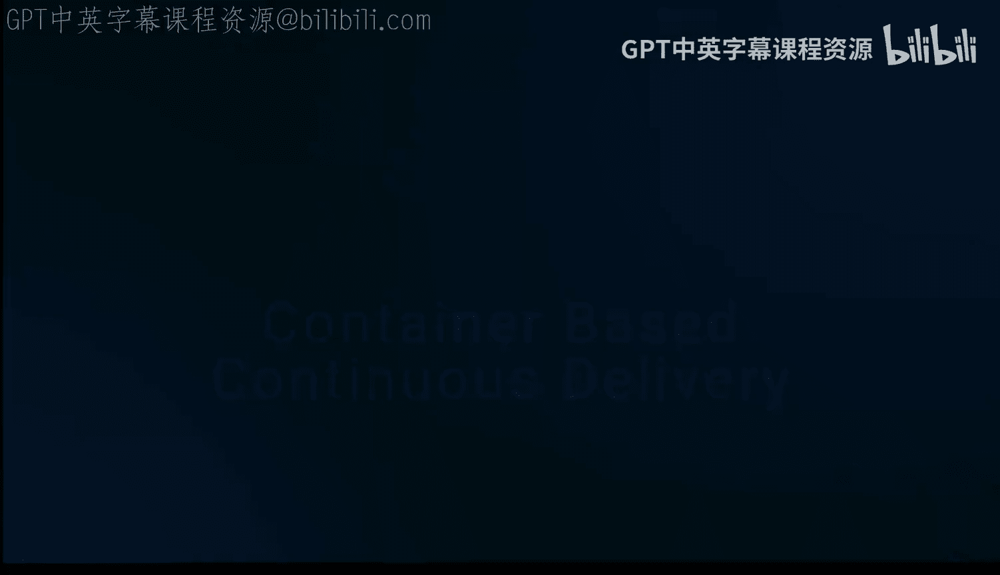
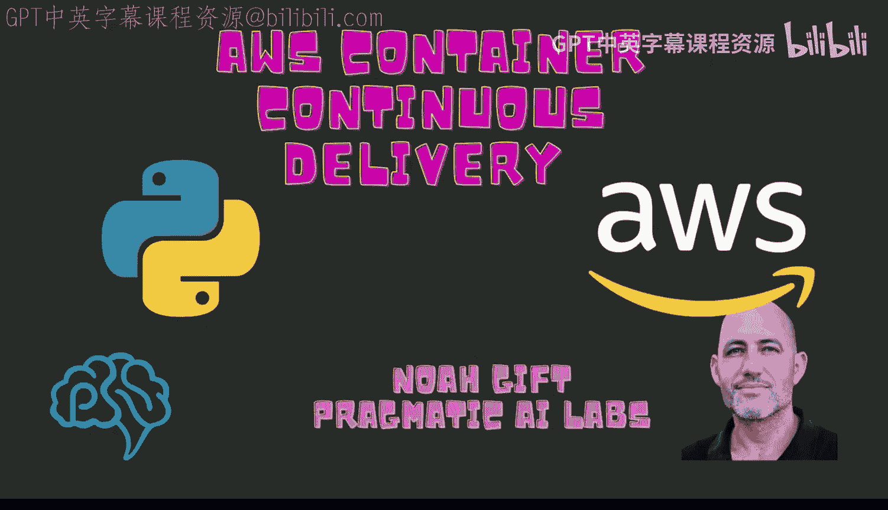
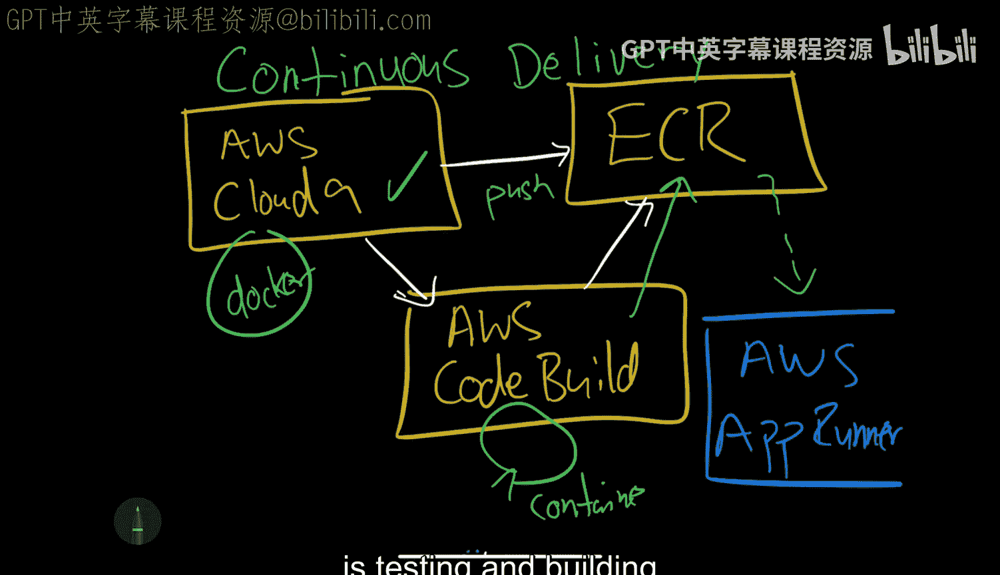
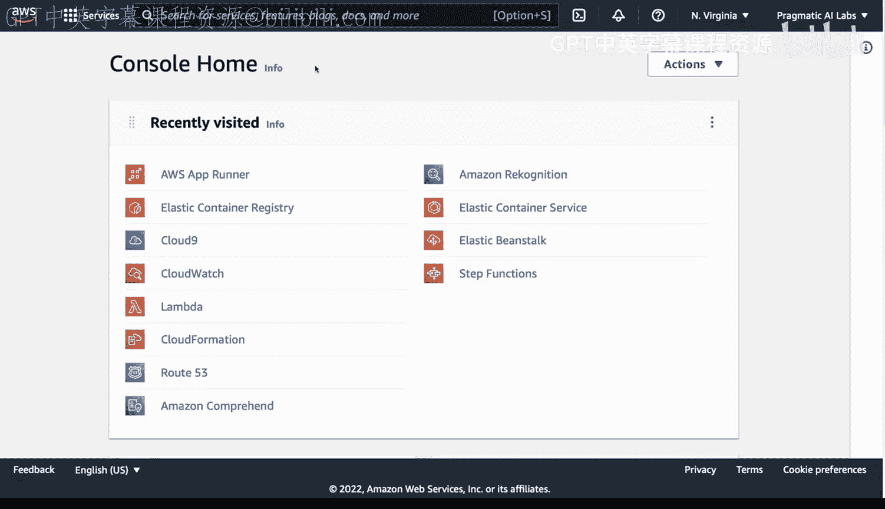
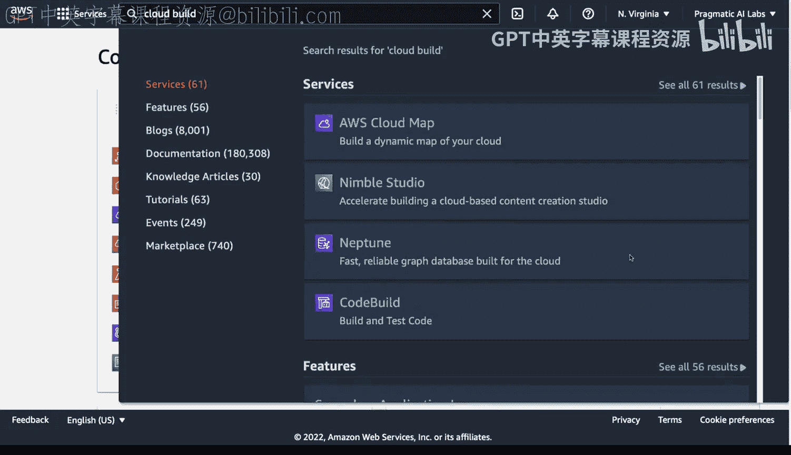
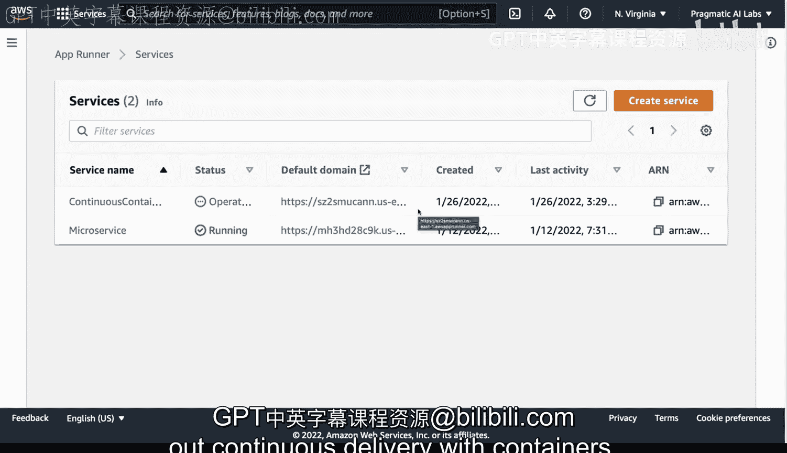

# 应用Python数据工程：3.4：基于容器的持续交付





在本节课中，我们将学习如何在AWS平台上，结合容器技术构建一个完整的持续交付生态系统。我们将使用AWS Cloud9进行开发，使用ECR存储容器镜像，并通过AWS App Runner和AWS CodeBuild实现自动化部署。

## 概述



我们将构建一个简单的FastAPI微服务，它能够将两个数字相加。通过这个项目，我们将演示如何将本地开发的容器化应用，通过一系列AWS服务，实现从代码提交到自动部署的完整流程。核心流程包括：在Cloud9中开发并本地构建容器镜像，将镜像推送到ECR，最后通过App Runner自动部署更新。

## 开发与本地构建

上一节我们介绍了课程的整体目标，本节中我们来看看如何开始一个项目并进行本地构建。

首先，我们需要在AWS Cloud9环境中克隆项目代码并设置开发环境。

以下是设置开发环境的步骤：
1.  使用 `git clone` 命令克隆项目仓库到本地。
2.  创建一个Python虚拟环境以隔离项目依赖。
3.  激活虚拟环境，并安装项目所需的包。
4.  运行应用程序，确保它在本地可以正常工作。

完成环境设置后，我们可以使用 `python main.py` 命令启动服务，并通过 `curl` 命令测试API接口是否返回正确结果，例如 `curl “http://localhost:8000/add?x=3&y=3”` 应返回 `6`。

## 构建并推送容器镜像到ECR

在确认应用本地运行正常后，下一步是将其容器化并推送到AWS的容器镜像仓库ECR。

以下是构建和推送镜像到ECR的步骤：
1.  在AWS控制台创建一个新的ECR仓库。
2.  在Cloud9终端中，使用ECR提供的命令进行身份验证。
3.  使用 `docker build` 命令在本地构建Docker镜像。
4.  使用 `docker tag` 命令为镜像打上符合ECR仓库地址的标签。
5.  使用 `docker push` 命令将镜像推送到ECR仓库。

这个过程的核心命令序列如下：
```bash
# 1. 认证
aws ecr get-login-password --region <region> | docker login --username AWS --password-stdin <account-id>.dkr.ecr.<region>.amazonaws.com
# 2. 构建
docker build -t fastapi-cd .
# 3. 打标签
docker tag fastapi-cd:latest <account-id>.dkr.ecr.<region>.amazonaws.com/fastapi-cd:latest
# 4. 推送
docker push <account-id>.dkr.ecr.<region>.amazonaws.com/fastapi-cd:latest
```

## 使用App Runner自动部署

将镜像成功推送到ECR后，我们可以配置AWS App Runner来自动监听该仓库的变化并部署新版本。

以下是配置App Runner服务的步骤：
1.  在AWS App Runner控制台创建新服务。
2.  选择“容器注册表”作为源代码，并选择我们刚刚推送镜像的ECR私有仓库。
3.  在部署设置中，选择“自动部署”，这样每次向ECR推送新镜像时，App Runner都会自动拉取并部署最新版本。
4.  为服务创建一个新的IAM角色，或使用现有角色，以授予App Runner访问ECR的权限。
5.  完成配置并创建服务。App Runner将开始从ECR拉取镜像并部署应用。

## 集成CodeBuild实现持续集成

为了构建一个更健壮的持续交付流程，我们可以引入AWS CodeBuild。CodeBuild可以监听代码仓库（如GitHub）的变化，自动执行测试、构建新的容器镜像并推送到ECR，从而触发App Runner的更新。



以下是配置CodeBuild的基本思路：
1.  在AWS CodeBuild控制台创建新的构建项目。
2.  将源代码设置为你的GitHub仓库。
3.  在构建规范中，编写与之前本地执行类似的命令：构建Docker镜像、打标签并推送到ECR。
4.  配置Webhook，使得每次向GitHub仓库推送代码时，都能自动触发CodeBuild项目执行。



这样，整个流程就实现了完全自动化：开发者提交代码到GitHub -> CodeBuild自动构建并推送新镜像到ECR -> App Runner检测到ECR镜像更新并自动部署新版本。

## 总结



本节课中我们一起学习了基于容器在AWS上实现持续交付的完整流程。我们从一个简单的FastAPI应用开始，在Cloud9中完成开发和本地测试。接着，我们将其容器化，并把镜像推送到ECR仓库。然后，我们配置了App Runner服务，使其能够自动部署ECR中的最新镜像。最后，我们探讨了如何集成CodeBuild来实现从代码提交到自动构建和部署的完整自动化流水线。这种结合了 **ECR**、**App Runner** 和 **CodeBuild** 的方案，为使用容器进行持续交付提供了一个强大而高效的“梦想场景”。