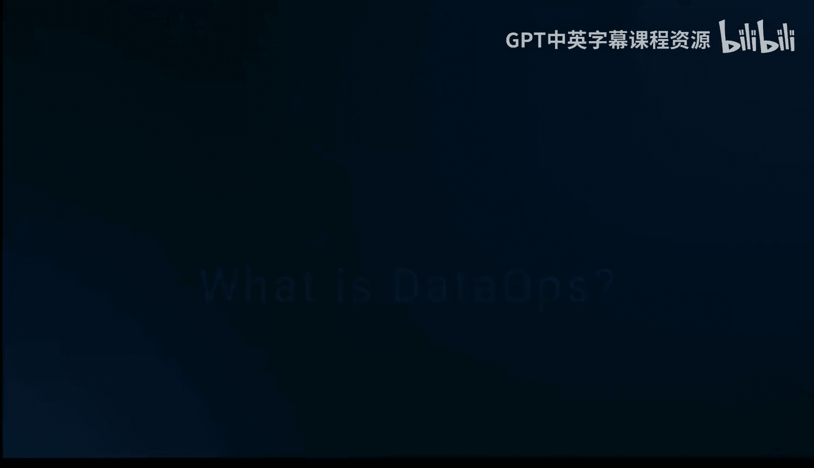

# 数据工程基础：01：什么是DataOps

在本节课中，我们将要学习DataOps（数据运维）的基本概念。我们将探讨它的起源、核心思想以及它如何应用于现代数据系统，以帮助组织持续改进其数据产品的价值。

## 概述

DataOps，即数据运维，其理念根植于传统的DevOps。理解DataOps，首先要理解其背后的自动化与持续改进思想。

## DataOps的起源与核心理念

DataOps与传统的DevOps有着深厚的历史渊源。DevOps的核心思想是**自动化**和**持续改进**软件工程栈的生命周期，通过微小的、持续的变更实现渐进式优化，同时促进团队成员间的协作，打破部门间的壁垒。

DataOps本质上应用了相同的概念，但将其专门应用于数据领域。随着组织越来越多地利用数据——从历史数据到实时数据，再到预测性数据——数据系统正变得日益重要。DataOps正是继承了DevOps的历史经验，并将其应用于数据系统，从而实现持续改进。

## DataOps的实践策略

从本质上思考，这是一种相当直观的策略。以下是其核心实践方向：

*   **每日与每周的渐进式改进**：每一天，你的工作都应比前一天有所进步；每一周，你的数据产品都应变得更好一点。
*   **数据系统的持续增强**：你的数据系统应该逐渐变得更强大、更可靠。
*   **数据产品能力的扩展**：你应当能够利用这些数据产品完成更多的事情。
*   **高效的组织内沟通**：你应当能够与组织内的每个人进行有效沟通。
*   **基于自动化的价值创造**：设定能够提升组织价值的目标，这些目标应基于你所实现的自动化和改进。

## 总结

本节课中，我们一起学习了DataOps的定义。简而言之，DataOps是将DevOps的自动化、协作与持续改进理念应用于数据系统和数据工程生命周期的一种方法论，旨在通过每日每周的微小改进，不断提升数据产品的价值与团队效率。