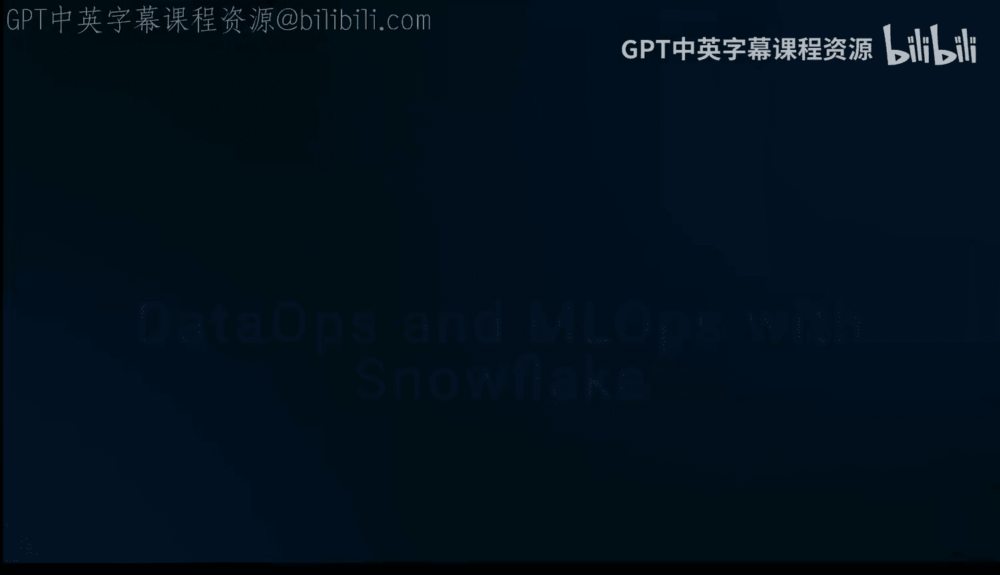
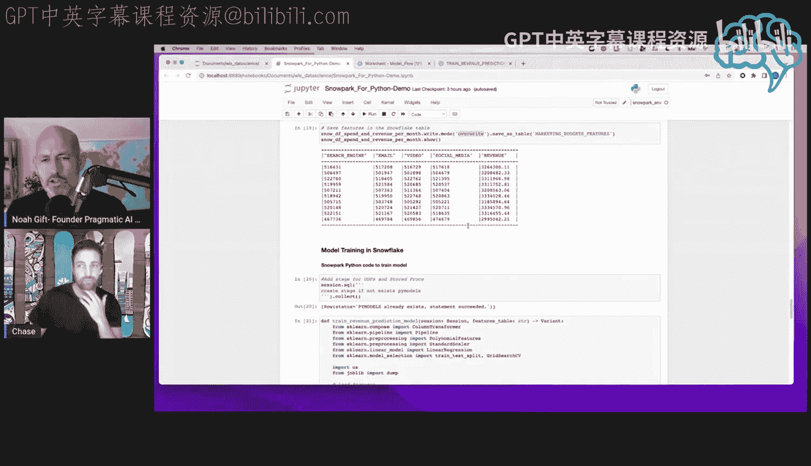

# 杜克大学《应用Python数据工程（3课全）｜Applied Python Data Engineering》中英字幕 p48 48_04_02_使用Snowflake实现DataOps与MLOps.zh_en -BV1nz421i7KP_p48-

Okay， we're live with enterpriseprise MLlaps interviews and today I have Chase from Snowflake why don't you introduce yourself Yeah。

 so my name is Chase Rao I'm a solutions architect of Snowflake focusing on machine learning within Snowflake so helping customers actually integrate data science workloads into snowflake and excited to share some examples today of how we can get that done。

And from maybe I could just ask you a couple questions about theflake。

I think there's some confusion for people who are not using snowflake because it's still pretty pretty new like like what is it like is it comparable to other you know tools that they're familiar with and like what is what are some of the problems that snowflake solves so we actually just hit our 10 year anniversary recently I think it was last week and so I know everyone's heard of like a data lake and a data warehouse you can kind of think of us as like a data lake house So think of it like that hopefully that kind of clears up exactly kind of like what snowflake is and again we have new features coming out all the time especially with snow coming out now now we have the ability to do MLOs within snowflake so you know you'll see snowflake getting used as just a data warehouse and you'll see it getting used as also a data lake you can use things like S3 and blob storage as your data lake and import that data into snowflake and then query all of your data and connect snowflake the tools like Power B。

I looker， any other tool BI tool you can think of power BI as well as just。

 you know your data analysis in general。Go in。Is there a story for snowflake where it's multi cloud is that one of the things it does Yeah。

 we have customers using GCP， Azure and AWS。And and would the snowflake also do things like lets you have a like a hybrid approach where you have your own data center。

 and then you also want to use a cloud provider。 is that Yeah， so you can actually。

Everything is on the cloud， there's no onprem you'll never have to buy anything physical but you can't have you can use snowflake with what we call internal stages and so everything is stored internally and then you can use snowflake with external stages and that's what you would use you know the S3 bucket or blob storage got it and and for someone that was interested like I know I know I get these kind of messages all the time from people about hey。

 I want to learn MLopps what do I do and like is there a story for someone that let's say to have some experience with snowflake and they want to be an MLopps expert that specializes on snowflake is there a story for that。

Yeah， so we actually have Snowflake University and you can log on and if you've never used Snowflake before or whether you're an avid Snowflake user they have tons of materials online。

 I'll even share a Git repository today that has a bunch of examples but again Snowflake University's great tons of materials and if you're new to snowflake and you're wondering how can I get started how can I learn it we actually offer free trial accounts and if you're a student you can actually get it up to 120 days so I see a lot of professors that are teaching snowflake in you know either it's cloud computing or I use it in my data science master's program as well。

 I have students use Snowflake especially because the ability to get a bunch of data for free in our data marketplace and being able to connect to so many other tools you can actually get 120 day student trial account。

Nice well 120 day w that's amazing if you have a university email 120 days and I think that anyone can actually get at minimum I think there's a there's a 30 day trial for anybody and that comes with 400 credits and if you don't know how snowflake you know works as far in the background and billing and things you know snowflake has warehouses and that's how we build customers。

And we build based on something we call credits and one of the amazing things with snowflake is that you can is the elasticity of the warehouses so you can scale up scale down and by scaling up and scaling down。

 I mean you can go from a small extra small warehouse all the way to six Excel warehouses and the power of the warehouses and we can actually scale out as well。

 which is the number of clusters running on each warehouse So what I'm going to use today I'm actually only going to use an extra small which is one credit per hour to do a full end to end machine learning pipeline and you know one credit per hour if you think about it that way it would take you 400 hours to get through your demo account until you have to put in a credit card which I think is pretty amazing Yeah that's actually you know I do have some experience teaching databs and one of the you and I think a lot of proprietary platforms one of the issues and as we both know because we both teach is that it's you know sometimes I think companies forget about the。

personerson teaching it like it's like hey this is this is a challenge to to teach your product you want to sell it right and so the fact that you can get a six month account。

😊，With a dotted view， I think that's pretty big， I think that's  120 days。 so about  120 days。 Yeah。

 that' thats that's actually abnormal because I think a lot of proprietary platforms don't give you something like that you know where you can actually learn it without doing a bunch of you know sign up forms and and the best part is you don't have to input your credit card at all in any payment information until after you've hit that 400 credit limit which in my I've been you know teaching you know UNC Charlotte's master's data science for a year now I've never hit had a student come anywhere close to the limit if anything people will hit the time limit before they hit the credit limit。

And in terms of the。The the tool streamlit is is when was when was that actually part of the platform and and what are some of the success stories you're hearing about that yeah so streamlits it's brand new we just acquire them a few months ago so we're still you know merging getting through all of those details you can use streamamlit now and connect to snowflake but in the future we're hoping you know。

That streamlet's able to be used within the snowflake platform right now if I were to run a streamlight app it's the same streamlet app that you're used to。

 but in the future we are going to be coming out with some announcements on the integration with Snow Park or with Snowflake and streamlit but is brand new so like if you know I'm just kind of putting things together in terms of a teaching perspective's what's cool so you get four months you get the ability to do to do portfolio projects which is something that I'm a huge fan of is people building portfolios because they can use streamlit and then the other problem that's really difficult and teaching。

These kinds of topics， data engineering and machine learning machine learning engineering and slash myops is that where you gonna get the data。

 but it sounds like there's a story for that as well you're saying that there's like there's like a data marketplace or something like that that's one of my favorite things about snowflake is we do have the data marketplace all of my students use it in the class because they're able to go out and get free data from many companies so you can explore the data marketplace and there's a lot of companies that will you know just for free。

 you'll request it and they'll send it back to you you don't have to deal with As or anything you literally can just you'll have a copy of that data in your snowflake account it's what we call a data share so if I'm customer a your customer B and you decide you want to purchase some data for me or from me or I want to give you just some data I can actually create a data share and have you using that data within minutes and it's a really really neat feature and that's basically what。

Happening within the data marketplace you're just sharing your data and I can control what data gets shared I'll basically just share a database to you with all the data that I want to be able to be shared。

And。From there there's two types of that right So we have what we call reader accounts and then we also have where you share data with other snowflake customers and when you are in the snowflake trial account。

 you basically have your own snowflake account。 So when you get this data the person sending you that data is not paying anything to send you that data you're only paying for that data when you query it through the warehouse compute Now say I want to share snowflake data with a client of mine and that client is not a snowflake customer I can create a reader account for that customer to log into with all of the data that I've shared and when they query and they spend those credits that actually gets build back to me So you're able to share with snowflake customers and non snowflake customers alike which I think is really awesome。

 that's cool。 So if you were like an independent consultant and you had like I don't know like a data science for hire or something you could have 10 clients and then they don't even have to know about snowflake they just get the dashboard you gave them and and you can。

We basically manage how it is presented to them and without having to do anything tricky you just share you know a copy of it and that's actually one of our three main courses in the stuff like education the badges you can take。

The snowflake Market and data sharing is actually one of those badges and it's just one of my favorite because you actually go in and throughout the lab。

 you create a datasha and post it on the snowflake marketplace and then you actually go in read from someone else's share teaches you how to navigate that whole data marketplace world it's also very helpful for companies that have similar interest right if back in the day if I had you know company A and company B that were kind of you know alliance they were in an alliance but and they wanted to share data together how hard was that back in the day now it can be done in as few as like five minutes like I can set up a data share pretty quickly。

Cool， and I think one other thing I always ask is like the certification story。Like I。

I'm actually doing some work recently on the Google cloud with vertex AI and I'm building some stuff around that。

 and I just because of what I was doing， I needed to take the。Google Cloud。

Professional machine learning certification it was brutal and I was assuming I would just totally fail it but I actually pass it I was like who I guess I know Google Cloud machine learning is there something like that as well for snowflake So the one thing I love about our cer program is we actually start with something what we call a the snowflake snowbro core certification so it's the very the base of all certifications so you'll go on and you'll take the core certification we have tons of materials that you can go online and study for this exam and it just covers all things based snowflake so basically just proves that you know the inner workings of snowflake and you understand it at a pretty you know pretty good level and then from the base certification that's where it kind of branches out where we then have the advanced certifications and the first one that I always recommend is the advanced architect certification and that's more of your architecture Can you actually go into a client set up their snowflake instance。

😊，K knowow all things around architecture of snowflake and then on top of that is where you're asking about we actually do have a data scientist certification as well that has been out for almost a year。

And prior to you know currently obviously we have Snowpar Python before we had Snowpar Python。

 we had Snowpar Scala and our certifications usually only cover things that have been out for a specific amount of time a new data science one is not currently covering snowpar Python just yet I expect it to be updated soon for that but again it's just one of those certifications that you want to start with the base。

 work your way up to the architect and then start taking the specialized certifications。Great。

 that's a good， that's a good lay of the land' yeah， rather than just like diving into， you know。

 people just dive into the AWS machine learning exam what with no previous AWS asserters， you know。

 they just want to jump right into the M1。 Yeah， I I think I agree with you I think， you know。

 because I've had。😊，I've gotten Google Cloud professional architects and then also the machine learning one and then I've got several AWS certs and then the machine learning one and I would agree with you that you know having taught probably thousands of students that your best bets you gotta get the basics down。

 not it' not doesn't mean you can't pass the specialty Cert。

 but if you don't know some of the foundational components of the platform you're really asking for trouble right I don't like we'll let you take one of those advanced without passing the base first。

 which I would。Great。Cool， so you you had some stuff you wanted to get Yeah I was gonna demo a linear regression use case for you guys today all done in snowflake。

 not using any other tools and keeping all of your data in snowflake as well。

 which I think is the the best feature of this cool ever。

I think whenever you want me to go ahead and share my screen， we can get started for。Yeah。

 so everyone that's watching this video， if you're a data scientist。

 you're probably familiar with Jupyter notebooks and that's what I'm working in currently as you can see on my screen or let me let me make sure I'm sharing on。

😊，There we go。哎 right。And so what I'm gonna to go over today is snowpar for Python。 And what this is。

 this just is a way for us to interact with snowflake and actually do machine learning all with snowflake warehouses。

 We're not actually going have to use the compute on our machine。

 So one of the big complaints that people have talked about in the past if they were using snowflake for data science。

 We would just use the snowflake Python connector in that would then connect the snowflake。

 bring the data into your Jupyter notebook。 And then you would handle it with。😊，Pada's data frames。

 And so but what the issue is with that is I'm just connecting to snowflake and bringing my data to my local machine。

 Well， when I'm doing that， my data is now leaving snowflake and it's living on my machine and I'm actually having to train the model of my machine。

 none of that data is now backed by all of the security that comes with snowflake。

 and with snowpar for Python I can actually use snowpar data frames。

 keep all of my data secured in snowflake and actually use the virtual warehouse to train the machine learning model。

 And so what I'm going to start with today is if you haven't ever installed snowpar on your machine to create a snowpar environment' it's very simple。

 you can actually just run a condoda create call it whatever you want I call mine snowpar and then again。

 we're hitting in aconda packages and it's just snowflake Python and we'll do version 3。8。

 So then we'll activate snowpar and then we'll actually install snowflake， snowpar Python。😊。

All of Panda's functionalities if we need to。Other libraries we're gonna to be using today is S can't learn Again。

 most of you are probably pretty familiar with that and I'm actually gonna run this notebook live for you just so you can kind of see again。

 I told you earlier I'm using an extra small warehouse。

 which is one credit per hour dollar amounts varied by customer but it's just it's a good measurement of how much is this going to cost in the real world how many credit am I going to spend。

 and that's usually what our customers are worried about is their credit expenditure So I'm going to go ahead and import my libraries。

😊，And then I'm going to establish my secure connection to snowflake。

 you can use username and password， multifactoractual authentication， OAth， OCta SSO。

 you'll see a lot of clients using SSO， so the only difference here is instead of password they might have external browser on here to actually connect through SSO。

 but I'm actually going to connect here via username and password is one of my demo accounts that I have。

😊，And that quickly， I'm now connected to snowflake。 I can hit snowflake query it。

 create data frames from data that's living in snowflake。

 I can create data and stored as a table in snowflake。 now I'm actually securely connected。

 So what I'm gonna to do first is I was given a CSv file that I wanted to load into snowflake I've already loaded that data into snowflake。

 I'm not gonna to do it again， but I did want to share with you the code that I'm that I used to actually load that data into snowflake from snowpar So again。

 if you wanted to load CSv， yes， it's living on your machine and we're loading at the snowflake。

 but I wanted to also show what if that data was already in snowflake and I didn't have to actually upload that data So if we go back into my snowflake account you'll see I have my database snowpar my schema sample data and I have four tables that I've created。

 if we go back to our model， you can see that I have campaign spend here as a table I've created。😊。

We can actually look at campaign spend and the data that I have in here， so 293。

000 records and a few columns。What if I wanted to turn this table that I have living in snowflake into a snowpar data frame it's as simple as just doing session do table and giving at the table name I don't need to give it the fully qualified name with the database and schema because if you noticed up in my connection parameters I actually said I'm going to be using the database snowpar in the schema sample data so I don't need to give it the fully qualified name as snowpar dot sample data dot campaign spend。

😡，And when I run this。It's very quick。 And that's due to our lazy evaluation。

 I just created a data frame called snow D F spent。 And if you go back in a snowflake。

 And I look at my history， you'll notice that it's it's  One，25 PM right now。

 I don't have anything at  One25 PM。 Nothing has rain on the snowflake side。

 So we have not spent any credits at this moment。If I were to run dot show。

 this is going to show me the top 10。Records in my data frame。

 This will invoke the warehouse on the snowflake side because it's then'm going to go ahead and run。

A sQL like statement to get us that to show us that snowpo data frame so I did want to just kind of show you that with this lazy evaluation in theory I could run through a lot of this notebook and spend 00 credits and have everything done until the very end but for this demo I did want to show you what that looks like so。

Again， I've now ran a dot show my data frame。 I can now see the data。 This is the data that is。

In this table。Right here and if I go back to my history and I refresh it。

 you'll see that it rain in 79 milliseconds at 126。 Now you're probably wondering well。

 why was there no warehouse ran how come it didn't cost anything for you I ran this earlier today just to make sure to go through everything and a really cool feature of snowflake as we have caching So if you run the exact same query and it's producing the exact same results you actually will not be billed on snowflake through the warehouses you're actually using that cash and that's a good thing you bring up your。

😊，When I've used other tools that are kind of similar， like the one that comes to mind is。

 I think BigQu。Do you know is there is is if I if I remember correctly every time I run something on a big query by default。

 it is actually incurring charges and is that kind of a big product differentiation， Yeah， I mean。

 our stuff customers love this because if if if I'm running a query right and you run a query we're two completely different people。

 But if we're using the same warehouse and it has not shut down。

 it'll use what we call the warehouse cash and it will actually return it and not actually。

Incur in a charge。 Now the but it'll come back instant。 Now what I just did was not warehouse cash。

 It was user cash， which is 2 hours。 So if I'm a user and I run a  query and I wait and I do it within 24 hours and I run the same query like to the character I can I can't change a capital letter to a lowercase letter like same that query and the results are the same。

 it will use the cache。 Now you're probably wondering well how does know the results if I didn't run a query right。

 it's all using metadata to do this。 and I can save you a lot of time and what's nice is it'll also do partial caches like if I'm running queries with lots of joins or you know。

 multiple queries all the time every day， we can make use of that cache in in your data will come back very。

 very quick。 I mean， you can see I'll even be able to show you in here if I can find that exact same query。

 which I mean， I can easily do that， I can actually。Copy this， I'll search for it。

In my query history and everybody has access， this is not like an account admin thing that I'm showing you If you're a user in snowflake。

 you have access to your query history。 and it's very easy to go through it。

 So you can see I've ran this three times by testing it and the first time it ran。

 it incurred on the it occurred on the extra small warehouse， it ran in 223 milliseconds。

 but because I was able to use the cache， it was returned in 79 milliseconds。

That's cool so that's the way you would tell whether you are being charged as your size shows up and cluster shows up。

Right here。 So and to kind of give an overview of what cluster is as well。

 say I have an extra small warehouse and my whole team is hitting it all day every day。

's lots of people are hitting that one warehouse， right， Well。

 what if I have 20 people hitting that extra small warehouse。

 but I don't want to give everybody their own warehouse。You can make use of concurrency。

 so if you and I are querying this same warehouse， you're not getting billed two credits an hour。

 you're still only being billed one credit an hour。😡。

Even though we're both querying at the same time， it's just how much that warehouse is running。

 But then sometimes what will happen is our other coworker starts querying and then someone else starts querying all in the same warehouse。

 you might get some queuing。 It might say， okay the warehouse is at capacity I'm gonna you're gonna be on hold until these are done and then I'll run your query how do we stop queuing you can actually increase the cluster count So I could actually do cluster number of two or three or four。

 So that way if like 30 people are hitting my warehouse at one time。

 it may scale out to three or four clusters。 but then as soon as it doesn't need them anymore。

 it'll scale back down。 So it's elastic。 So I never have to manually go in and scale my warehouse out or scale it in it'll do that automatically for you to optimize your cost know obviously with creditbased consumption。

 So if like is very conscious of users in cost。 So there's a lot of little features in here that are。

You knowThey seem little， but there are huge features that really help save cost。So again。

 it'll scale out to cluster number three if it needs to。Once it doesn't need anymore。

 we're scaling back down and we're only using one。 And like I said。

 when it's at cluster number three， that means it's basically three times the amount of credits。

 So we'd be sending three credits an hour， but only for that very small window that you need it so the use case that I have had a lot in my career was you know having to make you dashboards for executives like seems like the snowflake is completely solves that problem。

 Yeah because it'll cache it So say you know your business person A and there's business person B and business person A goes in the morning and runs their dashboard and it's it's running queries in the background is snowflake person B comes in runs that same dashboard。

Person A is gonna to be like， wait， my dashboard took five minutes。 This took five seconds。 Why。

 That's cause the cache。 Now， a lot of that can also be solved with extracts。

 like I know tablet does extracts and things like that。

 And what I've actually seen customers do is you'll actually run all the queries in the morning。😊。

And so that way throughout the day when people go back and run them it's cached and it comes back almost instantly I know I had one customer that their dashboards they were complaining were taking 1520 minutes to load and we did a one time load in the beginning of the day like really early before people got to work and then they're like wow this is amazing our dashboards are loading in seconds now and went off to worry about anyone getting upset about waiting in front of a screen and that's something that snowflake has I'm assuming that is a scheduled job。

Yes， we have what we call streams and task， and so that would be a task。So now back to。

Our machine learning demo。 So again this is just me showing you the data that we're gonna be using today。

 So we have spend on channels and by channels， I mean like email video social media for advertising how many clicks we got the total cost and the ads served we want to know the channel and the total cost that we're spending and what is our revenue and see if there's any type of relationship between all of that。

 So what I'm going to do is I'm gonna import some of the functions from snowpar and again I'm going to do all of this using snowpar code I'm not gonna have to use dotsqL。

 which goes back to the warehouse again， like I said this right here is creating a data frame that is aggregating up my total cost。

😊，And then sorting by year and month。And it's kind of just like SQL。 if you think about it backwards。

 it's just we're gonna to do the group by first， and then we're going to do our select。

 So we're gonna to do our group by the year， the month and the channel because I want the total cost by channel。

 and I'm gonna sum up total cost。 and I'm gonna rename them。 So again， if I run this。😊。

No cost would have incurred if this was the very first time。Now it will in if I do this。

 I could move along on my notebook and keep working if I wanted to。

 but if you want to check your work， you can do this， but again。

 we're using an extra small warehouse， this is Penny's to do this。And so。

Here now you can see we've got our data。 I've got it sort I've taken date。

 I've extracted year and month， and I've sorted by year and month。 I've got my channel in total cost。

 Now channel is what's gonna be my these are gonna be my features in my model。

 So I need to actually pivot these。 And if you're familiar with pivot in SQL that's actually what's happening in the background when we do that。

 So when I go to pivot on channel， I'm gonna specify all of the features that I want to pivot it on。

 And you're gonna say well， that's kind of annoying What if I have 100 unique values and channel。

 Well I'm gonna show you got to solve that in a minute。 But again， back to the SQL。

 one of the other things that it's gonna be doing automatically for you when you pivot is it actually wraps it in single quotes。

 So in order to get rid of those single quotes， we actually have to rename it as。😊。

And as a data scientist， I didn't really like that I had to manually do this。

 So I'm going to show you that this is the ending output that we wanted。 No single quotes。

 We've now pivoted。 We have all of our channels as a column。

And I can now do my some more feature engineering， but what if I didn't want to have to type out all of these What if I didn't want to go through and do as for each one Well data scientist mode kicks in it's like all right well let me just write some functions to do that or let's see if I can rewrite this pivot in order to get a better outcome。

So here all I'm doing is saying， all right for each channel。In this data frame。

 let's actually do the pivot and so that's all I'm doing right here。 and so if I actually run this。

And we show it。You'll see now that it does the pivot and I did not have to type out everything because again it's looking for a list right So all I was doing was getting a list of each channel in that column So now I'm like okay。

 well， I don't like all these single quotes， I don't want to have to write as I just created my own little function here to do that。

 And thiss another cool thing about snowpar is again， I'm working all within my Jupyter notebook。

 I'm not using any compute at the moment and I can define functions and use them on my data So I'm gonna to define a function here combine it with where I actually select every channel and I'll run it one more time super fast again no compute and now I'll run it and now it's gonna run the compute in the back end and get me my data frame。

😊，Cool， so it's so basically the snowflake it's lazy evaluation as what we call it。 Yeah。

 and and it's， it's like hooked into， is it pandas or or is it something。 Oh。

 so we don't it's not using pandas。 You can use pandas in here。 Now。

 this is my problem with pandas is。😊，If you want to work in panda's data frames， you can do that。😡。

The problem with doing it in your notebook is now your data is leaving snowflake and living on your vision if I leave it as a snowpar data frame。

 my data is not all moving onto my machine。And yeah you can do panda's data frames in snowflake。

 but Im when to get to that later， we can do those within stored procedures。

 you can actually write Python within stored procedures and use pandas。Yeah， I personally。

 I know it's maybe not as popular of a you， but I'm not a huge pandas person。 I I I' I'm like。

 and part of it is the thing you just brought up， which is that to me。

 the entire purpose of pandas is to work。Or a tool like that is to work on big data and it doesn't work on big data doesn't why am I using what I was going say it's not meant for large data sets now that what I'm using today is a little smaller。

 but I've done I've already done some massive data sets in snowpark with some clients and yeah you wouldn't want to use pandas for that anyways Another cool thing that I can show you those all that pivoting that was happening right I was writing that in snowpar But if I go back here and I want to look at what those pivot looks pivot function is actually looking like it's sending SQL back to St like it's converting what I wrote。

In snow part， into SQL and doing that for me。 Now， this may look a little bit like， wow。

 that's not the best written sequel in the whole world。

 but they are working on optimizing how it's written。

 But the the cool thing about this doesn't matter how it's written。

 Snowflake's optimization in the background is actually optimizing this query for you。

 So even though it's written like this， It's still running fairly quickly and being optimized in the back end。

 So I don't know if we see the pivot one in that one。😊，I think it might be。Let's see。

 I know I know that you can go through and actually see all of the queries that being that were being ran by me in the back end。

 so this is all happening on the back end。So you can anything that like in that notebook then。

You did all this really cool Python stuff。 Yeah， let's say like， I'm like， oh I don't like Python。

 I like SQL。 I can just go into the history and just grab the SequL and then just rerun it whenever I want。

 Yeah， or you can run sQel in Stonepar。 You can just do session do sQL。 and just Okay。

 and so you could even just， you could like， let's say you're working pair programming with a coworker or something And they do this whole like big Python thing。

 you're like， I don't want to do that。 They could just go to history， grab Oh yeah send you that。

 Yeah， for sure，10 Yeah， and then I can even do like session。😊。

Got sQL and then just do like I can do this like select star from like I can start I can it' it'll get me and I can even turn a data frame I can say like。

SQL Df equals。sQL select star from let me see what might。What was my table that I had up here。

 campaigna spend。There so I can invite people within here if I want and then you'll actually go inside history and you'll see that's all it's doing it's just doing a select star it's just it's just setting it back to snowflake so you can literally do everything in here and also you can write Sca as well so this we do have snowpar sca if that is what you want to use。

So now that I have， I don't need this anymore。So now that I have my my actual spend。

 I now't need to join revenue to it again， I can create all my data with the CSV if I want and you know using PD dot read CSV and you can use pandas if you want。

 but I'm going to say it's already in snowflake， so let's just grab it using session table。

And now we have year month。In the revenue， so。This revenue also may not only be just for these months。

 I may have duplicates because I might have revenue for different channels。

 and I need to be summed up。 So what I'm going to do here is again to show you that I'm doing group by year in month revenue。

 and then I'm want to order it by year and month as well。 So now I have。

My year and month of revenue together and sort of the way I want。

 But then what I also did here is I joined it to my spend from earlier。

 And that's as simple as just doing dot join。 So the data frame that you want originally。

 and then the other data frame you want to join it to。

 And then what are you joining on year and month。 So now I've got my。😊。

Data set that I'm actually going to be training my model on Now， obviously， if you're data scientist。

 we're not gonna train on year and month， we want to just train on search engine。

 email video and social media。 These were kind of like our keys if you think about it。

 This is the what's helping us join the two data frames together。

 But what's really cool is what was all happening in the background。

 What if I ran all of this and I never ran a dot show until the very end Like I used that lazy evaluation。

 I didn't want to spend any credits until I was absolutely done with it。

 What was really happening You can actually see that with dot queries and dot explain。

 It's the entire life cycle of what was happening when I did that dot show everything that was happening and it will actually show you how many partitions it went through the by scanned all of that stuff。

 you can see all of this here And again， you can kind of go back and you can do that all within your history as well。

 But if you didn't want to have to go back to the snowflflake Ui。

 you could actually see it within within your。😊，やぱ？

Now I know all the data scientists you're like okay well where's the data science when's that going to happen So let's go ahead and clean up our features So again I' gonna to drop some no values I also don't need year and month anymore and then I'm gonna actually save this to snowflake as a feature table so it's really cool how simple it is to write a table to snowflake I'm turning a data frame that I have in snowpar and snowpar data frame and I'm saving it as a table in snowflake So when I run that I can now go back and look at marketing budgets features。

😊，In here and I now have my table that I just that I just recreated right here and so again it's 143 right now it's created at 142。

And it's that it's that easy。 I did overwrite， which is basically going to do a create or replace table is what it's going to do in the back end。

 So now I have all of my features， my explanatory variables right here， search engine， email， video。

 social media， and then my response variable of revenue that I'm going be trying to predict so。😊。

What I want to do now is I'm want to actually do my model training in snowflake And back to your question earlier about using pandas and what if I want to use libraries like CyyittL that are。

 you know using panda's data frames。 I can do all of that inside of a store procedure and that'll all run on on the warehouse and snowflake and my datas not leaving snowflake。

 So if you're just like die hard， I want to use pandas and you could just do a bunch of store procedures to do all of your cleaning and you could use pandas and you could keep it on snowflake and you would not have to bring that locally to your machine。

 So what I'm gonna do first is I'm actually gonna create what we call a stage in snowflake。😊。

And I'm going to create a stage and just call it pie models。 and you can see that it already exists。

 So it's not going to， you know。It's not going to overwrite it， so its just creates age if not exist。

 not create replace。And so。When I'm creating this store procedure。

 I'm defining a function that I'm gonna to use to do my model training。

 I just call this trained revenue prediction model， things it needs。 it needs your session。

 And right here I'm actually feeding it my features table。

 all of the features that I want to train this model on should be in a table and I'm gonna to call that just features table and that'll be a string because it's just the name of the table and it's gonna output a variant Now you may be asking。

 well， why is it outputing a variant， what do we even outputing I want to see the accuracy you can actually output multiple things。

 I've outputted confusion matrices before， but if you're outputting multiple stuff。

 it's smart to do a variant because I want to output the accuracy of the train and the accuracy of the test and sorry。

 I didn't mean accuracy R squared because we're doing linear regression not logistic So I want to actually output the R squared of training and test So I'm going to import everything I need to build my model out。

And then now when I run the store procedure， it's going to run through all of this when I actually call that store procedure。

 So again， I'm going to load my features table I just doing a session do table。

 but I need to convert it into a pandas data frame and it's as simple as just doing two pandas So now I have a pandas data frame called Df that is my features table。

I have my numeric features and then I'm going to do a numeric transformer again。

 I'm just going to apply polynomial features and standard scaling preproces to the numeric columns。

So then I want to combine these pre processces steps together。

 and then the next step is to actually integrate the features we just pre processces with our machine learning algorithm。

 I'm just going to do a basic linear regression model here and then again。

 from here down very simple data science。I need to create my response variable and I need to create my explanatory variables right so X again is going to be everything but revenue it's all my explanatory features。

 I'm creating x which is again everything but revenue and then my response variable is revenue and somem keeping revenue。

😊，I want to use the train test split function to do a random 80-20 split where I have 80% in my training and 20% in my test you can see that here in random state just to keep it the same quick question for you here So this is where I would like when I'm using like a bigger data tool I always get worried when I use something like pandas because if there is behind like you know like when I'm first prototyping maybe it works okay but then especially getting into like okay let's you know let's pull the data into training and test you know splits that what if it's like a terabyte like how does that actually is it can I still use the same code or is there a better approach Yeah so you can and we can you can use the thing is is these libraries are expecting panda's data frames？

And。We're getting there again Snowpar is still in public preview。

 We are going to introduce highmemory warehouses at some point we've already talked about them。

 but they're not in public preview just yet and so we'll be able to handle all of that but yeah there is a certain limit to where you know I would not recommend training a terabyte on Snowpar that would be where I would use another tool but where we can benefit from other tools being able to train on that large of a data set is you can still train a model on other tools we partner with data robot data IQ。

 all those companies you can train your data set even on SageMaker and actually deploy that model on snowflake。

 I can contain model and can I can store that trained model in my stage still and call it in snowflake so you can pickle the files and you can you know if I've built a model and data robot I can actually export that model to snowflake So the solution for now with。

For this would be to basically if you did have you a huge data set or whatever and you're you know comfortable with sageMake or something you train it and then and then you and maybe sageMaker I think sageMaker can directly talk to snowflakeca that slurp up the data it does some kind of I don't know Pi towards model or something and then you just pull back into your code here and it's just essentially less code because you don't have to do all the stuff you just didep and then even so before Snowpar was introduced when I would go work with data scientists I would actually use model endpoints in sageMaker and actually you know do everything in sageMaker and then export at the snowflake but now a snowpar we can still do all of our feature engineering in snowpar and then you can just train it in another tool if you needed to now it still it can handle a good bit but yeah like a terabyte I don't know if we would recommend that but again there are some examples out there。

Using pretty large data sets。And so again， once I've split the data I can now use grid searcharch cross validationation to find the best fitting model and again your basic model dot fit using the X you know using your explanatory variables from your training set and your response variable Now what I'm going to do once I've trained this model is I'm going to actually upload it to a stage and this is what we were talking about earlier you can upload other trained models to stages as well that this one was just created in this notebook so I'm actually going to upload this train stage to a model。

😊，And to make sure my models good before I actually deploy it。

 let's actually look at our our squared on our train and R squared on our test。

 So you can see that that ran pretty quick because again， all it's doing is writing it。

 But now let's actually run the function that's inside the store procedure So I run it again runs pretty quick I've got an R squared on my train and R squared on my test that I'm very happy with。

 So now I'm actually gonna create the store procedure to deploy this training code on snowflake。

 Now when I create these store procedures again。😊，It's gonna now run in snowflake on the warehouse I need to tell it what packages to import it's going to spin up and it's going to say。

 okay I need to go ahead and import Spport Pythonsyit learn and joblib that's what I'm using inside of the store procedure and I'm actually going to store it again in that pi model stage that I created and so now when I run that this is basically just creating that store procedure So that way I can now deploy this training code on snowflake。

And once I do that， I can now just call this store procedure。

 I'm going to give it the name and then I'm going to give it the table because remember before。😡。

I said I needed to give it the features tables what it was expecting and so once I do that。

I can now call it this way rather than just calling the model up here。

 And now I know that my store procedure is is working。 So now how do we actually make inference。

 How do we make an inference on the data that's flowing in the snowflake。

 And that's what we'll use a UDf for。 It's a user defined function。

 and user defined functions are good because they're going to rip through each row。

 So it's gonna be row by row。 So as data comes in， row by row。

 it's gonna to get me that predicted value for all of that data。

 And so I'm going to import this model。😊，And then what you'll see is I'm loading this model in my UDF。

I'm telling it the features that go in it and I'm saying， okay， I don't need， you know， if I had。

 I'm not going to be using obviously month and year。

And I'm creating that data frame and then just running a model do predictd on it。

 So as data flows into a table or I call this UDF， it's going to say， all right。

 I want to use these features， so I need to make sure that my column names and snowflake match the features that it's expecting。

And then it's going to actually do it's going to run a model dot predict to get you those y values。

 So once I run this。Again， that's just creating the UDF。

And then I can actually see it in action in snowpar before we move over to snowflake so I'm just creating a test data frame here that has some sample data in it。

 but again you'll see I only have one，2， three， four I only have what i'm putting in for my features I don't have my response variable in here yet so if I run this。

It's now going to take in these run it through my UDF that I just created， which is again。

 using the model that I just trained and it's running a model that predict on all of these individual records to get me my predicted OI。

😡，All in Snowpar， your data has never left snowpar， which I think is the big win here。Now。

To see it in action on Snowflake side。And do you have any questions about that before I actually show it to you in snifffl so you you you basically once you。

You've trained the model。You then create this user defined function to basically pull it off of a disk。

And then you register that。With snowflake and then now anytime you do a like any kind of future operation。

You can just do inference directly on it yep， I can just call that UDf directly and at UDF again it's expecting it's expecting a list of all the columns right so that's why I'm doing an array construct。

Okay， that's going to get me the list， it's expecting all of the columns that you want in a list。

And then the table。 So yeah， and that's kind of nice because like in the table procedure sorry this isF is the columns it at once。

 Yeah versus like you know sometimes you train a model with second learn and then and then you're like you're doing a predict and it's like like you have to like shape the data frame all this you know like're like oh our Tensorflow or something where where when it's already in a highqu data set and it's in SQL and everything it's like oh look how clean this is Now I love that you said that I didn't have time I don't have time did they go over it but I did another demo for another customer who it wasn't even a demo we actually built an end to end support vector machine model for them their data was coming in and only like three columns but they were pivoting to 1200 columns So they were like okay well we need needed to train on those 1200 but my data is being fed in and just these three So we actually built a Python stored procedure that did the transformations and then it fed it into the model。

So we actually set up a task and in snowflake you can set up task that rely on other task so we had a task that did the model scoring but it would not run until the feature engineering task ran first so the feature engineering task would run off would be kicked off do all the feature engineering and be like okay i'm done here's all your data then it would actually。

Then it would actually use that train model get your prediction。

 spit it back to snowflake in a table and now they have their three columns and their predicted outcome so you can do all the feature engineering and snowflake as well using these python store procedures。

So now that we have this right you may say well what does this look like in production right it's great you can do it here but what if I have data that's flowing in on a daily basis or an hourly basis and I want to know what that predicted RoI is and how simple this is to do I can show you how to set up streams and task in less than two minutes so。

😊，I have this table predicted ROI， our ROI pre， there's nothing in it。

And I'm going to create what we call a stream and all this stream does is it's listening to a table and saying sitting there waiting and saying。

 okay， I'm waiting for new data， Let me know when new data is there。So I run this。

And I now have a stream and I can do a select star from the stream you'll see there's nothing in it and when you create a stream on a table it has all of the columns in a table。

And then it also has what was happening to that record。 So we haven't done anything。 So it's empty。

 And so then I can select star from the table。 And again， this is empty as well。

 So what about as data flows in。 So I'm going do a simple insert into。

And I'll run this and they'll see that two data two records were inserted and I can look at them in the table。

 I don't have predicted Ri because we don't know it yet。 we want it to be a prediction。

 If I look at the stream， you'll see I now I have two new records and it'll tell me that it was an insert and so I can set up a task that says。

 hey， anytime this stream has data。I want you to run my machine learning algorithm so that way I can get my predicted value。

 And so what that's going to look like is a merge statement。 So I'm actually going to merge into it。

 and I'm going to update my data with my predict R Y UDf that I created in snowpar。

 And so I can run this。😊，And now that I have actually ran this and you can see that rain in 2。

15 seconds， probably because it was cash from earlier， I think it only takes a few seconds anyways。

But what's really cool about this， because the stream knows that we accessed the stream。

 we actually had to query from the stream if I go back。

It's now empty because there's no new data that data has been used。

 so soon if I it's smart enough to say， okay， that data has been used。

 let me dump that from the strain because you've touched it now and I don't want that to be you know used again so I can go back to my table and now I have my features and now I have my predicted RI。

So again， I write all that manually。 What would it look like automated。

 All you would do is you would run it on a schedule。 I take that same merge statement right here。

And I say this is all it takes to create a task right here。

 So I say I create a task called ROI update。 I want to use a specific warehouse again only extra small。

What's my schedule。 You can just use Chon scheduling。 This is gonna run every morning at 6 a。

 And another cool thing is this task won't even try to run if the stream has no data。

 it won't waste any of your credits， any of your time。

 it'll look for that stream and say first of all， does my stream have data Oh。

 it doesn't okay that means my table has no new data then So I'm not even going try and do anything if the stream does have data it's gonna kick off this merge statement with only the records in the stream。

 So only the new data。 And what's nice is streams also pick up changes not just inserts。

 it'll do updates deletes as well。 And so this is all it would take to put it in production and run it on a schedule。

Yeah， that's very interesting。The thing that I think is different about this approach versus。

 let's say， a more more like a only notebook based approach is。

I think one of the real issues with the notebook only approach is that there's a lot of kind of handwaving you know with just a notebook is like。

 oh yeah， look at this and then then all the real issues of like well wait where's the data like you know and how do I run it on a periodic schedule and all these things where I like that you look at this and it's clear that there's it's kind of a production first mindset？

And here's all your data right here。 I mean， everything is in the same place。

 and I think that's that's why I'm seeing so many customers reach out to us when they。

 you know everyone went to sumummit， got all excited about Snowpar。 Wait a second。

 my data is not moving all all of these different places It's all staying in one location is really where I saw a lot of eyes opened up like I don't and is is there a pure sQL train and predict as well。

😊，I do not think so， okay。So basically one of the recommended workflows is that you use Python for what it's good at。

 which is， you know， it's got like all these ML libraries。

 and then you make it a user defined find function you know。

 and then you go back to SQL and then you you orchestrate things Well。

 I could do everything and like I could have created。This in in in sniffflake， if I wanted to Okay。

 I would have just done， you can create UDfs and sniffflake。 I could have just。

 it's just a different interface。 I could have even created this store procedure in sniffflake if I want I see so you could have put you could have used like visual studio code。

 I could have done it in here。 Oh， I see， but but I mean。

 just to clean it up a little bit and make sure syntax is good and everything。 you know。

 I'm if snifffl you were watching they're probably going get upset about this。

 I wasn't using our newest Ui So we do have a newer Ui。

 So let me log into that And I was gonna actually show。😊。

So what I was using we call this our classic UI but here we actually have our our new UI which we call S it's been out for a few months。

 so we actually are introducing Python worksheets as well so it'll actually do all your highlighting in syntax but I see what's nice is if I go here and I create a new worksheet。

😊，'s say I mess it up， right， let's say like I don't like like let me just make it look ugly。

 let me like just tap in a bunch random places like。

Someone gives you some code and it just looks super nasty you can actually go up here and just say format and there you go。

😊，Formats for you and so now you have nice neat looking code we also within this some other features that people don't know about like let me let me change my settings。

Real quick。 So I do want to use。S far。All right， and then let me make sure I'm using that database。

 that schema and now that I'm in that database and that schema。

 it'll know what's in it so I'll start typing and it'll actually has autofill this has all the nice neat stuff that you're wanting like highlighting everything。

And then again， like I said， we'll have all of this for Python as well。

 so it'll be like a visual studio code for Python but without the notebook blocks obviously yeah。

 that's very cool。😊，But again， that's a feature that I don't even know。

 I think Python worksheets are in pre private preview。

 so we have a few customers testing that out right now。And again。

 worksheets are really neat in here as well because I can like go to this worksheet and I can share it with you and we can work on it together basically a lot of collaboration there I can even go to my data so again this database that I have I want to look at that stage that I had。

And。There's my stage pi models right here and so， but within sample data。

 I also all the procedure that I had in the UDF I can see them here。Very cool。

 So you can see I pick it up。 but yeah， wow， that so you can pull up the the store procedure and just look at the ink。

 I'm assuming you can change it as well， right。😊，And is is there is there a versioning system as well Yeah。

 so also， by the way， this is not it's the way that we did it in Snowpar when it's coming over to snowflake。

 it's pickling it we actually can't look at the exact I can't go in snowflake right here and see the exact function that was being used Now I could do that if I created it in the snowflake Ui but again。

 you can see here that all of this came in from snowpar know in this manner not in a nice neat。

 it doesn't look like but we could make it look like this if we did on snowflake but again this is more of a snowpar demo。

Cool， yeah， I mean， I'm definitely impressed。 I think this is。A very。

 very cool product and I'd been meaning to go deep into snowflake and I just I haven't I had so much stuff on my plate that I haven't had a chance yet。

 but you're inspiring me to play around with it Yeah and I gonna give a shout out to my coworker dash He does a lot of these notebooks we worked together on the one that I just showed you I edited a little bit of it。

 but he's done a ton of notebooks and actually created a public repo that you guys can go to anyone can to kind of learn snowpar and and it walks through it and in one of the examples is the one we just did and it has actually turned it into a streamlit app so as I change my features my feature values it'll actually give me my predicted revenue using the UDf that we just created all in streamlight which is really really really neat and then this can be accessed again at dash at sumummit he also has some other you know snowpar let me see。

A bunch of other notebooks， different different scenarios that。We can。

We can look at so if we go back。And I think he has。Right here there about Python。 A lot of these are。

Public， so again， easy ways to walk through it and do do anything you need on that as well。

 and I can share that with you as well。Great。😊，But yeah。

 it's just it's really neat to show how how easy it is honestly。

 it's not a lot of people freak out because it's new and they' like oh my God got learn a whole another language and and it's really not。

 I mean if you look at the syntax to the snow park it's very similar to Pi part and then。😊，Yeah。

 with the with the big difference in that。I personally am not a huge Hadoop and Spark fan。

Because of the fact that。There I feel like it's in a transitionary technology phase where a good example is the if you've ever read a book on innovation and are you done with your demo？

Yeah， yeah， we can， yeah。 so so basically， you know。

 there's some really good books on the history of innovation and you know。

 go back to like the steam engine and then the internal combustion engine and like kind of all the different things and we're in the middle of that with electric cars like I mean。

 it would be ridiculous for people to say like， you know。

 only internal combustion engines is like sorry they're slower。 I mean， I mean。

 I was in a played Tesla year and a half ago I mean。

 it went almost 10 miles an hour and like two two and a half seconds or something。 like it's like。

 no， you're not gonna do that in a you know， you， like the same price car similarly， I think。

You know when you see the transition of the technologies。

 like I have a BMW I3 which is 120 miles of electric。

 but then it's got like a two gallon like generator on it where you filled up with gas and it can give you another 80 so it's kind of like a transitionary I feel like spark is like that in that Hadoop was a solution for like doing map produceduce problems in its day and then spark as kind of like it's kind like my BMW3 it's like kind of a transition but really I don't see in the future why you would actually want a bunch of machines just you know burning down the rainforest every time you do a query why it's so nice to be able to do this and have the elasticity of a stuff like warehouse。

Which is amazing and and again we are introducing guess to the high memorym warehouses and you can again there's the ability to scale up scale down when you need to again I was running all on extra small if I wanted to I could ran a four Excel if I wanted to but I don't want to spend how many credits right only when you need to so and the ability to change it very quickly too is really awesome。

Cool， so how can people you know get get a hold of you and in with you and learn more about snowflake as well Yeah。

 so you can just follow me on LinkedIn Chase Ramano my email is just chasese。 Ramano at snowflake。

 co if you're already a snowflake customer and you're interested in snowpar have your AE or SE reach out to me as well we've been doing a lot of engagements with customers that are already snowflake customers but wanting to get into snowpar do a lot of internal demos and then if you're not a snowflake customer and interested you know just reach out to the snowflake team and again any any snow park questions or any integration questions feel free to reach out。

Awesome， all right， well thank you very much， Yeah， thanks for having me this is awesome。

