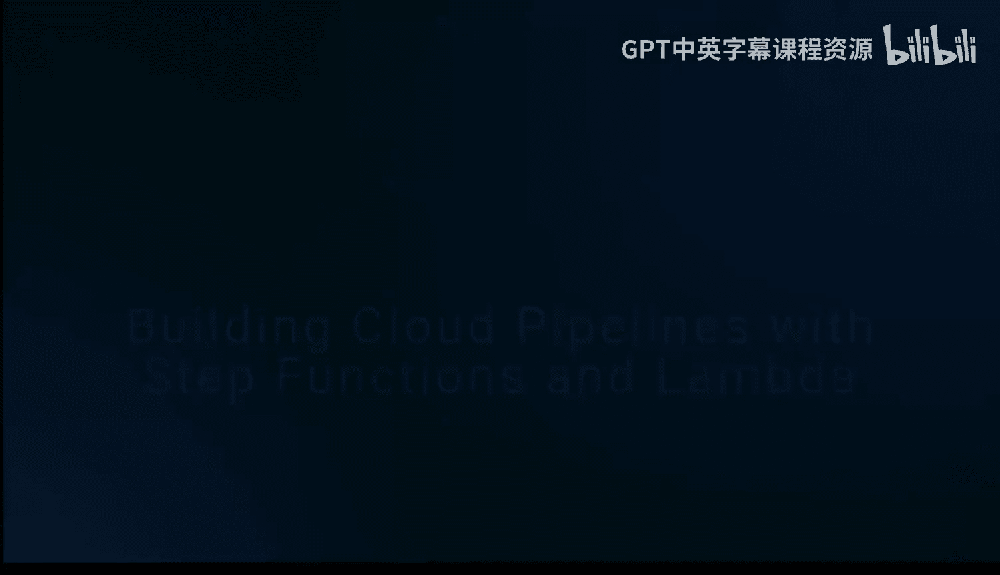
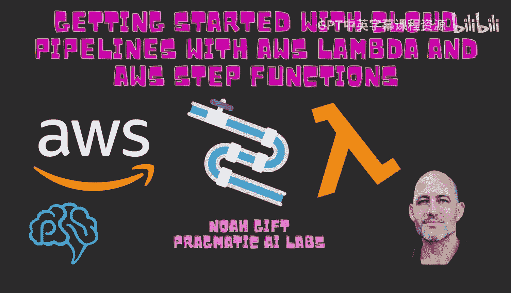
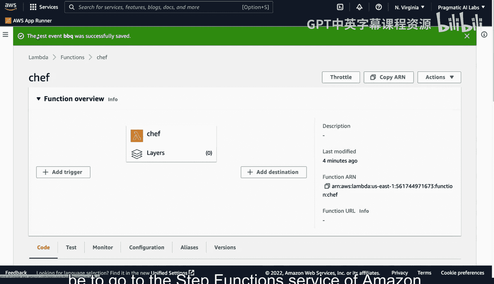
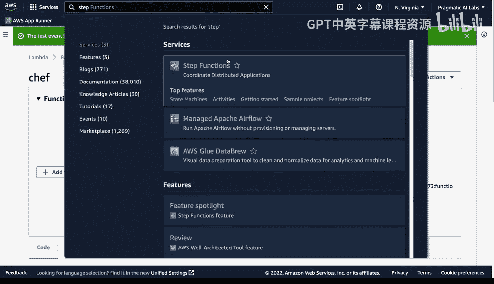
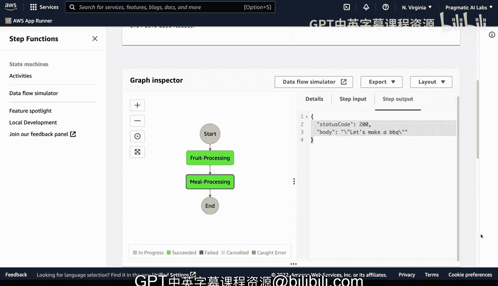

# 应用Python数据工程：3：使用Step Functions和Lambda构建云管道 🚀



在本节课中，我们将学习如何使用AWS Lambda函数和AWS Step Functions来构建一个简单的云数据处理管道。我们将从编写一个基础的Lambda函数开始，然后将其与另一个函数串联，最后使用Step Functions可视化地编排它们的工作流。



---

## 概述

我们将创建一个模拟厨师处理食材的简单管道。第一个Lambda函数（`random_fruit`）负责接收一种水果并表达喜好。第二个Lambda函数（`chef`）根据第一个函数的“喜好”结果，决定制作沙拉还是烧烤。最后，我们使用AWS Step Functions将这两个函数连接成一个自动化的工作流。

---

## 创建第一个Lambda函数：处理水果 🍎

首先，我们需要在AWS控制台中创建一个Lambda函数。Lambda函数的核心是一个简单的处理单元：它接收输入（事件），执行一些工作，然后返回输出。

以下是创建和配置`random_fruit`函数的步骤：

1.  在AWS控制台导航到Lambda服务。
2.  点击“创建函数”。
3.  选择“从头开始创作”。
4.  设置运行时为 **Python 3.9**。
5.  将函数命名为 **`random_fruit`**。
6.  点击“创建函数”。

创建完成后，我们将看到代码编辑器。Lambda为我们提供了一个基础的处理函数结构：

```python
def lambda_handler(event, context):
    # TODO implement
    return {
        'statusCode': 200,
        'body': json.dumps('Hello from Lambda!')
    }
```

参数`event`包含了函数的输入数据。我们将修改这个函数，使其根据输入的水果类型返回不同的信息。

### 编写函数逻辑

我们将编写一个函数，检查输入事件中是否包含名为`fruit`的字段。如果该水果是“cherry”，则返回喜爱的信息；否则，返回不喜爱的信息。同时，我们添加一些调试信息来查看传入的事件。

以下是`random_fruit`函数的完整代码：

```python
import json

def lambda_handler(event, context):
    # 从事件中获取水果名称
    fruit = event.get('fruit', '')
    
    # 调试：打印传入的事件
    print(f"Received event: {event}")
    
    # 判断逻辑
    if fruit.lower() == 'cherry':
        response_body = "I love cherry!"
    else:
        response_body = f"No thanks, I don't like {fruit}."
    
    # 返回响应
    return {
        'statusCode': 200,
        'body': json.dumps(response_body)
    }
```

### 测试函数

在部署函数之前，我们可以创建测试事件来验证其逻辑。

1.  点击代码编辑器上方的“部署”按钮。
2.  点击“测试”按钮，创建一个新的测试事件。
3.  为测试事件命名，例如 `test_cherry`。
4.  在事件JSON中，提供输入数据：`{"fruit": "cherry"}`。
5.  保存并运行测试。你应该看到返回结果：`"I love cherry!"`。
6.  再创建一个名为 `test_pear` 的测试事件，输入为 `{"fruit": "pear"}`。运行测试后，应返回：`"No thanks, I don't like pear."`。

现在，我们已经成功创建了第一个可以独立工作的Lambda函数。它接收一个简单的JSON输入，进行处理，并返回一个明确的输出。

---

## 创建第二个Lambda函数：厨师决策 👨‍🍳

上一节我们创建了一个能表达水果喜好的函数。本节中，我们将创建第二个函数，扮演“厨师”的角色。这个函数将接收第一个函数的输出，并据此决定制作哪种餐品。

我们将创建一个名为 `chef` 的新Lambda函数，其逻辑是：如果输入信息中包含“love”这个词，就决定做沙拉；否则，就做烧烤。

### 编写函数逻辑

按照同样的步骤创建第二个Lambda函数，命名为 `chef`，运行时同样选择Python 3.9。

以下是`chef`函数的代码：

```python
import json

def lambda_handler(event, context):
    # 调试：打印传入的事件
    print(f"Chef received event: {event}")
    
    # 注意：event 现在是上一个Lambda函数的整个返回体
    # 我们需要解析其中的 ‘body’ 字段
    try:
        # event['body'] 是一个JSON字符串，需要先解析
        body_data = json.loads(event.get('body', '{}'))
        message = body_data if isinstance(body_data, str) else str(body_data)
    except:
        message = str(event)
    
    # 决策逻辑
    if 'love' in message.lower():
        meal_decision = "Let's make a salad."
    else:
        meal_decision = "Let's make a barbecue."
    
    # 返回响应
    return {
        'statusCode': 200,
        'body': json.dumps(meal_decision)
    }
```

### 测试串联逻辑

为了测试`chef`函数，我们需要模拟`random_fruit`函数的输出作为其输入。

1.  部署`chef`函数。
2.  创建一个新的测试事件，例如 `test_salad_decision`。
3.  在事件JSON中，模拟`random_fruit`对樱桃的响应：
    ```json
    {
      "statusCode": 200,
      "body": "\"I love cherry!\""
    }
    ```
4.  运行测试，应返回：`"Let‘s make a salad."`。
5.  再创建一个测试事件 `test_barbecue_decision`，模拟对梨的响应：
    ```json
    {
      "statusCode": 200,
      "body": "\"No thanks, I don‘t like pear.\""
    }
    ```
6.  运行测试，应返回：`"Let‘s make a barbecue."`。

至此，我们有了两个可以独立工作且逻辑上关联的Lambda函数。接下来，我们将使用AWS Step Functions将它们正式连接成一个自动化的工作流。

---

## 使用AWS Step Functions编排工作流 ⚙️

我们已经有了两个功能明确的Lambda函数。本节中，我们将使用AWS Step Functions服务，以“低代码”或“无代码”的方式，将这两个函数可视化的串联起来，构建一个完整的管道。

Step Functions 允许你通过拖放状态（步骤）来设计工作流，并定义它们之间的执行顺序和数据传递。

### 创建状态机

以下是创建状态机（State Machine）的步骤：

1.  在AWS控制台导航到 **Step Functions** 服务。
2.  点击“创建状态机”。
3.  选择“使用可视化设计器设计工作流”。
4.  在画布上，从左侧的“操作”面板拖拽一个 **Lambda函数调用** 到工作区。
5.  点击这个状态进行配置：
    *   **API参数** -> **函数名称**：选择我们创建的 `random_fruit` 函数。
    *   **输入**：选择“使用状态输入作为有效负载”。这意味着工作流的初始输入会直接传给这个函数。
6.  从画布右侧拖拽另一个 **Lambda函数调用** 状态，放在第一个状态后面。它们会自动连接。
7.  配置第二个状态：
    *   **函数名称**：选择 `chef` 函数。
    *   **输入**：同样选择“使用状态输入作为有效负载”。Step Functions会自动将上一个状态（`random_fruit`）的输出作为这个状态的输入。





现在，你的工作流看起来应该像这样：`random_fruit` -> `chef`。

### 定义和部署状态机

1.  在状态机设置页面，为其命名，例如 **`MealGenerator`**。
2.  权限设置可以选择“创建新的IAM角色”，让Step Functions有权限调用指定的Lambda函数。
3.  点击“创建状态机”。

状态机创建成功后，我们就可以执行它了。

### 执行和测试工作流

1.  在状态机详情页，点击“开始执行”。
2.  在输入框中，提供我们测试用的JSON数据，例如：`{"fruit": "pear"}`。
3.  点击“开始执行”。

执行开始后，你可以直观地看到每个步骤（状态）的执行情况：绿色表示成功，红色表示失败。点击每个步骤，可以查看其详细的**输入**和**输出**。

*   对于输入 `{"fruit": "pear"}`，你应该看到：
    *   `random_fruit` 步骤的输出为：`{"statusCode": 200, "body": "\"No thanks, I don‘t like pear.\""}`
    *   `chef` 步骤的输入即为上述输出，其最终输出为：`{"statusCode": 200, "body": "\"Let‘s make a barbecue.\""}`

这个可视化的工作流清晰地展示了数据如何从一个函数流向下一个函数，最终产生结果。这种将小型的、单一职责的函数（如Linux命令行工具）串联起来构建复杂流程的理念，是分布式计算和现代数据工程的核心思想之一。

---

## 总结 🎉

在本节课中，我们一起学习了如何使用AWS Lambda和Step Functions构建云数据管道。

我们首先创建了两个独立的Python Lambda函数：
1.  `random_fruit`：接收水果名称并返回喜好。
2.  `chef`：根据第一个函数的返回信息决定制作何种餐品。

接着，我们使用AWS Step Functions的可视化设计器，将这两个函数连接成一个有序的工作流。我们定义了状态机，并通过执行测试验证了整个管道能够按预期运行：输入一种水果，最终得到应制作何种餐品的决策。



这个练习展示了“函数即服务”（FaaS）和“无服务器编排”的强大之处：你可以用很少的代码，通过组合小型、可重用的组件，来构建灵活、可扩展的自动化流程。这种模式与Linux管道（`|`）的思想一脉相承，是构建现代数据工程和微服务架构的重要基础。