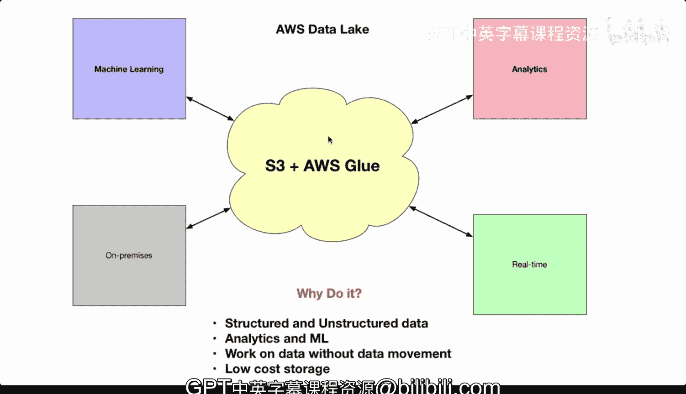

# 杜克大学《应用Python数据工程（3课全）｜Applied Python Data Engineering》中英字幕 p50 50_04_04_什么是数据湖.zh_en -BV1nz421i7KP_p50-

Let's take a look at what a data lake is really doing in， let's say an AWS environment here。

 S3 is an object storage system that has a high degree of concurrency available to essentially in infinite or near infinite amount of concurrency and also processing power and the reason that this is set up in the way it is is so that you can do multiple things at the same time。

 you have the ability to process both structured data and unstructured data so let's say data that's in a keyvalue store format versus just raw text you can also work on analytics problems so there are tools inside of AWS like AWS Athena that lets you do queries across the unstructured data and create reports at the same time you can do machine learning and use the infinite disko and storage to store models version those models and even pull training data。

And actually create new models that get put back onto the S3 system。

 You can also synchronize a onprem system。 So let's say you have a big cluster of GPUus in a specialized data center。

 you could go and synchronize data back and forth， maybe train a model on your onprem and then push that model and push the training data back to S3 to keep snapshots of it。

And finally， you can work on things with real time， and that's a huge aspect of using a data lake。

A couple other things to think about would be that because of the fact that the data is able to be processed with this essentially infinite capacity。

 you don't have to move the data all over the place and this is a huge win in terms of building new managed services on top and that's why things like AWS SageMaker or the AWS Athena。

 the query system are able to be built on top of it is that the data doesn't have to be moved and then finally it also has to be a lowco storage system。

 so all of these things combined to create a value proposition for a data lake。

