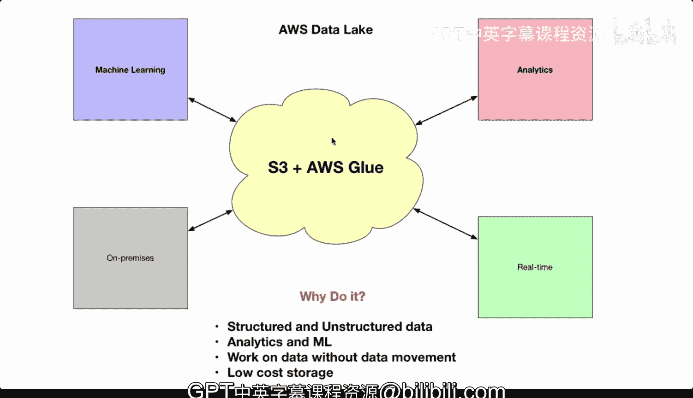

# 数据工程基础：04：什么是数据湖

在本节课中，我们将要学习数据湖的核心概念，特别是它在AWS环境中的具体实现和作用。我们将探讨数据湖如何存储和处理数据，以及它为何能支持多种数据工作负载。

---

上一节我们介绍了数据存储的基本概念，本节中我们来看看数据湖的具体架构和优势。

数据湖本质上是一个集中式的存储库，允许你以任意规模存储所有结构化和非结构化数据。在AWS环境中，这通常通过S3对象存储服务来实现。

S3是一个对象存储系统，它提供了极高的并发访问能力，本质上是无限或接近无限的并发处理能力与计算资源。这样设计的目的是让你能够同时执行多项任务。

以下是数据湖支持的核心功能：

*   **处理多种数据类型**：数据湖能够同时处理结构化数据（如键值对存储格式）和非结构化数据（如原始文本）。
*   **进行分析工作**：AWS内部提供了如Athena这样的工具，允许你直接对非结构化数据进行查询并生成报告。
*   **进行机器学习**：可以利用近乎无限的磁盘存储空间来存储模型、对模型进行版本控制，甚至提取训练数据，并最终将新创建的模型存回S3系统。
*   **同步本地系统**：例如，如果你在专用数据中心拥有一个大型GPU集群，你可以在本地和云端之间同步数据，在本地训练模型，然后将模型和训练数据推回S3进行快照备份。
*   **支持实时处理**：这是使用数据湖的一个巨大优势，能够处理实时数据流。

---

因为数据能够利用这种近乎无限的处理能力进行处理，所以你无需将数据四处移动。这对于在其之上构建新的托管服务是一个巨大的优势。像AWS SageMaker或AWS Athena查询系统这样的服务能够构建在数据湖之上，正是得益于数据无需移动的特性。

最后，数据湖还必须是一个低成本的存储系统。所有这些特点结合起来，共同构成了数据湖的价值主张。

---

本节课中我们一起学习了数据湖的定义及其在AWS环境中的关键特性。我们了解到，数据湖的核心优势在于其能够以低成本、高并发的形式集中存储各类数据，并允许在其上直接进行分析、机器学习和实时处理，而无需频繁移动数据，从而为构建上层数据服务提供了强大的基础。