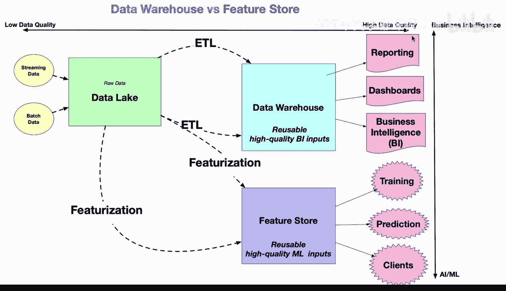

# 杜克大学《应用Python数据工程（3课全）｜Applied Python Data Engineering》中英字幕 p51 51_04_05_数据仓库与特征存储对比.zh_en -BV1nz421i7KP_p51-

Let's take a look at this data warehouse and compare it against a feature store。

 These are two different types of technologies for dealing with data management。

At the start here we have a data lake and this is where a cloud computing environment is able to provide essentially infinite storage and infinite disko。

 then the data warehouse pulls in that data is able to do an extract a transform and a load operation and as a result we can see that from a business intelligence angle you can do reporting。

 you can do dashboards， you can do business intelligence and these are scheduled jobs that typically run and and create these reports for different executives in a company and also business leaders there's a new emerging standard here though where you also would create a feature store。

what a feature store does is it allows you to create reusable high quality machine learning inputs。

 and it's different from a data warehouse in that the end user of this would be the training system so the machine learning system that is going to later use those features and because it's stored in a way that's easily reusable there isn't going to be a lot of preparation necessary。

Later we can take these features， we can use them to create predictions we can create clients that also connect to the feature store。

 and this is more in the AI and ML space。 So they're both valuable aspects of the data pipeline in the real world the data warehouse is a little bit more shifted towards business intelligence and the feature store is more shifted towards the machine learning workspace。

 it's also good to know that a data lake here is one of the core components of cloud computing and that it takes both batch data so uploading something once for example。

 like terabyte's data as well as streaming data like stock ticker information and you can see here that there's also the concept of lower quality right if it's raw unformatted versus higher quality here as you get to these more advanced tools。

