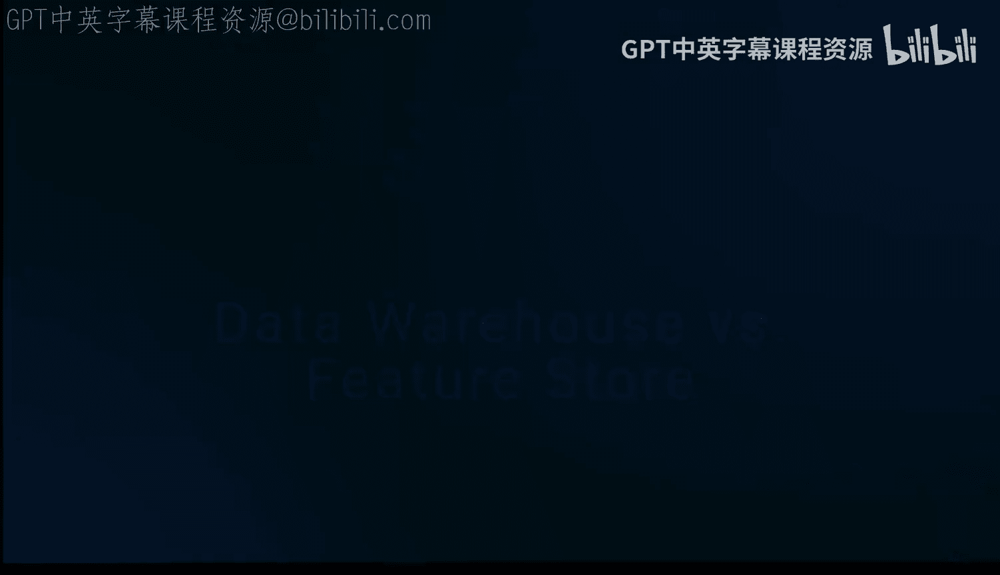
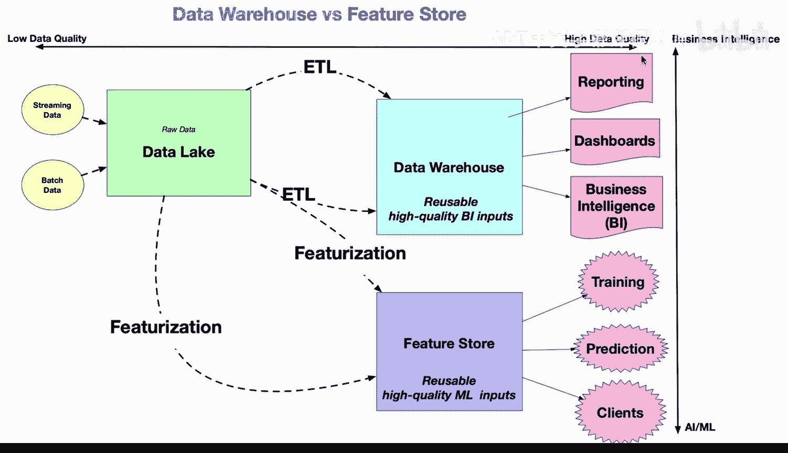

# 数据工程基础：04：数据仓库与特征存储对比

在本节课中，我们将要学习数据仓库与特征存储这两种数据管理技术的核心区别。我们将通过对比它们的架构、用途和适用场景，帮助你理解在数据工程中如何选择合适的技术。

## 概述

数据仓库和特征存储是现代数据架构中处理和管理数据的两种关键技术。它们服务于不同的目的和用户群体。理解它们的差异对于构建高效的数据管道至关重要。

## 数据湖：数据的起点

上一节我们介绍了数据管理的基本概念，本节中我们来看看具体的技术。一切始于**数据湖**。

数据湖是云计算环境提供的一种存储方案，它本质上能提供近乎无限的存储空间和磁盘容量。数据湖能够接收两种类型的数据：
*   **批处理数据**：例如一次性上传数TB的历史数据。
*   **流式数据**：例如实时更新的股票行情信息。

数据湖中的数据通常是原始的、未经过格式化的，因此被认为是**较低质量**的数据。

## 数据仓库：服务于商业智能

数据仓库从数据湖中提取数据，并执行**提取、转换和加载**操作，这个过程通常被称为 **ETL**。

经过ETL处理后，数据质量得到提升，变得结构化且易于分析。数据仓库的主要服务对象是商业智能领域。

以下是数据仓库的典型应用场景：
*   **生成报告**
*   **构建仪表盘**
*   **进行商业智能分析**

这些通常是以定时任务的形式运行，为公司的高管和业务领导者生成所需的报告。

## 特征存储：服务于机器学习

然而，随着技术发展，出现了一个新的标准——**特征存储**。

特征存储与数据仓库不同，它的核心目标是创建**可复用的、高质量的机器学习输入特征**。它的最终用户是**训练系统**，即后续将要使用这些特征的机器学习系统。

由于特征以易于复用的方式存储，在使用前通常不需要大量的准备工作。之后，我们可以利用这些特征：
*   进行预测
*   创建连接到特征存储的客户端应用

特征存储更侧重于**人工智能和机器学习**领域。

## 核心对比与总结

在本节课中，我们一起学习了数据仓库与特征存储的对比。

总而言之，数据仓库和特征存储都是数据管道中非常有价值的组成部分。在现实应用中：
*   **数据仓库**更偏向于**商业智能**。
*   **特征存储**更偏向于**机器学习**工作空间。

同时，我们了解到从数据湖（原始、低质量数据）到数据仓库或特征存储（高质量、结构化数据），是一个数据价值不断提升的过程。