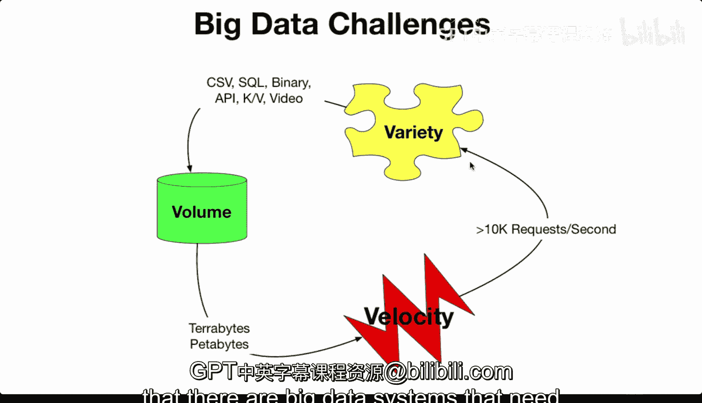
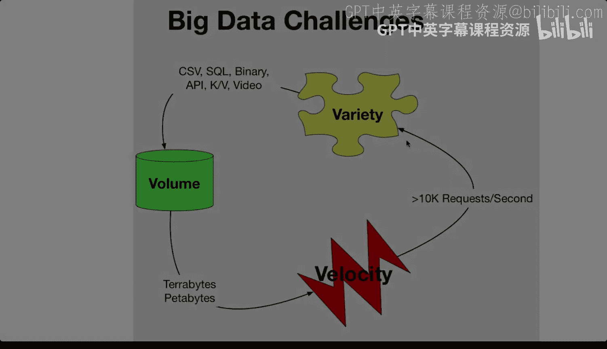

# 杜克大学《应用Python数据工程（3课全）｜Applied Python Data Engineering》中英字幕 p52 52_04_06_大数据挑战.zh_en -BV1nz421i7KP_p52-

One of the ideal ways to think about big data is this concept of the3Vs volume， variety velocity。

 and you can see in the case of the volume， this could be things like terabytes of data。

 petabytes of data and that's one way to define a big data problem is just a huge quantity of data。

 The velocity is another way。 and this would be things like 10，000 requests a second。 100。

000 requests a second， a million requests per second。 these things are at the scale of let's say。

 a social network or a stock streaming service， and then we've got variety。

 This is another challenge with big data。 I it a CSV file， a SQL file， a binary file， a video file。

Is it a format that's specific to big data itself， the variety of data causes challenges and makes it so that there are big data systems that need to deal with this huge collection of data？

