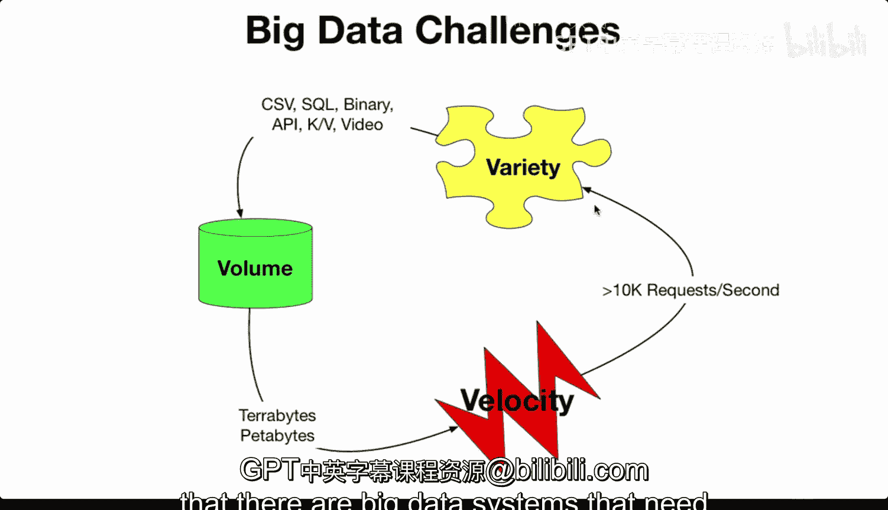
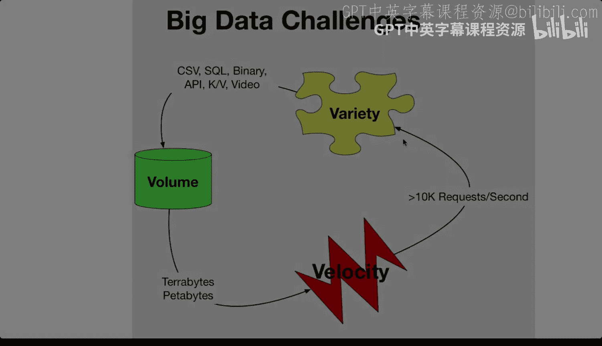

# 应用Python数据工程：3.4：大数据挑战

## 概述
在本节课中，我们将要学习大数据领域面临的几个核心挑战。我们将通过“3V”模型来理解大数据的定义，并探讨数据量、数据速度和数据多样性如何共同构成了现代数据工程需要解决的关键问题。

---

## 理解大数据的“3V”模型 🎯
思考大数据的一种理想方式是“3V”概念，即**数据量**、**数据多样性**和**数据处理速度**。

这个模型为我们提供了一个框架，用以界定和分类大数据问题。

---

## 挑战一：数据量 📊
上一节我们介绍了“3V”模型，本节中我们来看看第一个“V”——数据量。

数据量指数据的巨大规模。这可以是太字节级的数据，甚至是拍字节级的数据。定义大数据问题的一种方式，就是处理海量的数据。

以下是数据量挑战的典型例子：
*   太字节级的数据
*   拍字节级的数据

---

## 挑战二：数据处理速度 ⚡
了解了数据量的挑战后，我们接下来关注第二个“V”——数据处理速度。

速度是定义大数据问题的另一种方式。这指的是系统需要处理极高频率的数据流入或请求。

以下是速度挑战的典型场景：
*   每秒一万次请求
*   每秒十万次请求
*   每秒一百万次请求

这些规模通常出现在社交媒体网络或股票流数据服务等场景中。

---

## 挑战三：数据多样性 🎭
最后，我们来看看“3V”中的最后一个挑战——数据多样性。

数据多样性是大数据的另一个挑战。数据可能是CSV文件、SQL文件、二进制文件或视频文件。数据也可能是大数据领域本身的特定格式。数据的多样性带来了挑战，使得我们需要专门的大数据系统来处理这种庞大的、异构的数据集合。

---

## 总结
本节课中我们一起学习了定义大数据的“3V”模型。我们探讨了**数据量**带来的规模挑战，**数据处理速度**对系统实时性的要求，以及**数据多样性**所涉及的格式与类型复杂性。理解这三个维度是设计和构建有效大数据解决方案的基础。