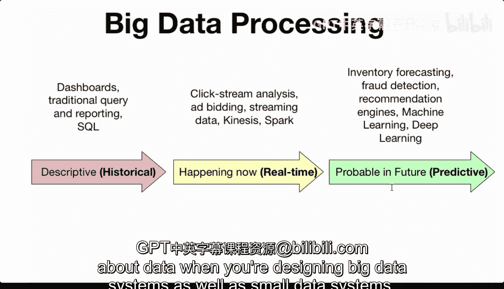

# 杜克大学《应用Python数据工程（3课全）｜Applied Python Data Engineering》中英字幕 p53 53_04_07_大数据处理类型.zh_en -BV1nz421i7KP_p53-

Big data processing can be categorized into three different sections。 First。

 we have the descriptive form of big data。 This is a dashboard or traditional reporting that goes to a data warehouse。

 And you could call this historical data， right It's happened in the past。

 And there's some kind of report that's going to describe it。

 Realtime data is unique in that it would be something that's happening from a realtime system like kinesis or spark could be ad data。

 You could be taking streaming data from， let's say， social network。

 We don't really know yet what's happening with the data。

 It's you know dynamically changing according to events。 maybe new hashtags。

 And so this requires different tools。And there's also predictive data。

 This could be things like predicting the inventory， detecting fraud， you know if certain actions。

 like a credit card is used in multiple states at the same time， you know machine learning problems。

 deep learning problems。 And this is something that we would have a probability that would occur in the future。

 So this idea of historical real time and predictive is a great way to think about data when you're designing big data systems as well as small data systems。

