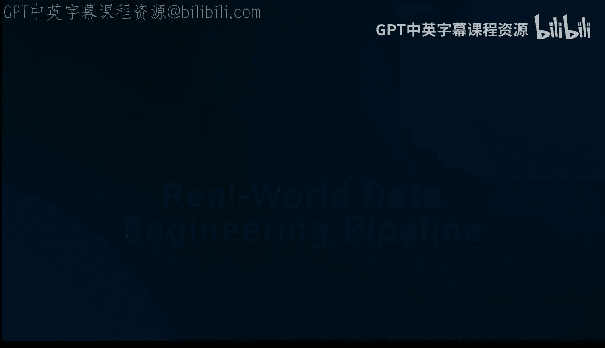
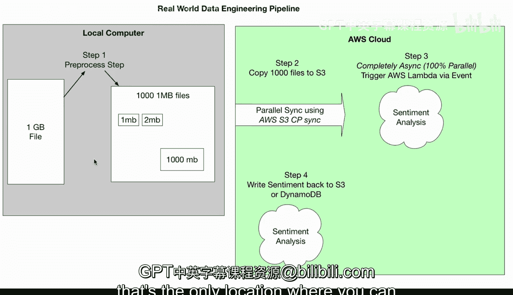

# 杜克大学《应用Python数据工程（3课全）｜Applied Python Data Engineering》中英字幕 p54 54_04_08_真实世界数据工程管道.zh_en -BV1nz421i7KP_p54-

Let's walk through a real world data engineering pipeline。

A lot of times when you're dealing with a Jupyter notebook and pandas or dealing with some small data set。

 you'll grab that into your local laptop， you'll pull into a data frame and process it。

And in the real world， though。A lot of times it becomes a burden to do anything beyond that very small sample of data so as a result。

 you have to use bigger tools that are specialized tools that can deal with it for example。

 maybe a larger scale system that can process things with the pandas API there's several technologies that do that or moving it to something like dynamo DB or to maybe MongoDb。

 some kind of a larger scale system or a graph database and so the first step would be to take this data and potentially do a parallel sync into the data lake system and you could copy let's say thousands of files to S3 because that's the only place that can actually process that quantity of data。

You could then go ahead and potentially synchronize this with some kind of cloudbased system like a serverless functionality with AWS Lambda。

 and then do some kind of processing， it could be a business intelligence type processing or it could be like a AI type API like sentiment analysis。

 and then you would write that data back into dynamo DB system。

 so really we have two different worlds， we have the local computer。

 which is good for hobbyist or experimental workflows。

 but then when you get into a real worldd pipeline。

 you have to use different tools because the cloud technology itself has the ability to scale to thousands。

 tens of thousands or millions of concurrent operations and really that's the only location where you can process certain data engineering problems。

