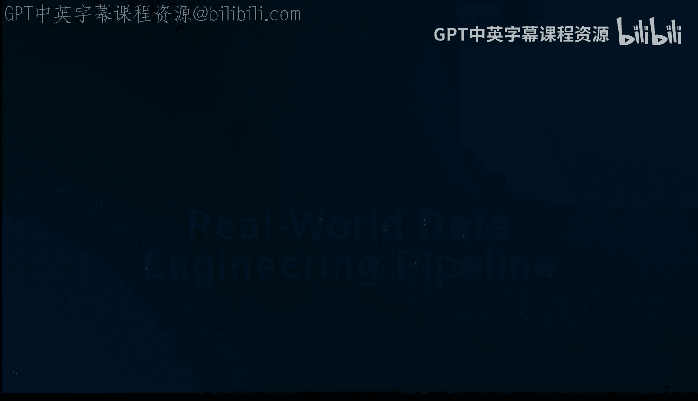
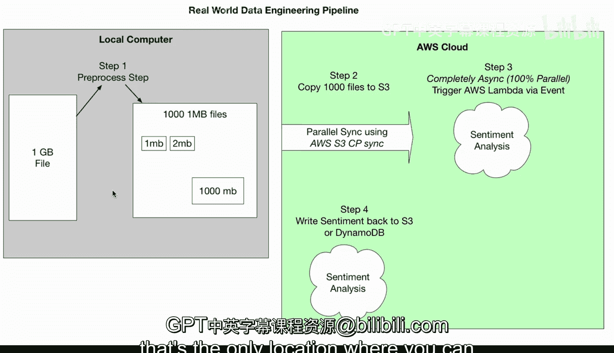

# 数据工程：第3课：真实世界数据工程管道 🚀

在本节课中，我们将一起学习一个真实世界数据工程管道的构成，了解从本地小规模数据处理到云端大规模系统处理的演变过程，并认识其中涉及的核心工具与概念。

## 概述

许多时候，当你使用 Jupyter Notebook 和 Pandas 处理小型数据集时，你会将数据加载到本地笔记本电脑，读入一个 DataFrame 并进行处理。

然而，在现实世界中，一旦超出那个非常小的数据样本范围，处理工作往往会变得繁重。因此，你必须使用更强大、更专业的工具来处理这些数据。

## 从本地到云端的转变

上一节我们提到了本地处理的局限性，本节中我们来看看如何转向更强大的系统。例如，你可能需要一个能够使用 Pandas API 处理数据的大规模系统，有多种技术可以实现这一点。或者，你也可以将数据迁移到像 DynamoDB 或 MongoDB 这样的大规模系统，甚至是图数据库中。

因此，第一步是将数据并行同步到数据湖系统中。例如，你可以将成千上万的文件复制到 Amazon S3，因为只有那里才能处理如此庞大的数据量。

## 构建云端处理流程

在数据进入云端存储后，下一步是构建处理流程。你可以继续将其与某种基于云的系统同步，例如使用 AWS Lambda 的无服务器功能。

以下是随后可能进行的处理类型：
*   **商业智能类处理**：进行数据聚合、报表生成等分析。
*   **人工智能类 API 处理**：例如，调用情感分析 API 对文本数据进行处理。

处理完成后，你会将结果数据写回 DynamoDB 这样的数据库系统中。

## 两种世界的对比

综上所述，我们面对的是两个不同的世界。一方面，我们有**本地计算机**，它适用于爱好者或实验性的工作流程。

但另一方面，当你进入**真实世界的数据管道**时，你必须使用不同的工具。因为云技术本身具备扩展到数千、数万甚至数百万并发操作的能力，而这里确实是你能处理某些特定数据工程问题的唯一场所。

## 总结

本节课中，我们一起学习了真实世界数据工程管道的核心思想：从适合小规模、探索性分析的本地环境（Jupyter Notebook + Pandas），过渡到能够处理海量数据、需要利用云端可扩展服务（如 S3, Lambda, DynamoDB）的工业化流水线。理解这两种模式的差异和适用场景，是构建有效数据解决方案的关键。