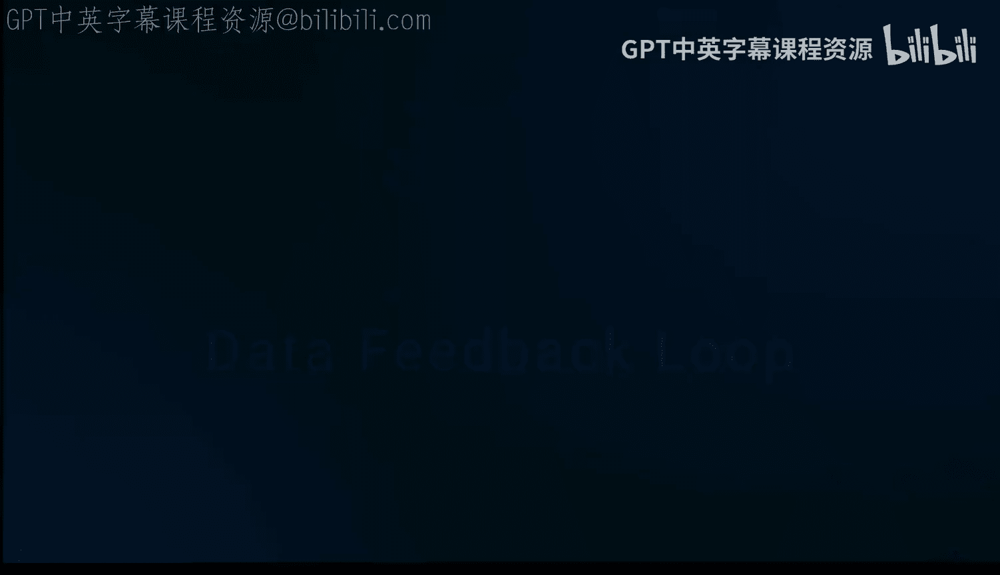
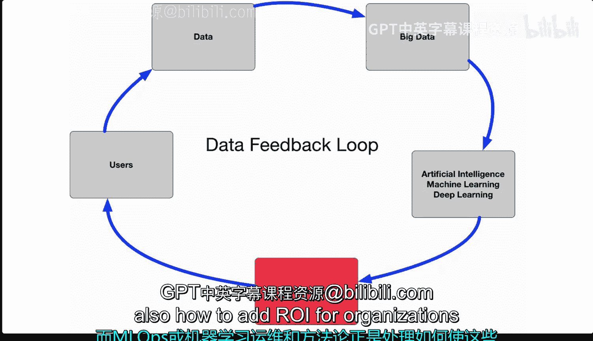

# 杜克大学《应用Python数据工程（3课全）｜Applied Python Data Engineering》中英字幕 p55 55_04_09_数据反馈循环.zh_en -BV1nz421i7KP_p55-

The typical data feedback loop for modern companies is the concept of users who create data。

That data then gets turned into some bigger pool of data。

Gets processed into bigger data systems like feature stores。

 and then those are used for artificial intelligence， machine learning。

 deep learning and turn to products， for example， things that can generate images through AI or natural language tools that will summarize huge quantities of data。

 So this data feedback loop really is a constant process and the MOlops or machine learning operations。

 methodologies are some of the things that are dealing with how to make these data feedback loops more productive and also how to add ROi for organizations。

