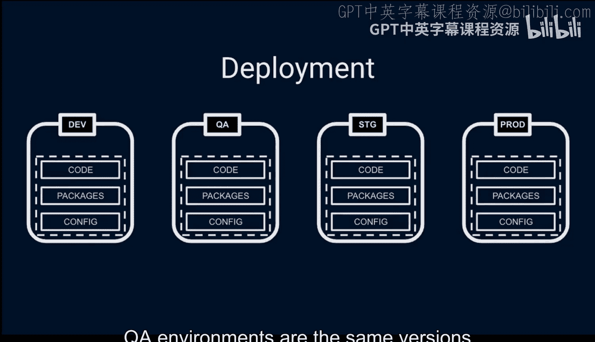
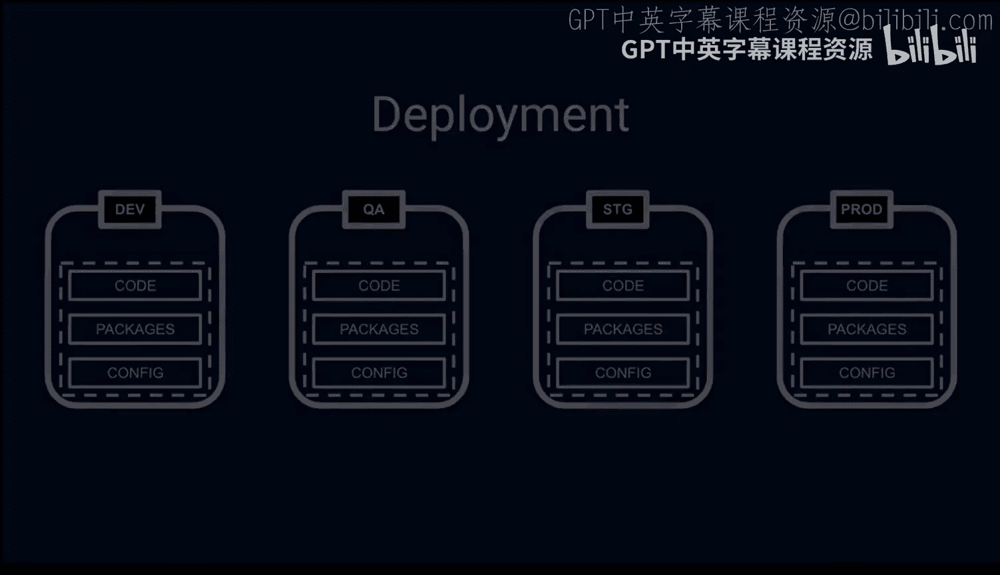

# 杜克大学《应用Python数据工程（3课全）｜Applied Python Data Engineering》中英字幕 p56 01_01_02_虚拟化技术.zh_en -BV1nz421i7KP_p56-

In this lesson。We're going to talk about computer virtualization。

Well introduce what computer virtualization is and some of its advantages。

Including advantages in application deployment， application scaling。And hardware utilization。

 hardware virtualization involves creating a layer between the actual hardware。

And the application's running on it。This layer appears to the application as a fully operating machine with its own operating system。

Some of the advantages of this type of virtualization are reliable deployment。Scaling。

And hardware utilization。Software is generally deployed to multiple environments。

In the simplest case， this might be limited to just one for development and one for production use。

In larger projects， there are usually also environments for quality control and security。

 performance testing， as well as a prepro staging area。When we develop software。We write the code。

Determine any outside dependencies， such as software packages。

And set up any environment or configuration， such as environment variables or configuration files。

One challenge when deploying between environments is ensuring that each of these elements is copied accurately。

If， for example。A package version changes。The behavior of the code may change with it。

So if we deploy code that expects one package version。And a different version of that package。

The code may not run。There are numerous approaches to solving this problem from carefully notated run books。

To using infrastructure as code。In languages such as chef， ansible and terraform。With virtualization。

We group specific versions of the code， dependencies and configuration together。

We can then deploy them together as a unit。This guarantees。

That the versions we tested in our development and Q A environments are the same versions。

That are then deployed out to later environments。

