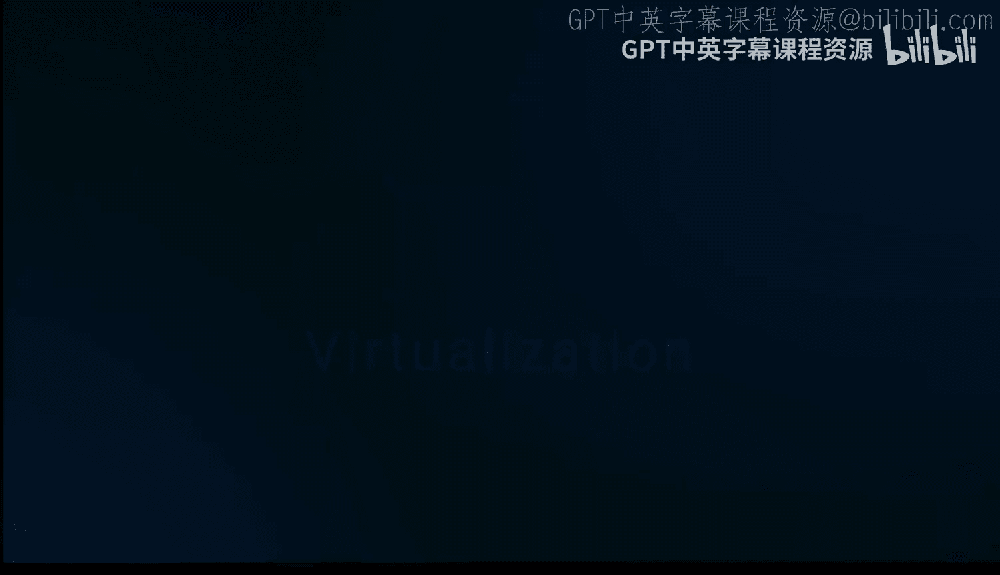
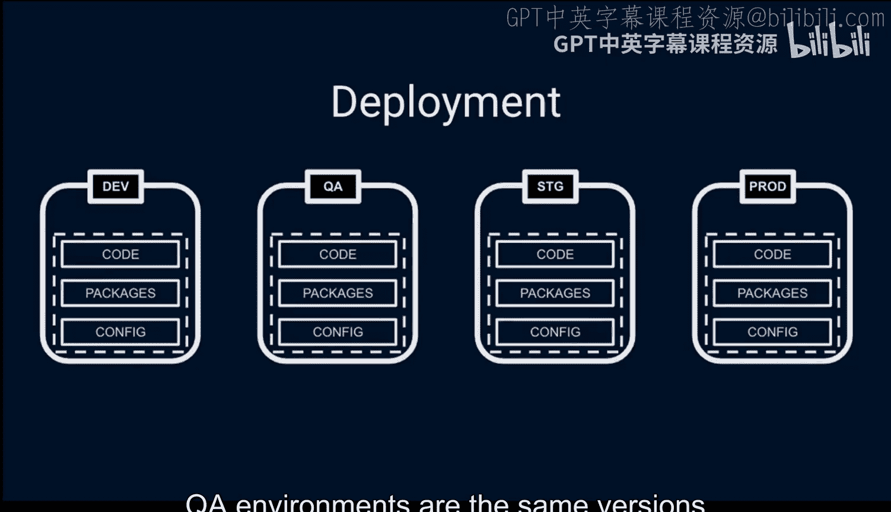
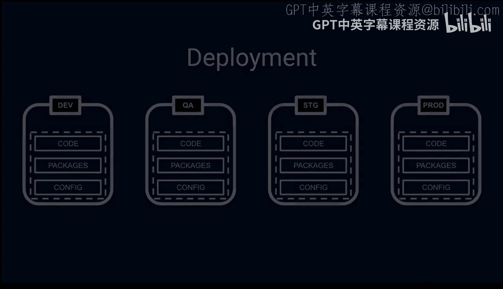

# 应用Python数据工程：01：虚拟化技术 🖥️

在本节课中，我们将学习计算机虚拟化技术。我们将介绍什么是计算机虚拟化，以及它在应用部署、应用扩展和硬件利用率方面的优势。

## 什么是计算机虚拟化？

上一节我们介绍了课程目标，本节中我们来看看虚拟化的核心概念。

硬件虚拟化涉及在实际硬件和运行在其上的应用程序之间创建一个抽象层。对于应用程序而言，这个层看起来就像一台拥有完整操作系统的独立计算机。

## 虚拟化的优势

了解了虚拟化的基本概念后，本节我们将探讨它的主要优势。虚拟化的优势包括可靠的部署、灵活的扩展以及高效的硬件利用率。

### 1. 可靠的部署

软件通常需要部署到多个环境中。在简单情况下，可能只有一个开发环境和一个生产环境。在大型项目中，通常还会有质量控制、安全测试、性能测试以及预发布（staging）环境。

当我们开发软件时，会编写代码、确定外部依赖（如软件包）并设置环境或配置（如环境变量或配置文件）。在不同环境间部署时，一个挑战是确保所有这些元素都能被准确复制。

例如，如果一个软件包的版本发生变化，代码的行为也可能随之改变。如果我们部署的代码期望某个特定版本的包，而环境中是另一个版本，代码就可能无法运行。

有多种方法可以解决这个问题，从详细记录的运行手册，到使用基础设施即代码（IaC）工具，如 Chef、Ansible 和 Terraform。而通过虚拟化技术，我们可以将特定版本的代码、依赖项和配置打包在一起，作为一个单元进行部署。这保证了我们在开发和测试环境中测试的版本，与后续部署环境中的版本完全一致。

### 2. 灵活的扩展

### 3. 高效的硬件利用率

---

本节课中，我们一起学习了计算机虚拟化的基本概念。我们了解到，虚拟化通过在硬件和软件之间创建抽象层，带来了可靠的部署、灵活的扩展和更高的硬件利用率等核心优势。这为后续学习容器化等技术奠定了重要基础。