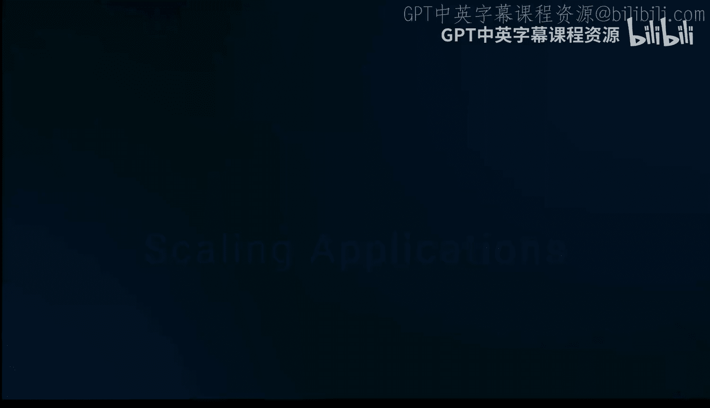
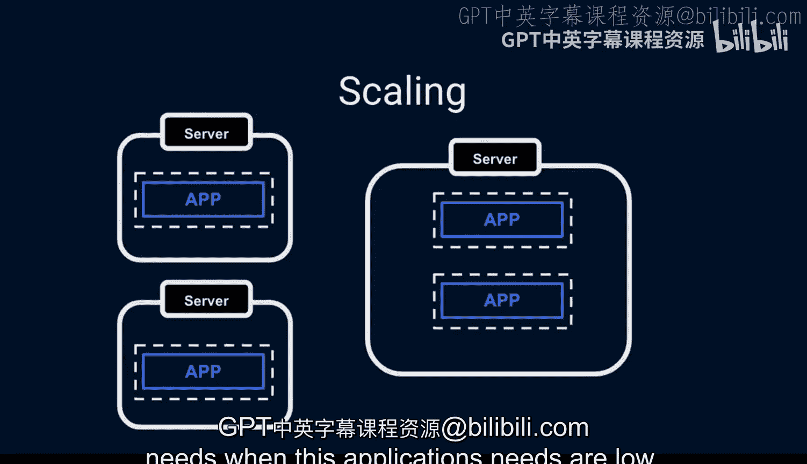

# 杜克大学《应用Python数据工程（3课全）｜Applied Python Data Engineering》中英字幕 p57 02_01_03_应用扩展.zh_en -BV1nz421i7KP_p57-

When we deploy an application to a physical server。

The server must be outfitted with the resources the application needs。T run its fullest load。

If over time， the application needs more resources。嗯。Then we need to deploy it。

To a larger or more powerful server。This generally will require downtime for the application。

And a fair amount of work。If the application's use varies over time。

Perhaps with heavy usage during the day unless at night。

We also need to deploy it to the server based on its peak load。

This means that for potentially substantial amount of time。

 the resources of that server are underutilized。When we use virtualization。We can。Runner application。

On one server。But we can also run it concurrently， either on another server。

Or multiple copies on the same server。This means that we can scale up as the load is needed。

 but also scale down as the load goes down。And use the resources of our servers for other application needs when this applications。

Needs are low。

