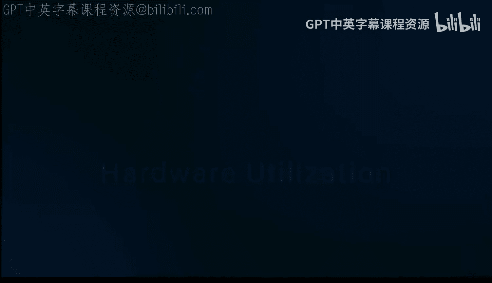
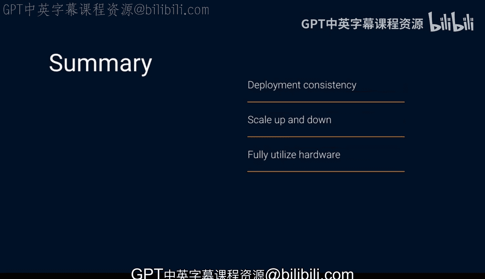

# 杜克大学《应用Python数据工程（3课全）｜Applied Python Data Engineering》中英字幕 p58 03_01_04_硬件利用率.zh_en -BV1nz421i7KP_p58-

Because we could run multiple copies of our application on one server。

When the application's needs are low， we can actually replace it with other applications。

This enables us to fully utilize our hardware。So， in summary。没有。

Virtualization allows for deployment consistency。It eases the ability to scale up and scale down as the needs of our applications change。

And also。Enables us to fully utilize our hardware。By spinning up and down different applications on the same hardware。

