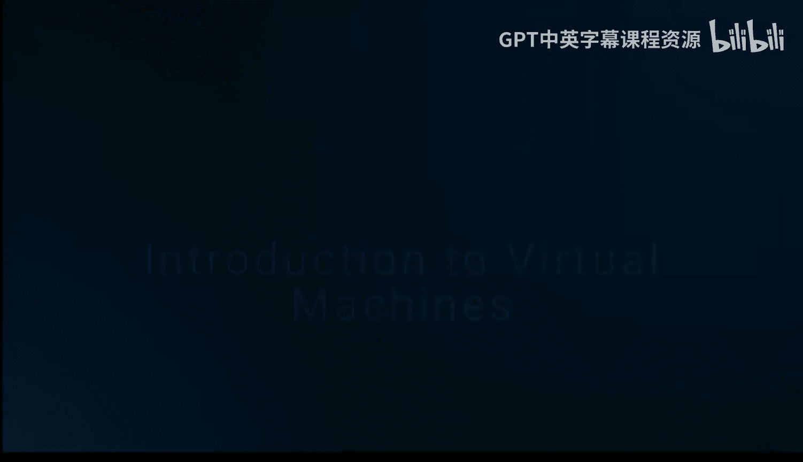
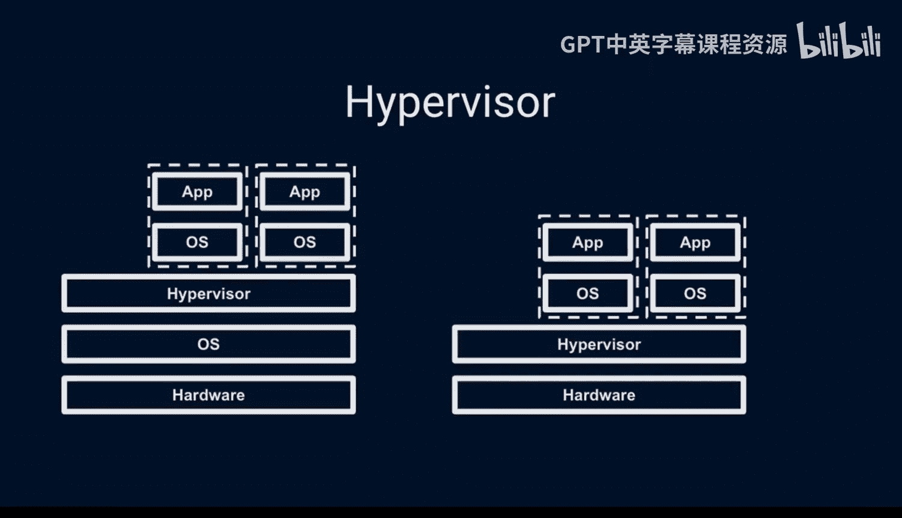

# 杜克大学《应用Python数据工程（3课全）｜Applied Python Data Engineering》中英字幕 p59 04_01_02_虚拟机简介.zh_en -BV1nz421i7KP_p59-

Now， we're going to talk about virtual machines。We'll talk about what a virtual machine is。

What a hypervisor is。Had a creative virtual machine。

And how to install an operating system on a virtual machine。

Two types of machine virtualization that are widely used are virtual machines and containers。

Both bundle applications with their dependencies， but differ in how much they fully simulate an actual computer。

Virtual machines。Simulate a complete machine， both hardware and in operating system。

Because each virtual machine has its own operating system。

 we can run virtual machines with different operating systems on the same host machine。

Some popular virtual machine solutions are Microsoft parallels。The infusion。Oracle Vir box。

And Cittrix hypervisor。A hypervisor。Is the virtualization layer that sits between the host machine。

And the virtual machine。A single hypervisor。Can have multiple virtual machines running。

There are two types of hypervisors。One type commonly used on workstations。

Sits on top of the operating system of the host machine。Another type of hyperor。

Used more in server situations is designed to sit directly on the hardware。

And thereby not have to share any resources with the host operating system。

