# 杜克大学《应用Python数据工程（3课全）｜Applied Python Data Engineering》中英字幕 p60 05_01_03_VirtualBox演示.zh_en -BV1nz421i7KP_p60-

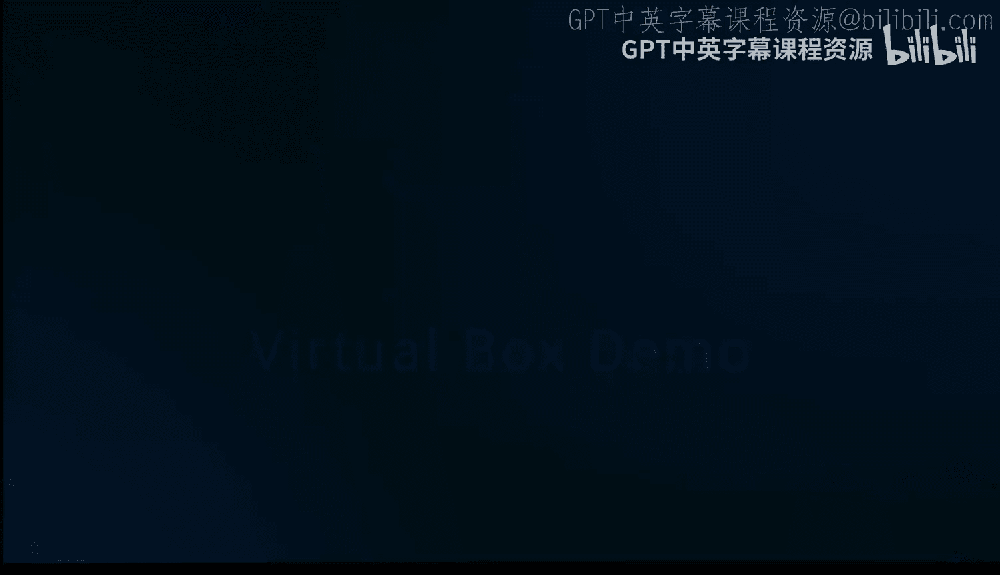

Now let's go ahead and create a virtual machine。We'll use virtual box as our hypervisor。First。

 we download Virt box from the Vir B website and install it。

And because our virtual machine will need an operating system。

 we're going to download an installation image of Linux Mint from the Linux Mint website。

Once you downloaded this image and installed virtualt box， we can go ahead and open virtualr box up。

When you first open virtual box， you should see something like this welcome the screen。

To create a new virtual machine， just use a new button。We give our machine a name。

This is the directory where our virtual machines will be stored， we can change this if we like。

And we need to choose the type of machine thatll create and we want to choose a machine that is appropriate for the operating system that we're going to install so we can see there are options for Cs。

 BD。OSX and Windows。And then there's the version。U。In our case。

 Mint will run fine on the Bluetooth version， so we'll leave that as is。Next。

 we want to choose how much RA the host machine dedates to our virtual machine。

If we give it too little Ram， then the machine won't function well。If we give it too much。

 then the host machine won't be able to operate efficiently and we have performance problems there。

Go ahead and create a virtual disc now。These are the different virtual disk formats we can choose from。

We're going to use the virtual box format if you're going to be a sharing machine across different hypvisors。

 you might want to use a different format。We're going to assign a size on disc for our virtual machine。

We're going to use the dynamically allocated option。

 which means that it will only take up as much space as it's actually using up until the maximum amount allocated to it if we use the。

Fixed size option。And immediately take up the maximum amount allocated to it。

 the advantage of the fixed size is that the machine will run somewhat faster a little more efficiently。

 but the trade off is you lose unused memory。So now we're going to choose the size of our virtual。

Machine。In order to install Linux Mint， we need at least 12。

Kickabytes I believe so let's go ahead and。Give it 13。Now we've created our virtual machine。

 we can see it here on the left。If we double click on it。We can power it up。Yeah。

Now if you choose a disk， power it up from since it has no operating system。We have our Linux。

Met installer image already here。 if we didn't， we could find it using this directory。Icon。

 so we'll start up。From our Linux Min installer image。Now when we're running our virtual machine。

 it's going to capture our keyboard and mouse。If we want to。

Stop and capturing our keep and mouse so that we can use the host machine we need to use in the escape key。

And you can see this escape key is identified here。

You want to make sure to remember what that escape key is。

 or it'll be very frustrating if you're stuck in your virtual machine。

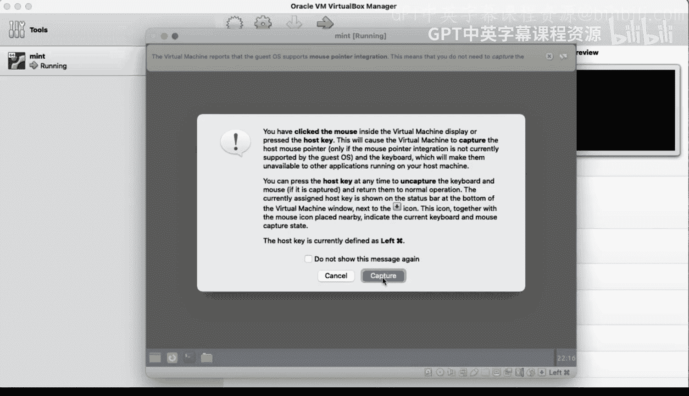

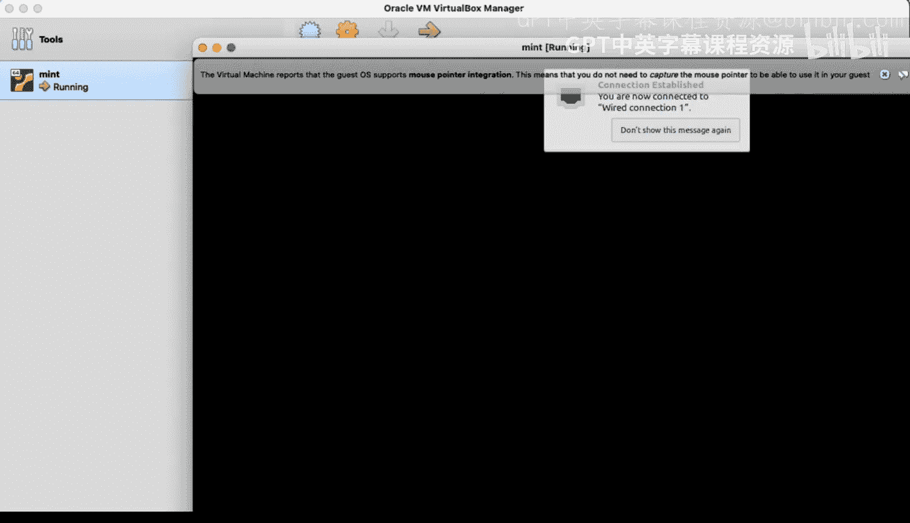

And now we can see our machine is booted up from the installation image。And we can go ahead。

Double click on the image。To install Linux。And can see this warning about erasing the disk and installing Linux。

 The disc that it's talking about erasing is our virtual machine。

 So it's perfectly fine to go ahead with this。Next， you want to choose a time zone。

And here's where we can。Fill in。User name， computer name。the password if we want。

It's a bad idea if you're really creating a machine that you're going to use to log it automatically because then anyone else can get into the machine。

But since this is just a。Examp， I'm not going to worry about it。Now， our scholar is done。

So we can go ahead and restart our virtual machine。

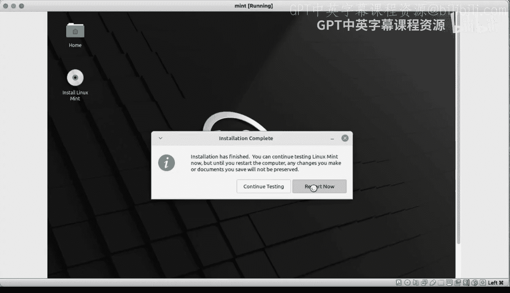

And now we're running。Linux min from our virtual machine。When we close our machine。

 we have three options。We can power the machine off。 This is the equivalent of。Forcing a machine。

To power off。The same as unplugging it。We can do a normal shutdown。

Or we can save the current running state of the machine。Let's go ahead and do that。

So we can see our machine is saved。You can see the logs for running the machine here。

When roing machine， we can also take a snapshot of that machine。Let's good to start her up again。

You can see it's restoring the machine to the state it was when we shut it down。

So this window is still open just as we left it。

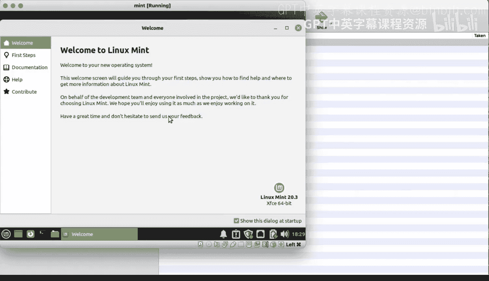

If we close our welcome message。We've got a machine。

So let's just create a folder here on our desktop。

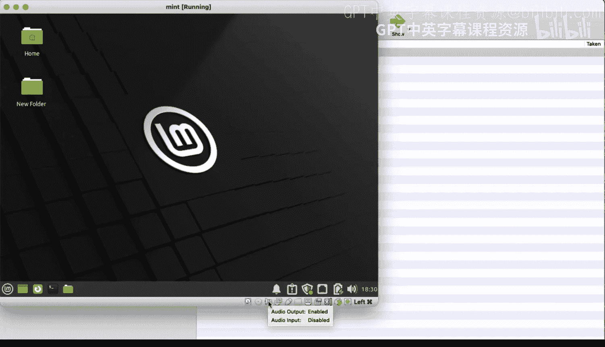

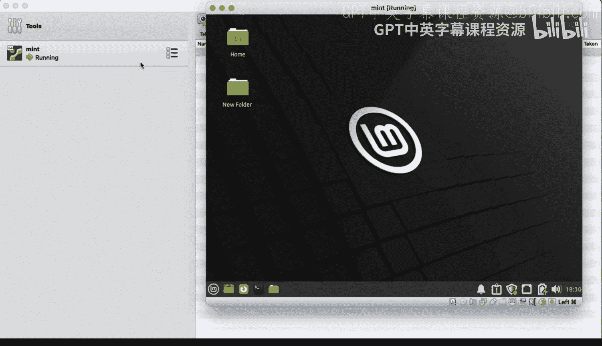

So here。In the virtual box interface， we can take a snapshot of our machine。Give it a description。

And if we look at snapshots， we can see there's that。

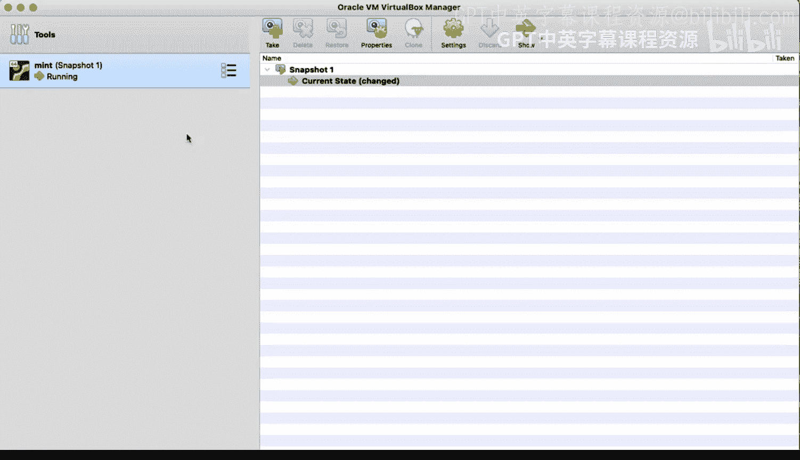

P是。Now if we go back to our machine。And we can get rid of our。New folder。

We can go ahead and shut our machine down。Now we shut the machine down with the folder deleted。

So with our machine powered off。We can restore a snapshot by right clicking on it。

 choosing restorestore。Now we open our machine back up。

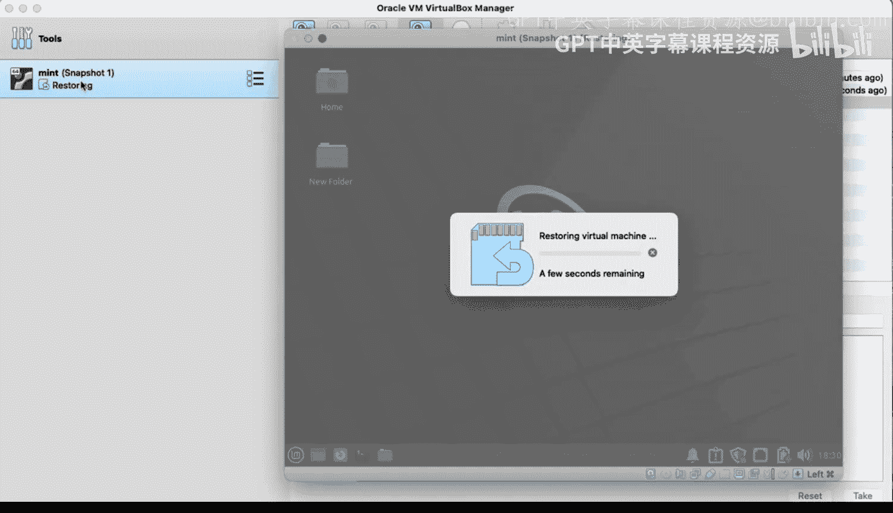

We can see that the snap shutters are stored with the folder wereated there。This means you can。

Save a snaps out of the current state of your machine before you install new software you want to try or。

Rerange your file system or whatever you want to do。

 and you can always go back to that working version。

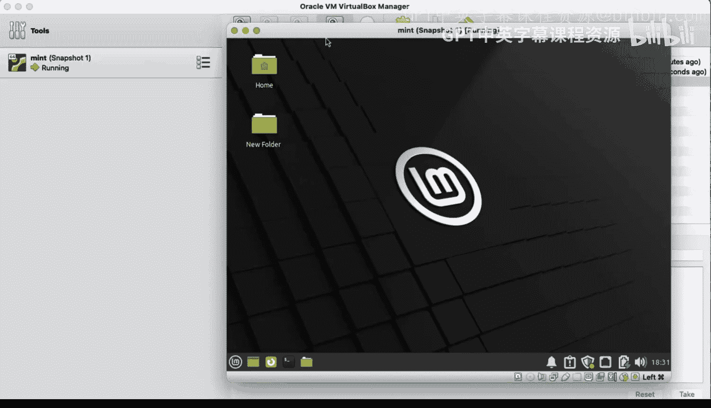

So that's how you create a virtual machine and install an operating system on it。

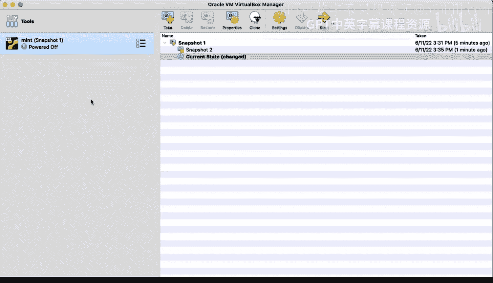

And run it。So， in summary。A virtual machine simulates a complete machine。

 including a hardware and an operating system。The hypervisor is the virtualization layer upon which the virtual machine runs。

And because each virtual machine has its own operating system with virtual machines。

 we can run a variety of operating systems at the same time。

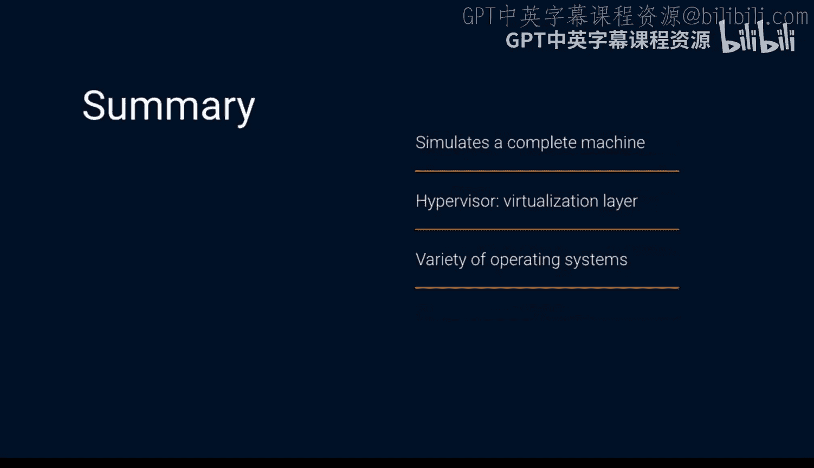

