# 应用Python数据工程：05：使用VirtualBox创建虚拟机 🖥️

在本节课中，我们将学习如何使用VirtualBox创建一台虚拟机，并在其上安装Linux Mint操作系统。我们将从下载软件开始，逐步完成虚拟机的配置、操作系统的安装，并了解快照等实用功能。

## 概述

虚拟化技术允许我们在单一物理主机上运行多个独立的操作系统实例。本节教程将指导你使用VirtualBox这一流行的虚拟机管理程序（Hypervisor），创建并配置一个Linux Mint虚拟机。我们将涵盖从软件下载、虚拟机创建、系统安装到基本管理的完整流程。

---

## 创建虚拟机

首先，我们需要下载并安装虚拟机管理程序。我们将使用VirtualBox作为我们的Hypervisor。

1.  从VirtualBox官方网站下载并安装VirtualBox。
2.  由于虚拟机需要一个操作系统，我们从Linux Mint官网下载Linux Mint的安装镜像文件。

完成镜像下载和VirtualBox安装后，即可打开VirtualBox应用程序。

## 配置虚拟机参数

首次打开VirtualBox，你会看到类似欢迎界面的屏幕。要创建新虚拟机，请点击“新建”按钮。

以下是创建虚拟机时需要配置的关键参数：

*   **名称**：为你的虚拟机命名。
*   **文件夹**：这是虚拟机文件的存储目录，可以根据需要修改。
*   **类型和版本**：选择与将要安装的操作系统匹配的类型和版本。对于Linux Mint，选择类型为“Linux”，版本为“Ubuntu（64-bit）”即可。
*   **内存大小**：分配主机内存（RAM）给虚拟机。分配过少会导致虚拟机性能不佳；分配过多则会影响主机效率。建议根据主机配置合理分配。
*   **虚拟硬盘**：为虚拟机创建虚拟磁盘。
    *   **硬盘文件类型**：选择`VDI (VirtualBox Disk Image)`格式。如果你需要在不同Hypervisor间共享虚拟机，可以选择其他格式。
    *   **存储在物理硬盘上**：选择`动态分配`。这意味着虚拟硬盘文件最初很小，随着虚拟机内数据增加而动态增长，直至达到设定的最大容量。另一种`固定大小`选项会立即占用全部指定容量，性能稍好，但会浪费未使用的空间。
    *   **文件位置和大小**：设置虚拟硬盘文件的存储位置和最大容量。安装Linux Mint至少需要12GB，建议分配13GB或更多。

完成上述配置后，虚拟机即创建成功，会显示在VirtualBox主界面的左侧列表中。

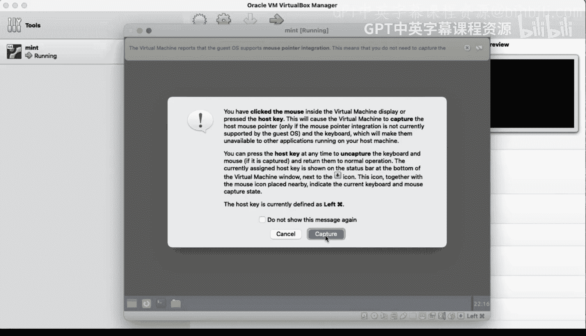

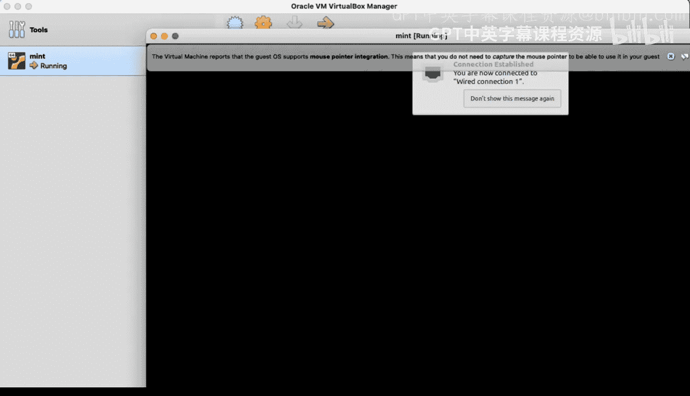

## 安装操作系统

双击左侧新建的虚拟机即可启动它。由于虚拟机尚无操作系统，VirtualBox会提示你选择启动盘。

1.  选择之前下载的Linux Mint安装镜像文件作为启动盘。如果未自动列出，可以点击文件夹图标手动查找。
2.  启动后，虚拟机将捕获你的键盘和鼠标输入。**重要**：要释放控制权（将键盘鼠标焦点交还给主机），需要按下**Host键**（通常是键盘右侧的`Ctrl`键），你可以在虚拟机窗口底部看到提示。
3.  虚拟机将从安装镜像启动，进入Linux Mint安装界面。双击桌面上的“Install Linux Mint”图标开始安装。
4.  安装程序会警告将擦除磁盘并安装Linux。这里所指的“磁盘”是我们的虚拟硬盘，因此可以安全继续。
5.  按照提示选择时区、创建用户名、计算机名并设置密码。**注意**：如果勾选“自动登录”，任何能访问此虚拟机的人都可以直接进入系统。对于演示环境可以勾选，但生产环境不建议。
6.  等待安装完成，然后重启虚拟机。

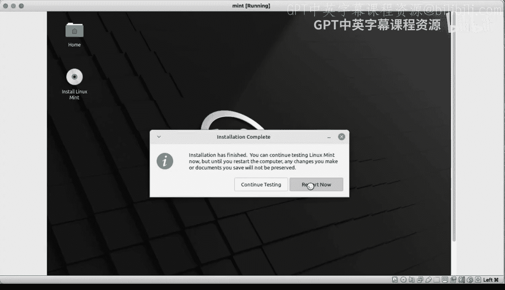

重启后，你将运行在全新安装的Linux Mint系统中。

## 虚拟机的关闭与快照

关闭虚拟机窗口时，有三个选项：

*   **关闭电源**：相当于强制断电。
*   **正常关机**：向虚拟机发送关机信号，让其安全关闭。
*   **保存虚拟机的当前状态**：将虚拟机的完整运行状态（包括所有打开的程序和文件）保存下来，下次启动时直接恢复到此状态。

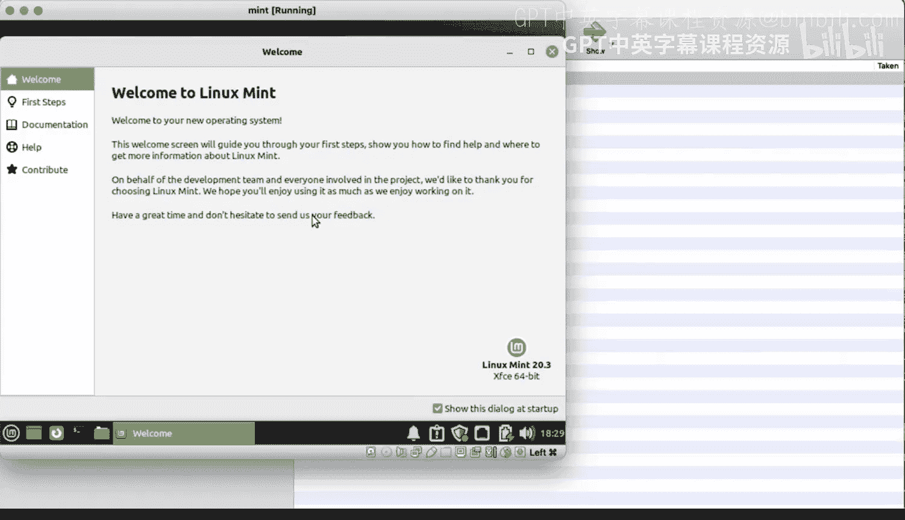

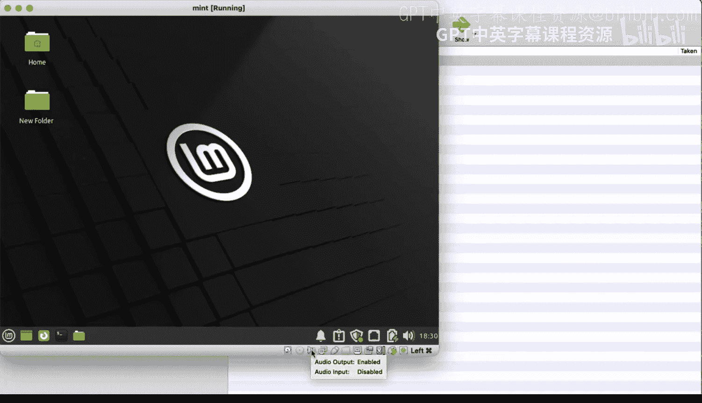

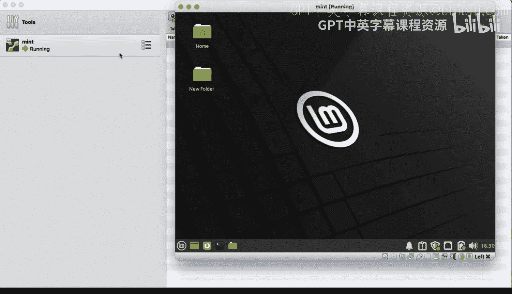

**快照**功能非常有用，它可以保存虚拟机在某个时间点的完整状态。

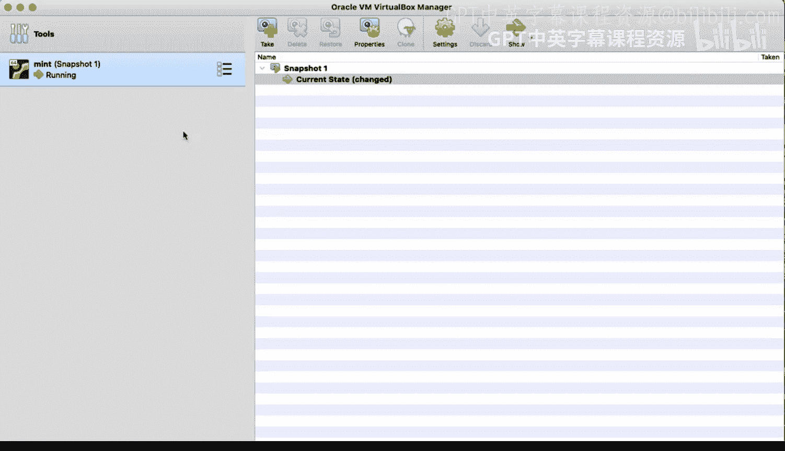

1.  在虚拟机运行时（或关闭后），在VirtualBox管理界面选中该虚拟机，点击“快照”按钮。
2.  为快照命名并添加描述，然后点击“确定”。
3.  快照创建后，你可以在虚拟机上进行任何操作，例如安装新软件或删除文件。
4.  如果操作出现问题，你可以在虚拟机关机状态下，右键点击之前的快照，选择“恢复”，即可将虚拟机回滚到创建快照时的状态。例如，我们可以在桌面上创建一个文件夹，创建快照后将其删除，然后通过恢复快照，文件夹又会重新出现。

这意味着你可以在尝试有风险的操作（如安装新软件、修改系统配置）前创建一个快照，以便随时回退到稳定状态。

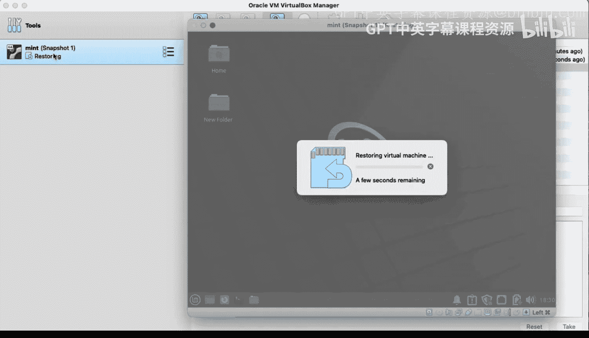

---

## 总结

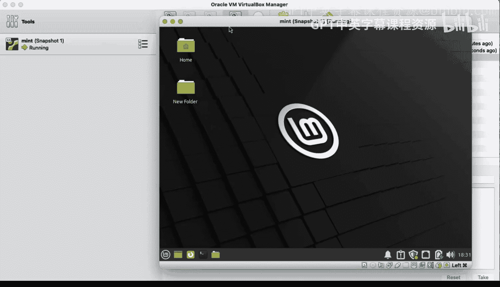

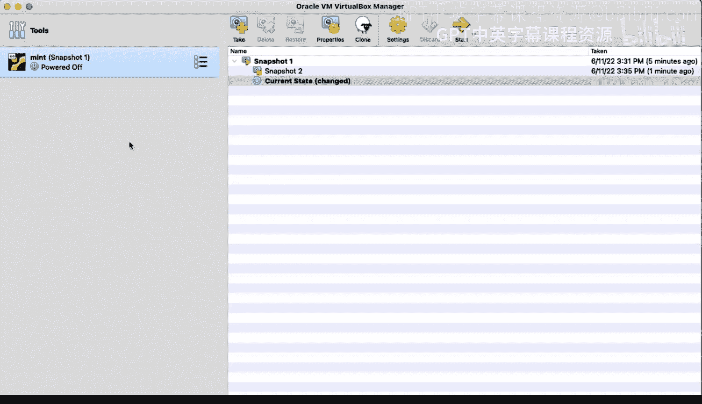

本节课我们一起学习了虚拟机的创建与管理。我们使用VirtualBox创建了一台虚拟机，并在其上安装了Linux Mint操作系统。

核心概念总结如下：
*   **虚拟机**：模拟了包括硬件和操作系统在内的完整计算机系统。
*   **管理程序（Hypervisor）**：是运行虚拟机的虚拟化软件层，例如我们使用的**VirtualBox**。
*   **虚拟化的优势**：通过虚拟机，我们可以在同一台物理主机上同时运行多种不同的操作系统。

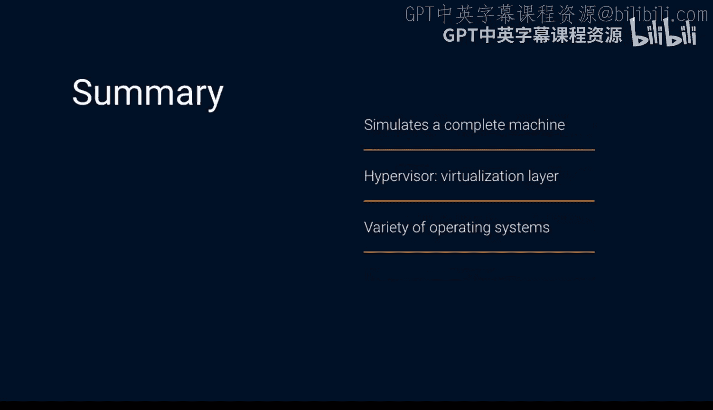

通过掌握虚拟机的创建、配置、系统安装和快照管理，你为后续的数据工程环境搭建打下了坚实的基础。