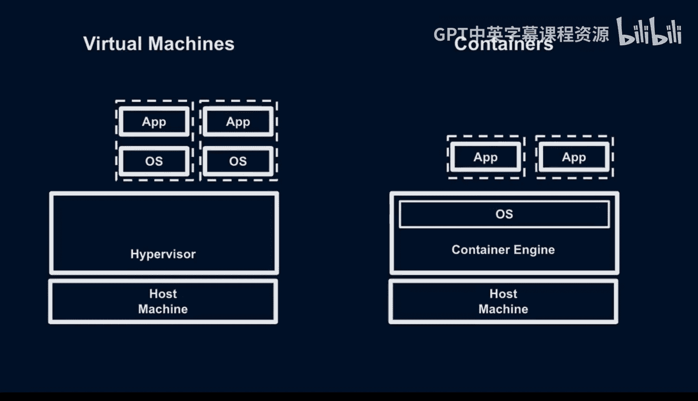
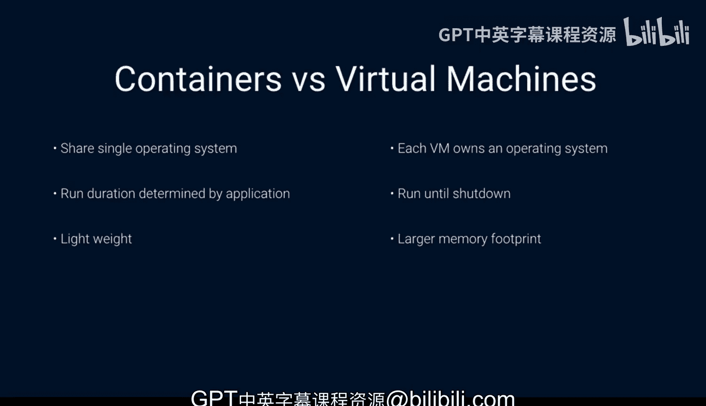

# 杜克大学《应用Python数据工程（3课全）｜Applied Python Data Engineering》中英字幕 p61 06_01_02_容器概念.zh_en -BV1nz421i7KP_p61-

Let's talk about another virtualization solution， containers。

This lesson will compare containers and virtual machines。Well， talk about general container concepts。

 but also container concepts specific to the Docker container solution。

As well as Docker container architecture。Both containers and virtual machines bundle applications。

 along with dependencies。Both are portable across environments。Bringing those dependencies。

 along with the applications。And both can run multiple instances concurrently on the same host。

As we've seen before， the virtual machine。Runs on a hypervisor， which runs on a host machine。

And each virtual machine has its own operating system。Containers are similar。

And that there's a container engine running out a host machine。But unlike a hypervisor。

 the container engine runs its own operating system。

And all the containers running on the container engine share this operating system。

Because of this。Containers are much lighter。And they start up and spin down much faster。

So let's review some of these differences。Containers share a single operating system。

Some of the ramifications of this are that you can only run containers with the same operating system。

On the same engine。Because the container is not running an operating system。

 It only runs as long as there is an application running upon it。And because of this。

 they're very lightweight。Virtual machines， on other hand。

 each virtual machine has its own operating system。

And it will run until that operating system is shut down。Because of this。

 it has a much larger memory footprint。

