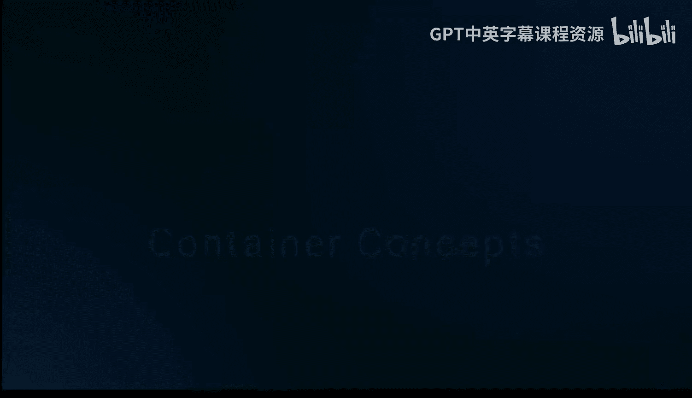
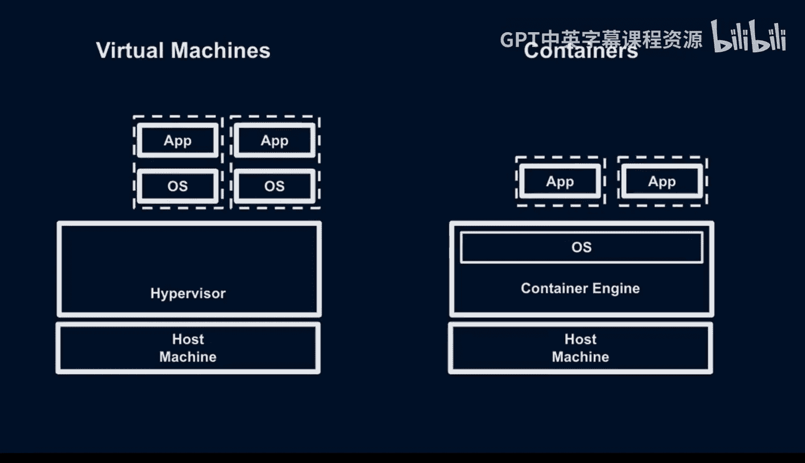
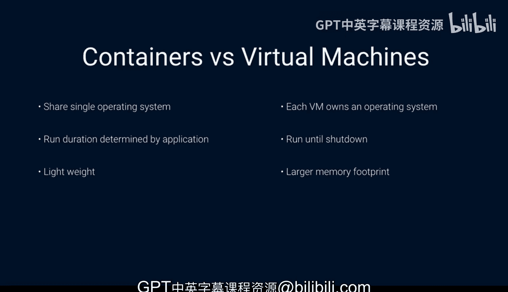

# 应用Python数据工程：06_01_02：容器概念 🐳



在本节课中，我们将学习另一种虚拟化解决方案——容器。我们将比较容器与虚拟机的异同，介绍通用的容器概念，并重点讲解Docker容器解决方案的特定概念及其架构。

## 概述

容器是一种将应用程序及其依赖项打包在一起的虚拟化技术。与虚拟机类似，容器也具有环境可移植性，并能在一台主机上同时运行多个实例。然而，它们在架构和资源消耗上存在显著差异。

## 容器与虚拟机的比较

上一节我们提到了虚拟化，本节中我们来看看容器与虚拟机的核心区别。

容器和虚拟机都能将应用程序及其依赖项捆绑在一起。两者都能在不同环境中移植，并能在同一台主机上并发运行多个实例。

虚拟机运行在位于主机之上的**管理程序（Hypervisor）**上。每个虚拟机都拥有自己独立的**操作系统**。

容器则运行在位于主机之上的**容器引擎**上。但与虚拟机管理程序不同，容器引擎本身运行着一个**操作系统**，而所有在该引擎上运行的容器都**共享**这个操作系统。


## 容器的主要特性

正因为上述架构差异，容器具有以下特点：
*   容器**更轻量**。
*   容器的启动和停止速度**更快**。

以下是容器与虚拟机的一些关键差异总结：



*   **操作系统**：容器共享单个操作系统。
*   **运行限制**：由于共享操作系统，同一引擎上只能运行相同操作系统的容器。
*   **生命周期**：容器仅在内部有应用程序运行时才存在，因此非常轻量。
*   **内存占用**：相比之下，每个虚拟机都有自己的操作系统，会一直运行直到操作系统关闭，因此内存占用更大。


## Docker容器架构

现在，让我们深入了解Docker这一特定容器解决方案的架构。

Docker容器架构的核心组件包括：
*   **Docker守护进程（Docker Daemon）**：一个在主机上运行的后台服务，负责管理容器、镜像、网络和存储卷。
*   **Docker客户端（Docker Client）**：用户与Docker守护进程交互的命令行工具。
*   **Docker镜像（Docker Images）**：只读模板，用于创建容器。镜像包含运行应用所需的代码、运行时、库和环境变量。
*   **Docker容器（Docker Containers）**：镜像的运行实例。你可以使用Docker API或CLI来创建、启动、停止、移动或删除容器。
*   **Docker注册表（Docker Registry）**：用于存储Docker镜像的服务，例如Docker Hub。

其基本工作流程可以用以下伪代码描述：
```
# 用户通过客户端发送命令
docker run <image_name>

# 守护进程执行操作
1. 检查本地是否存在指定镜像
2. 若不存在，则从注册表（如Docker Hub）拉取镜像
3. 基于该镜像创建一个新的可写容器层
4. 分配网络和存储接口
5. 启动容器，运行指定应用
```



## 总结


本节课中，我们一起学习了容器的核心概念。我们了解到容器是一种轻量级、快速启动的虚拟化技术，它通过共享主机操作系统的内核来实现高效运行。我们比较了容器与虚拟机的区别，并介绍了Docker容器解决方案的基本架构。理解这些概念是进行现代应用部署和微服务开发的重要基础。