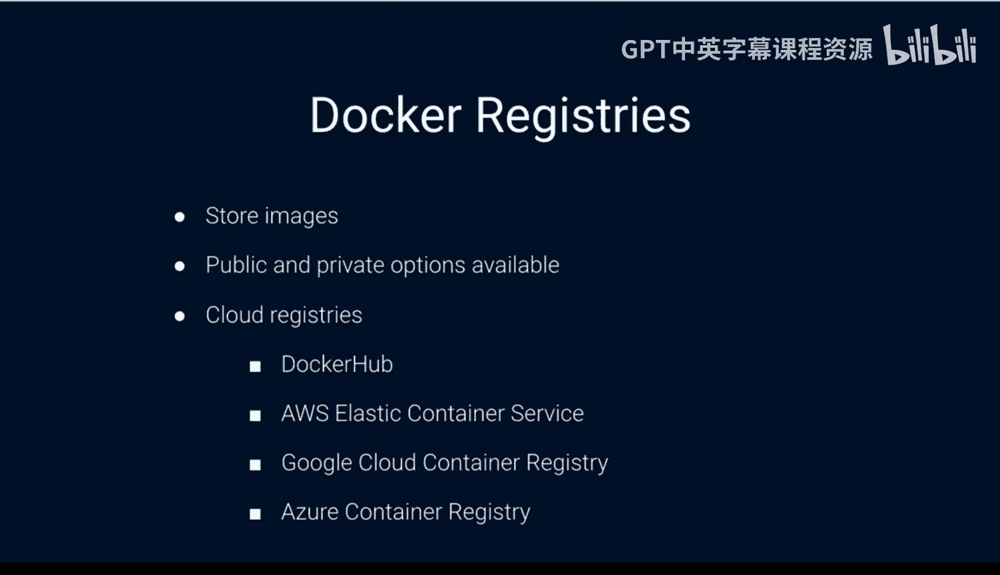
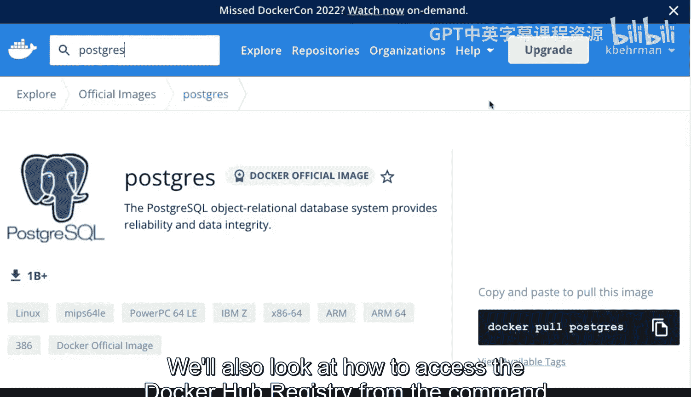

# 杜克大学《应用Python数据工程（3课全）｜Applied Python Data Engineering》中英字幕 p62 07_01_03_Docker简介.zh_en -BV1nz421i7KP_p62-

Now， let's talk about docker containers。Docker is both a container platform and a company promoting this platform。

 as well as tools related to Docker containers。While there are other Linux based containers。Docker。

 at the moment， is the most widely adopted container type。Doctors written in the go language。

And uses Linux namespaces behind the scenes to isolate containers。As of this recording。

 Docker offers containers that run both Linux and Windows。

It's important to understand the ideas of images and containers in the Docker ecosystem。

An image is a read only template。It's used to create a container。

You can create images yourself using Docker files or use pre builtil images。Containers。

 on the other hand， are readudable instances of images。

It's important to understand that unlike a virtual machine， containers do not store state。 That is。

 when you shut a container down。It doesn't store any of the state of the running container。Now。

 you can attach outside storage to a container and effectively a store state there。

 but the container itself will not。Docker desktop。Is a popular application for interacting with Docker。

It's available to run on OSX， Windows and Linux。And in the Docker desktop application。

 bundled together are。The Docker Damon。Dor。 clientient。Doctor compose。And Kubernetes。

 which is an orchestration system。For running。Docker containers。Docker registries。

Ourre locations for storing Docker images。And these can be local to your machine or in the cloud。

Options are available for creating public or private registries。

And there are a number of popular cloud registry solutions。Including Do Hub。

AWS's elastic container service。Google Clouds container registry。And Azurs contained her registry。

Let's look at the image registry。At Docker Hub。So if we go to the Exper section， we can see。

Some suggested images。And on the left， some ability to filter so we can filter for。

Official images by verified publishers so that we have an idea of who's making them。

And see some of the more popular， suggested ones here。See。

 each image has a series of tags associated with it。

We could also switch this to recently updated to see。Which images have been most recently updated。

We can also filter by operating system。As I mentioned before， doctor。Containers run on either Linux。

Or Windows。And various architectures。Then we can search for an image。

See here is the Docker command we use on the command line to pull the image into our local Docker。

Client。Description reviews and tags， as well as some reference。

The tags are useful if you want to get a particular version of an image。

 so you can use these tags to pull down particular versions if you need a particular version of that image。

Add sor documentation。So that's how the Docker Hub registry works we'll also look at how to access the Docker Hub registry from the command line in a following lesson。

