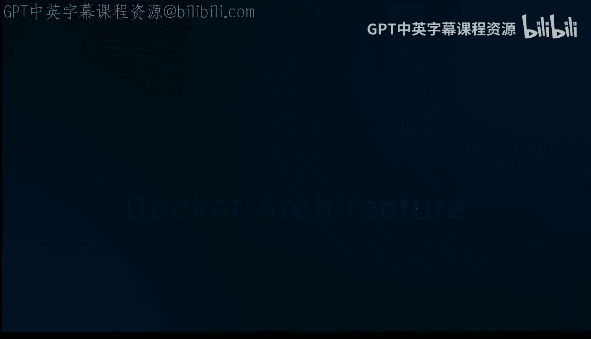
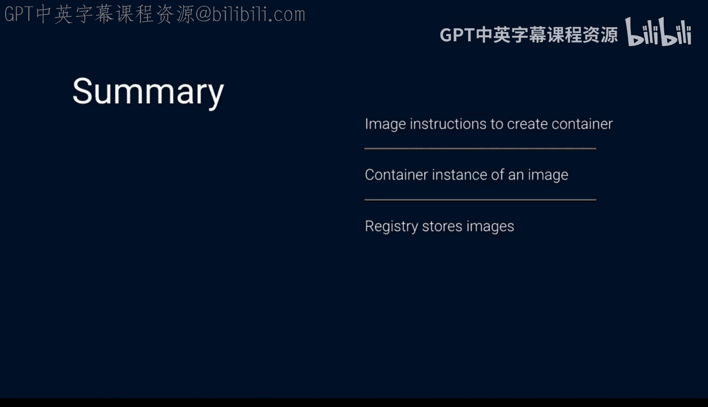

# 杜克大学《应用Python数据工程（3课全）｜Applied Python Data Engineering》中英字幕 p63 08_01_05_Docker架构.zh_en -BV1nz421i7KP_p63-

Let's talk about Do's architecture。As mentioned before。

 Docker is based on a client server model or a client Damon。

The client and the damon can be run on the same host。

 or you can run a local client and sends commands to a remote damon。The client and the demon。

Communicate solely through a rest API。So the Damon passively listens for API requests。

And with these requests， it manages images， containers and networks。

The client is the primary way to send commands to the damen。But not the only way。

You can use the API directly to send commands to the Damon。

 or use other tools that use this API to do so。But the client is a good place to get started。

So in summary， in this lesson。We've talked about how images are instructions used to create a container。

Containers are instances of an image。And registries are used to store images。

