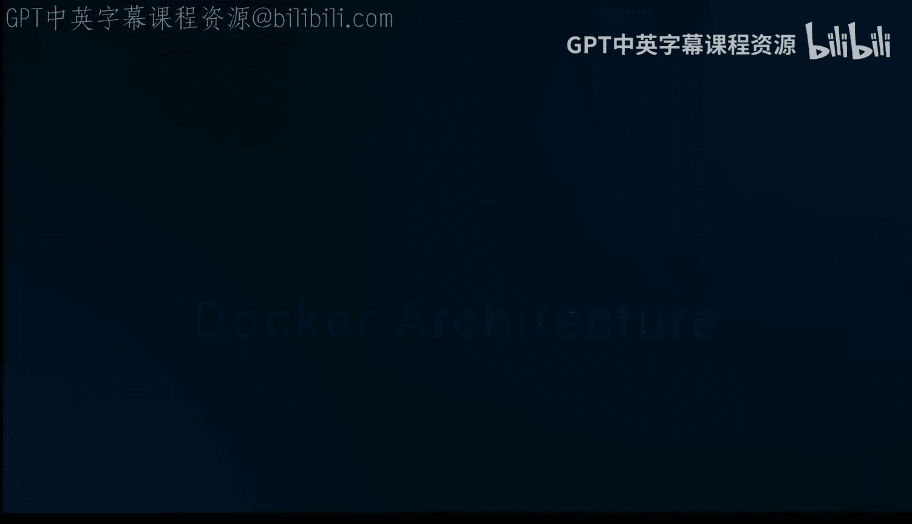
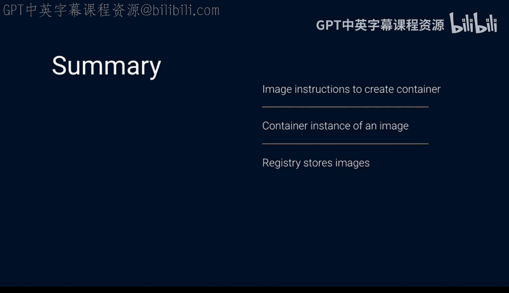

# Docker入门：1：Docker架构 🐳

在本节课中，我们将要学习Docker的核心架构。理解其工作原理是有效使用Docker的基础。

## 概述

Docker的架构基于**客户端-服务器模型**。我们将探讨其核心组件如何协同工作，以管理镜像、容器和网络。

## 客户端与守护进程

上一节我们介绍了Docker的基本概念，本节中我们来看看其核心的运行架构。

Docker基于一个**客户端-守护进程模型**。客户端和守护进程可以运行在同一台主机上，也可以配置为本地客户端向远程守护进程发送命令。

## 通信机制

客户端与守护进程之间的通信完全通过一个**REST API**进行。守护进程被动地监听API请求，并根据这些请求来管理镜像、容器和网络。

## 发送命令的方式

客户端是向守护进程发送命令的主要方式，但并非唯一方式。

以下是向Docker守护进程发送命令的几种途径：
*   使用 **`docker` 客户端** 命令行工具。
*   直接使用 **REST API** 发送命令。
*   使用其他基于此API构建的工具。

对于初学者而言，`docker`客户端是一个很好的起点。

## 核心概念回顾

在本节课中，我们一起学习了Docker的架构。现在让我们总结一下目前已学的核心概念：

*   **镜像** 是用于创建容器的指令模板。
*   **容器** 是镜像的一个运行实例。
*   **注册表** 用于存储和分发镜像。

理解这些组件及其交互方式，是掌握Docker技术的关键。