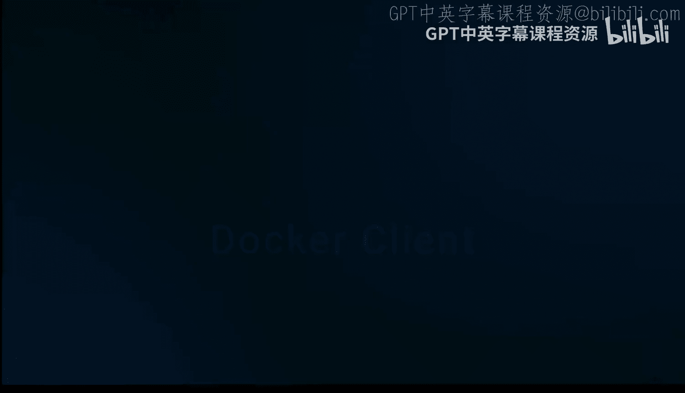
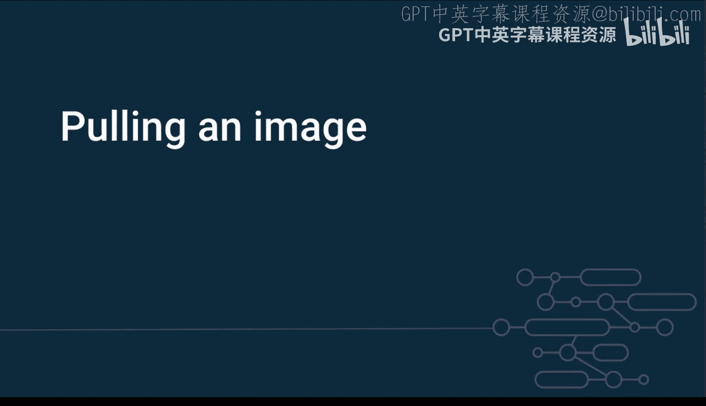
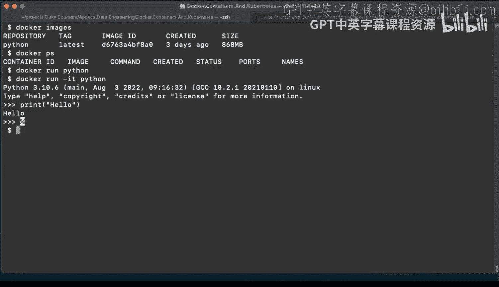
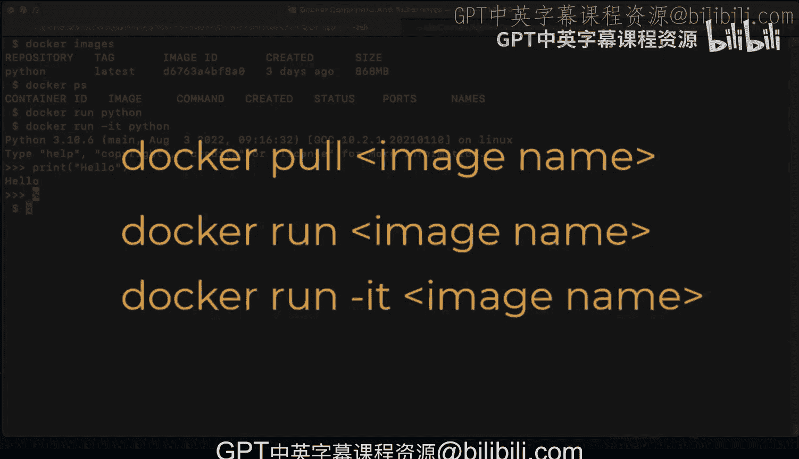

# 杜克大学《应用Python数据工程（3课全）｜Applied Python Data Engineering》中英字幕 p64 09_02_01_Docker客户端.zh_en -BV1nz421i7KP_p64-

In this lesson， we'll look at the Docker client。We'll talk about how to use the Docker client to tell the Docker engine。

To pull images from a remote repository。To run containers。To attach a shell to a container。

And to attach a volume to a container， which allows。A location for persisting data。

First， let's look at plain and image。The Docker client is available as a command line tool。

 the name Docker。If we want to use this tool to see what images。

Are available in the Docker engine we're connected to。 In this case， my local docker engine。

We use the imagesage command。You can see that we don't have any images available in my local Docker engine。

We can use Doctor's search。To search for images。In a daca repository。By default。

The Docker repositor used is Docker hubub， but you can set。

Configuration to point to a different repository， if you wish。

So here let's search for images that have Python in their name。And we can see。

We get the names of the images。A description。Any star writing they have。

And whether the images are official or not。So we can refine our search。By using filters。

So here we're add a filter。To ask if it's official。

And we could say whether we have that filter to be true or false。Let's also look for a filter then。

Limited to。Images that have three stars。So a high rating。I'll look for Python again。

So we can see this limits us down to three images。To pull an image。Into the repository。

 our Docker engine maintains。We use the pool command。Just with the image name。

So here we'll pull the official Python image。Now， we've talked about images having tags before and noticed that I didn't specify a tag。

So by default， it's using the tag latest。I can specify a tag by。

Putting a colon at the end of the image name and then putting the tag name after that。Now。

 if we use Drcker images again to see what images are available。

We can see that the Python image is now available。To see if they're in a containers running。

 which are managed by our engine。Use the PS command。We have no containers running。To run a container。

Use the Docker run。In case， we're going to run the Python image。And this image will stop right away。

 because there's no。Commanded it to continue executing， so let's add another flag。

This will connect a shell to our image。So we've done now is our images running and we're connected to it in a shell where we can run Python commands。

And if we switch to another tab。And we run Dr。 Pi S again。We can see our running container。

With its container I D。The image it originates from。Any command it has。

 which is its execution command。And more information about it。Now， if we want to stop this container。

 we' would grab the container ID。And use the stop command。And see that now no containers are running。

If you go back to our original shell， notice that the Python shell has now been forced to exit。

And we're back in our shell。

So now you've seen how to pull an image。Using the Docker client。

And how to use that image to run a container， as well as how to run that container with a shell attached so you can interact。

With the container as it runs。

