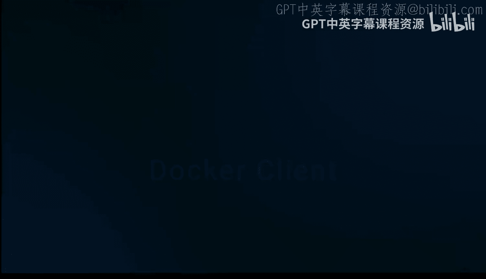
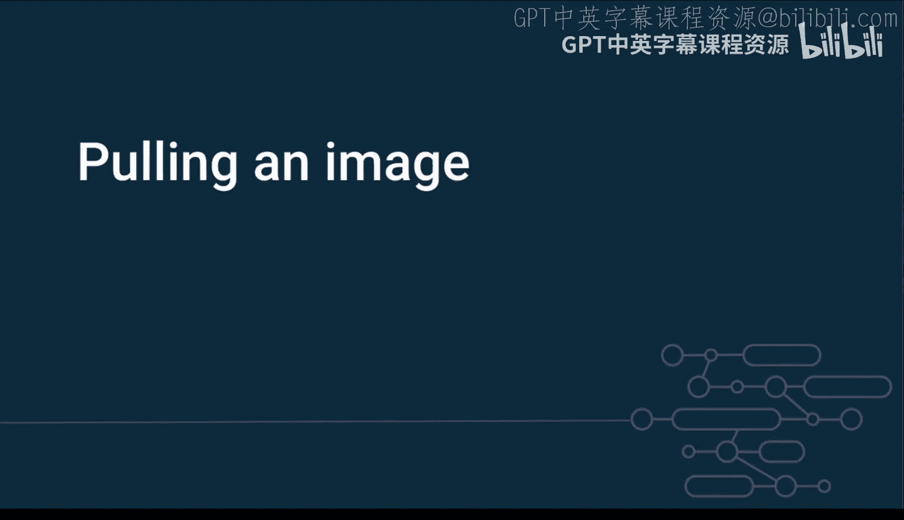
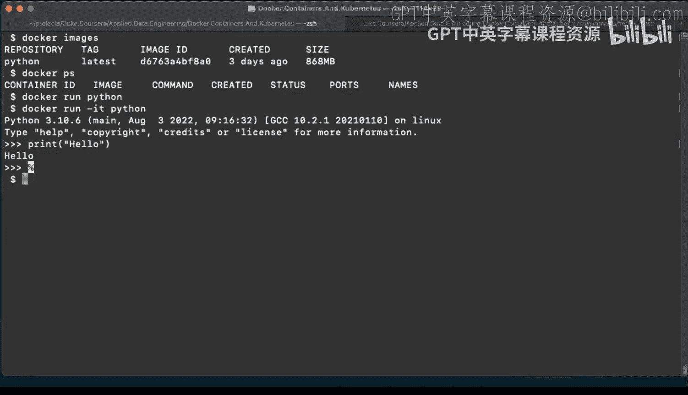
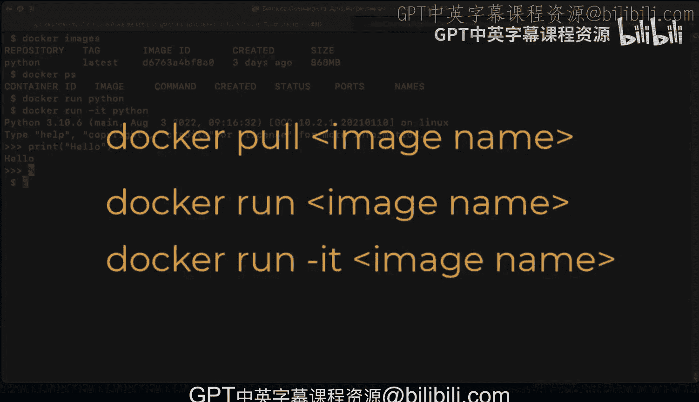

# 应用Python数据工程：3.2.1：Docker客户端 🐳

在本节课中，我们将学习Docker客户端。我们将探讨如何使用Docker客户端向Docker引擎发送指令，包括从远程仓库拉取镜像、运行容器、连接到容器的Shell，以及为容器挂载数据卷以实现数据持久化。

## Docker客户端与镜像管理 🖼️

首先，我们来了解Docker客户端和镜像。Docker客户端是一个命令行工具，名为 `docker`。

要查看当前连接的Docker引擎（本例中是本地引擎）中可用的镜像，我们使用 `docker images` 命令。可以看到，我的本地Docker引擎中目前没有任何镜像。

我们可以使用 `docker search` 命令在Docker仓库中搜索镜像。默认情况下，使用的仓库是Docker Hub，但你也可以通过配置指向其他仓库。

以下，我们搜索名称中包含“Python”的镜像。搜索结果会显示镜像名称、描述、星级以及是否为官方镜像。

我们可以使用过滤器来优化搜索。例如，这里我们添加一个过滤器，要求镜像必须是官方的。我们还可以设置过滤器来限定星级，比如只显示三星以上的高评级镜像。再次搜索“Python”，可以看到结果被限定为三个镜像。

要将镜像拉取到Docker引擎维护的本地仓库中，我们使用 `docker pull` 命令，后面跟上镜像名称。这里我们将拉取官方的Python镜像。之前我们提到过镜像有标签，请注意，这里我没有指定标签，因此默认使用 `latest` 标签。要指定标签，可以在镜像名后加上冒号和标签名，例如 `python:3.9`。

现在，再次使用 `docker images` 命令，可以看到Python镜像已经可用。

## 容器操作与管理 📦

要查看由引擎管理的、正在运行的容器，我们使用 `docker ps` 命令。目前没有容器在运行。

要运行一个容器，使用 `docker run` 命令。这里我们将运行Python镜像。这个镜像会立即停止，因为没有命令让它持续执行。因此，我们需要添加另一个标志 `-it`，这将为我们的镜像连接一个交互式Shell。

现在，我们的镜像正在运行，并且我们通过Shell连接到了它，可以在其中运行Python命令。

如果我们切换到另一个终端标签页，再次运行 `docker ps`，就能看到我们正在运行的容器，包括其容器ID、来源镜像、执行命令以及其他信息。

要停止这个容器，我们需要获取其容器ID，然后使用 `docker stop` 命令。之后，可以看到没有容器在运行。回到原来的Shell，会发现Python Shell已被强制退出，我们回到了自己的Shell中。

## 总结 📝

本节课中，我们一起学习了如何使用Docker客户端拉取镜像，以及如何使用该镜像运行容器。我们还学习了如何以附加Shell的方式运行容器，以便在容器运行时与其进行交互。