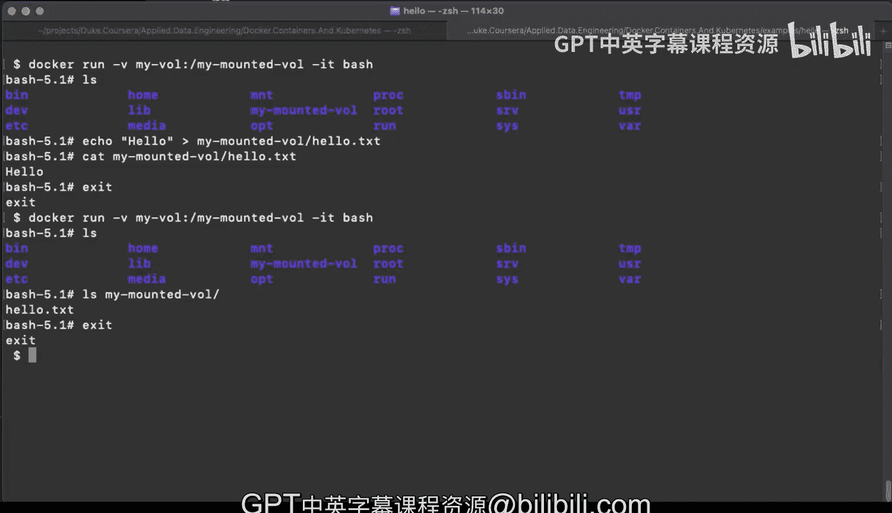

# 杜克大学《应用Python数据工程（3课全）｜Applied Python Data Engineering》中英字幕 p65 10_02_03_创建卷.zh_en -BV1nz421i7KP_p65-

Now， let's look at creating a volume and attaching it to a container。

Let's start。By running to container。AndOnce again attaching to it。

This time we'll use the container bash。Notice we haven't pulled this container。But Dr。

 Run will automatically pull the container with any tag we specify or latest if we don't specify a tag。

So now we're running in a bathshell。Look around run normal bash commands。Let's try making a file。

So we've made a simple file。Now let's exit this bash。Okay。And thatll we checked， Docker。

 there are no running containers。If we run the same container again。And this time。

 let's add another flag。Let's add the flag。Name and give our container a name。So once again。

 we're in a bathhell。If we look around， we see that the file we made no longer exists。

If we open up another shell， though。And use the P command to look for running。Containers。

 we can see that our container now has a name。This means we can refer to our container by that name。

So if we want to do。Stop， we can do stop using the container's name。

So we can see the container is stopped。Now if we want to be able to create data that persists。

We need to create and attach a volume to our container。To see what volumes are available。

Is the volume。LS command。We see that we have no volumes created in our local engine。

To create a volume。Volume， create。And then give it a volume name。

And now we see that we have an existing volume。Now， let's run a container with this volume attached。

So we use the dash V flag to attach the volume to the container。

And the first part of the dashv flags。Argument is the name of the container to attach。

And we have the colon。In the place we had liked the volume mounted in the container。

We'll use the IT flag again to attach。To our container。Here we are， in our guitartator。

And we can see there's the my mounted volume there。So let's make a file in that volume。

Let's see its contents。See it says hello。So let's exit this container。And then。

Whenut a container once again with the same volume mounted。And the same bash image。

And if we look in the volume， you can see that our file persisted。

Which it would not do without the volume mounted。We can also look at our running container。

And use the inspect command。With the container ID。And if we search for mounts。

 we can see that our volume is mounted。You can see both the volume name。And its destination path。

So that's how you create and mount a volume。

