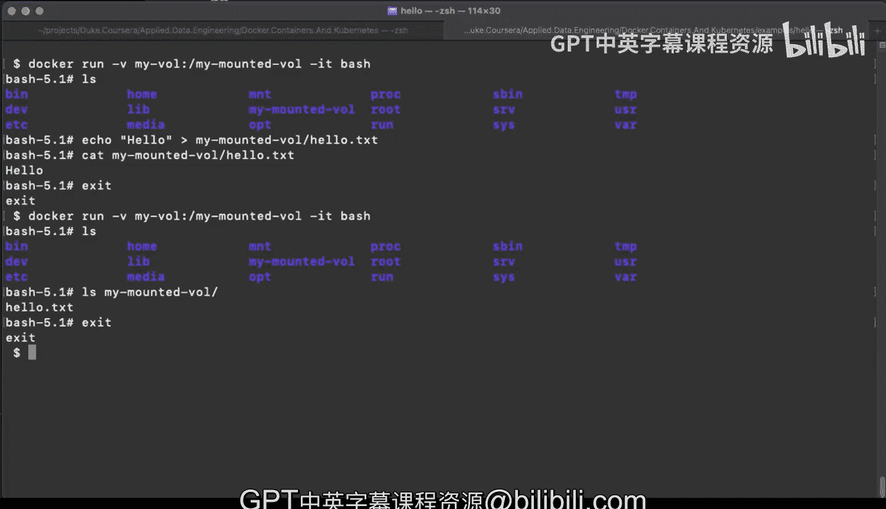

# Docker数据工程：第10章：创建与管理数据卷


## 概述

在本节课程中，我们将学习如何在Docker中创建数据卷，并将其附加到容器上。数据卷是Docker中用于持久化存储数据的重要机制，它允许容器在停止或删除后，其内部的数据依然得以保留。我们将通过实际操作演示如何创建卷、将卷挂载到容器，并验证数据的持久性。


---

## 创建并运行一个容器

首先，我们启动一个容器并进入其内部的bash shell。

运行以下命令来启动一个容器并附加到它：
```bash
docker run -it bash
```

请注意，我们之前并未拉取这个`bash`镜像。但`docker run`命令会自动拉取我们指定的镜像标签，如果未指定标签，则默认拉取`latest`标签。

现在，我们已进入容器的bash shell环境。可以像在普通bash中一样查看和操作文件。

让我们尝试创建一个文件：
```bash
echo "Hello from first run" > testfile.txt
cat testfile.txt
```

我们已经创建了一个简单的文件。现在，让我们退出这个bash shell：
```bash
exit
```

---

## 为容器命名并管理其生命周期

退出后，我们检查Docker，会发现没有正在运行的容器。

如果我们再次运行相同的容器，这次可以添加一个标志来为容器命名：
```bash
docker run -it --name my_named_container bash
```

我们再次进入bash shell。如果查看周围，会发现之前创建的文件`testfile.txt`已经不存在了。这是因为每次运行新容器时，它都从一个全新的文件系统开始。

如果我们打开另一个终端，并使用`docker ps`命令查看正在运行的容器，可以看到我们的容器现在有了一个名字`my_named_container`。这意味着我们可以通过这个名字来引用我们的容器。

例如，如果我们想停止这个容器，可以使用其名称：
```bash
docker stop my_named_container
```

执行后，可以看到容器已停止。

---

## 创建数据卷以实现数据持久化

为了使容器创建的数据能够持久保存，我们需要创建并将一个数据卷附加到容器上。

首先，查看当前可用的卷：
```bash
docker volume ls
```
可以看到，我们的本地Docker引擎中尚未创建任何卷。

接下来，创建一个新的数据卷：
```bash
docker volume create my_data_volume
```
再次运行`docker volume ls`，现在可以看到一个名为`my_data_volume`的卷已经存在。

---

## 将数据卷挂载到容器

现在，让我们运行一个容器，并将刚创建的卷挂载到它里面。

我们使用`-v`标志来附加卷到容器。该标志的参数结构为：`[卷名]:[容器内的挂载路径]`。
```bash
docker run -it -v my_data_volume:/mounted_volume --name vol_container bash
```

我们再次使用`-it`标志以交互模式附加到容器。进入容器后，可以在`/mounted_volume`目录下看到挂载的卷。

让我们在该卷中创建一个文件：
```bash
cd /mounted_volume
echo "Hello from persisted volume" > persistent_file.txt
cat persistent_file.txt
```
文件内容显示为“Hello from persisted volume”。现在，退出这个容器：
```bash
exit
```

---

## 验证数据的持久性

然后，我们再次运行一个容器，挂载同一个数据卷，并使用相同的bash镜像：
```bash
docker run -it -v my_data_volume:/mounted_volume bash
```

进入容器后，查看挂载的卷目录：
```bash
ls /mounted_volume
cat /mounted_volume/persistent_file.txt
```
可以看到，我们之前创建的`persistent_file.txt`文件依然存在，并且内容保持不变。如果没有挂载卷，这个文件是不会被保留的。

---

## 检查容器的挂载信息

我们还可以检查正在运行的容器，查看其挂载的详细信息。

首先，获取容器的ID或名称，然后使用`inspect`命令：
```bash
# 假设容器名为 vol_container， 如果已停止，可以先启动或使用最近运行的容器ID
docker inspect vol_container | grep -A 10 Mounts
```
在输出结果中，搜索`Mounts`部分，可以看到我们的卷`my_data_volume`的挂载信息，包括卷名和它在容器内的目标路径（`/mounted_volume`）。

---

## 总结



在本节课中，我们一起学习了Docker数据卷的核心操作。我们首先创建并运行了一个容器，然后通过为容器命名来更好地管理它。接着，我们创建了一个数据卷，并将其挂载到容器中，从而实现了容器数据的持久化存储。最后，我们通过再次运行容器并挂载同一卷，验证了数据的持久性，并学习了如何检查容器的卷挂载详情。掌握数据卷的使用，是进行可靠数据工程和容器化应用部署的关键一步。