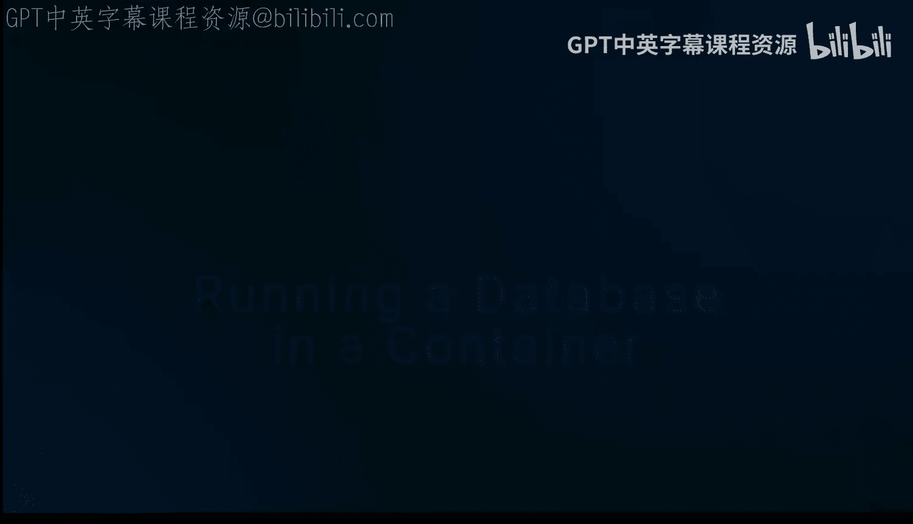
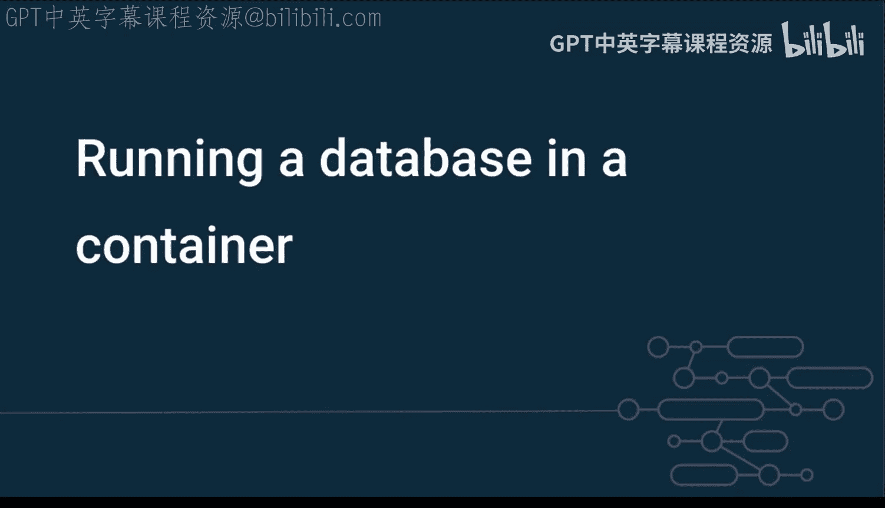
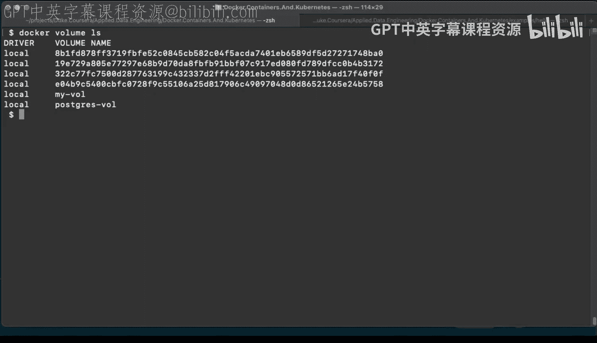
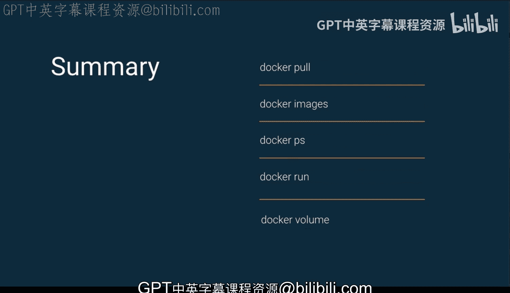

# 杜克大学《应用Python数据工程（3课全）｜Applied Python Data Engineering》中英字幕 p66 11_02_04_在容器中运行数据库.zh_en -BV1nz421i7KP_p66-

Now， let's look at a more complicated example of running a database in a container。

We're going to use the Docker image Postgres。So we'll go ahead and pull it， pull the latest。

Let's try running it with no arguments。And you can see that， because。A Postgres server。Needs to have。

Either password setup。Or allow for no security。Okay， now let's run Postgres again。But this time。

 we'll actually set a password。An environment variable。And a user environment variable。

We're also going to define a port mapping。Which map have the support in the container。

To a externalal to the container。As well as mounting of volume。

Notice we haven't created this volume beforehand， it'll be created on the fly in the mounting。

We're also going to use the D flag。This will cause our container to run as a background process。

So now our container is running as a background process。

And we can see there's our running containers ID。To connect to this container。

We're going to use the Docker Exec command， which executes a command。On a running container。

We'll connect to it with IT again。It will'll grab the container ID。

And then the command we wish to run on the container， which in this case is a bahe。

So now we're running a bash shellll on the running container that's running Postgres。

And we can try to connect to Postgress。Remember， the port was 5432。Our user。

So now we have a connection to a Postgres server running into a container。See。There's no tables。

 but we could。Run SQL commands here。We'll make a table with a single column， named name。

And there we can see our SQL command worked， we have a table。We can exit our best show。

The container is still running。ちっとタ。You can grab its ID again。Last thing to look at。

So you can see here volumes that were created。 The only one of these volumes that we created explicitly was the。

Second from last， the myva， All of these other volumes were created in the process of running containers。

 either explicitly by us In the case of the postre dashva。Or behind the scenes by necessity。

 by the containers and the other volume names。So that is how you run a database locally without installing it on your machine。

Connected to a volume so the data can be。Persisted。

And then connect to it with a shell so that you can run SQL against it。

Let's review some of the Docker Klein commands that were introduced in this lesson。

We use Docker pull to pull images from a remote repository。

Doctor images to list what images we had locally。Dr。 Piiaes。To show what containers are running。

Doctor Run to run a container from an image。And docker volume。

 both to create volumes and to list what volumes are locally available。

