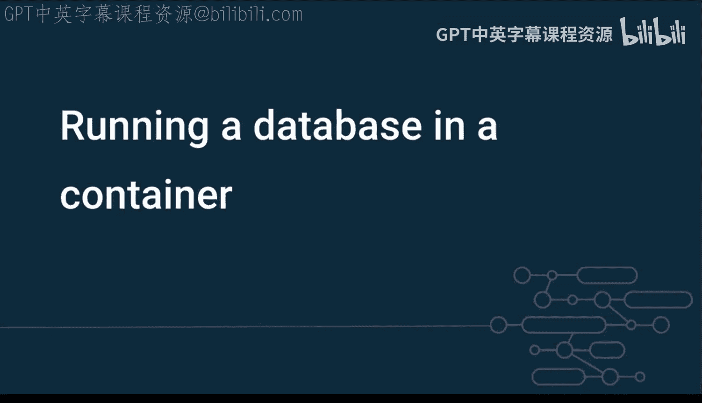
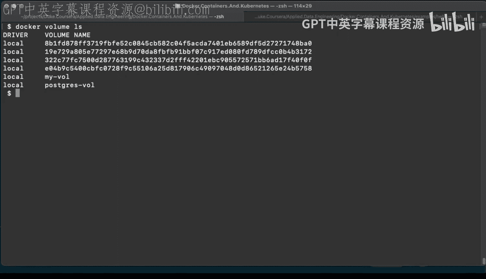
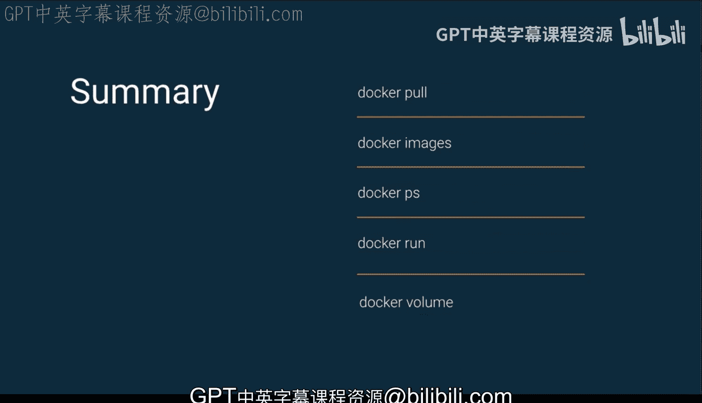

# 应用Python数据工程：11：在容器中运行数据库 🐘


在本节课中，我们将学习如何使用Docker容器来运行一个数据库服务。我们将以PostgreSQL为例，演示如何拉取镜像、运行容器、设置环境变量、映射端口、挂载数据卷，并最终连接到容器内的数据库执行操作。这种方法允许你在本地运行数据库，而无需在主机上直接安装它。



---

上一节我们介绍了Docker的基本概念，本节中我们来看看一个更复杂的例子：在容器中运行数据库。

我们将使用Docker官方的PostgreSQL镜像。首先，我们拉取这个镜像的最新版本。

```bash
docker pull postgres
```

接下来，尝试不带任何参数运行它。

```bash
docker run postgres
```

你会看到运行失败，因为PostgreSQL服务器需要设置密码或允许无安全连接。

现在，让我们再次运行Postgres容器，但这次设置必要的参数。

以下是运行命令：

```bash
docker run -d \
  --name my-postgres \
  -e POSTGRES_PASSWORD=mysecretpassword \
  -e POSTGRES_USER=myuser \
  -p 5432:5432 \
  -v my-pg-data:/var/lib/postgresql/data \
  postgres
```

让我们分解这个命令：
*   `-d`：以后台守护进程模式运行容器。
*   `--name my-postgres`：为容器指定一个名称。
*   `-e POSTGRES_PASSWORD=mysecretpassword`：设置环境变量，定义数据库的密码。
*   `-e POSTGRES_USER=myuser`：设置环境变量，定义数据库的用户名。
*   `-p 5432:5432`：将容器内部的5432端口映射到主机的5432端口。
*   `-v my-pg-data:/var/lib/postgresql/data`：将名为`my-pg-data`的数据卷挂载到容器内的PostgreSQL数据目录。即使容器被删除，数据也会保留在卷中。

现在，我们的容器已经在后台运行。我们可以使用以下命令查看运行中的容器：

```bash
docker ps
```

要连接到这个正在运行的容器内部，我们使用`docker exec`命令。

以下是连接命令：

```bash
docker exec -it my-postgres bash
```

这个命令会在名为`my-postgres`的容器内启动一个交互式bash shell。

进入容器后，我们可以使用`psql`客户端连接到PostgreSQL服务器。

```bash
psql -h localhost -p 5432 -U myuser
```

现在，我们已经成功连接到了运行在容器内的PostgreSQL服务器。可以看到当前没有表。

我们可以在此执行SQL命令。例如，创建一个名为`test_table`的表，它有一个`name`列。

```sql
CREATE TABLE test_table (name VARCHAR(255));
INSERT INTO test_table VALUES ('Hello from Docker');
SELECT * FROM test_table;
```

执行后，可以看到SQL命令生效，表已创建并插入了数据。输入`\q`退出`psql`，再输入`exit`退出容器的bash shell。

容器仍在后台运行。最后，我们可以查看一下本地创建的数据卷。



```bash
docker volume ls
```

在列出的卷中，只有`my-pg-data`是我们显式创建的。其他卷是在运行各种容器过程中自动创建的。

---

本节课中我们一起学习了如何在本地通过Docker运行数据库，而无需在机器上直接安装。我们连接了数据卷以确保数据持久化，并通过shell连接到容器来对其运行SQL。



让我们回顾一下本课引入的一些Docker命令：
*   `docker pull`：从远程仓库拉取镜像。
*   `docker images`：列出本地已有的镜像。
*   `docker ps`：显示正在运行的容器。
*   `docker run`：从镜像运行一个容器。
*   `docker volume`：用于创建卷或列出本地可用的卷。