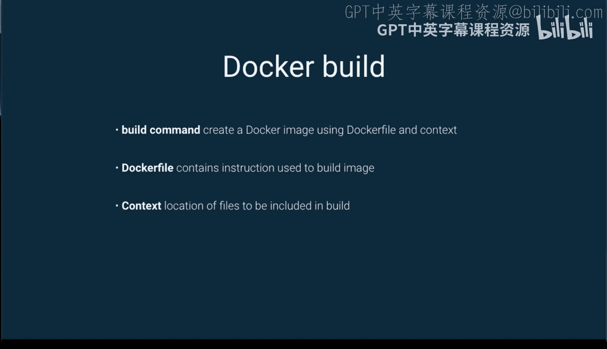
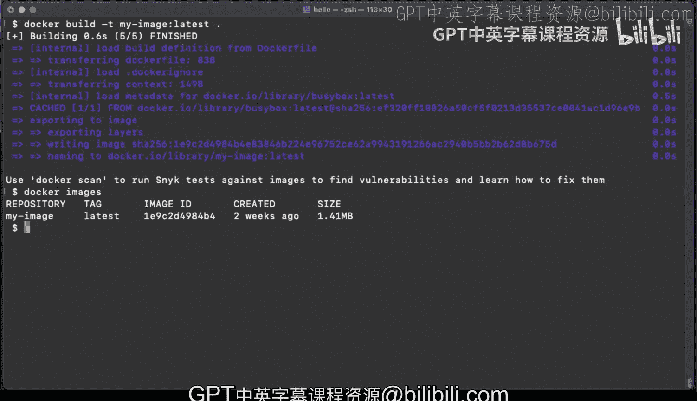

# 杜克大学《应用Python数据工程（3课全）｜Applied Python Data Engineering》中英字幕 p67 12_02_01_构建镜像.zh_en -BV1nz421i7KP_p67-

In this lesson， we'll look at building a docker image。

We'll use the build command the most common way to build a Docker image。We'll look at Docker files。

And look at some example docker files。Duckcker build。Is the most common way to build an image。

 though images can be built from running containers。

The build command creates a Docker image using a Docker file and a context。

The Docker file is a file containing instructions used to build the image。By default。

 Docker files are expected to be named DockerFile。But other file names can be used。

And specified using the dash F flag with build。The context is a location of files to be included in the build。

This location。Is often a local directory。But it can also be a URL of a remote directory。For example。

 it could be a project in GitHub or Gitlab。

So let's look at the Docker， build command。Here I am in a directory。That has a Docker file。

If we look at the documentation for DockerBuild。We can see that。The required argument is a Pa or URL。

 and that is to the context for the build。And then there's some optional arguments。

As mentioned before， there's the F or file argument。

 which can be used to specify a Docker file that is either not in the context or else has a different name than the default name。

The other flag which we'll be interested in is the tag flag。So， I'm going to build。

Using this Docker file， and I'm going to use the current working directory as my context。

Now keep in mind with your context， especially with a remote Docker engine。

Whatever is in the context will be pushed to the engine。

 so it's a good idea only to have files and directories in the context that are necessary for the build。

If for some reason you would have files in the context which should not be included in the build。

You can use what's known as a Docker ignore file。So with a dot Docker ignore file。

We specify any specific files or paths in the context to be ignored by the build。

Now let's go ahead and build this Docker file。Because the Docker file has the default Docker file name and is in the context。

 we don't need to specify a path through the file， just a path for the context。

We can see looking at Docker images that our image has been created。

Notice that the image ID is reported here。So that you can identify in the images list。Okay。Now。

 let's build the image again。But at a tag。The tag flag lets us create a name for our image。

And if we want， we can add an optional tag， which happens after a colon。

So the tag could be a version number。Or it could be an environment。

Tag latest is often used for images that are built to indicate the latest build。

 so the actual image that is the latest might rotate， but it can always be grabbed by using that tag。

Now， if we look at Docker images。We can see now that the image has a name。And a tag。

And this image is available then to be run as a container。

