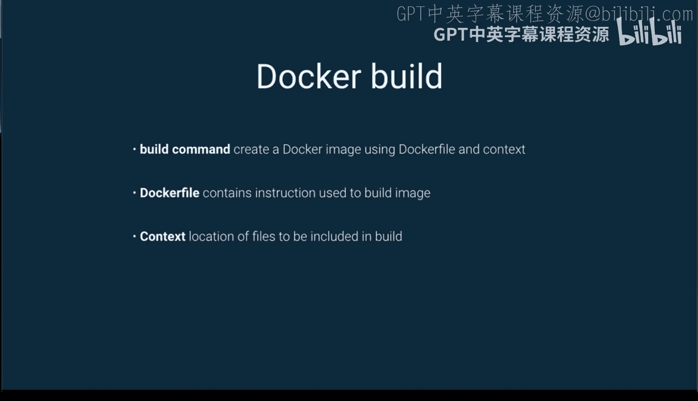
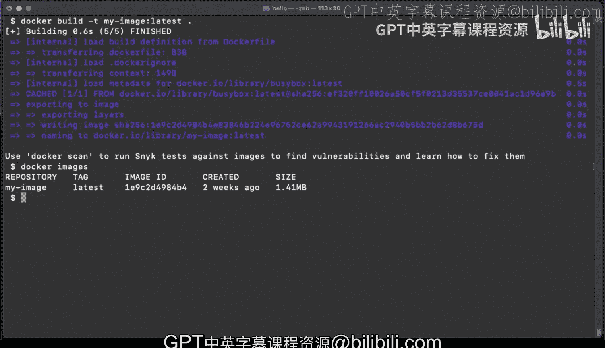

# 应用Python数据工程：3.2：构建Docker镜像 🐳


在本节课中，我们将学习如何构建一个Docker镜像。我们将重点介绍最常用的构建命令 `docker build`，并深入理解其核心组成部分——Dockerfile。通过具体的示例，你将掌握从零开始创建自定义镜像的完整流程。

## 概述

Docker镜像是容器运行的基础。`docker build` 是构建镜像最常用的方式，它通过读取一个名为 Dockerfile 的文本文件，并配合一个构建上下文（context）来生成镜像。虽然镜像也可以从正在运行的容器创建，但使用 Dockerfile 进行构建是更标准化和可复现的方法。

## Docker Build 命令详解

上一节我们介绍了构建镜像的基本概念，本节中我们来看看具体的构建命令 `docker build`。



`docker build` 命令使用一个 Dockerfile 和一个构建上下文来创建 Docker 镜像。Dockerfile 是一个包含用于构建镜像的指令的文件。默认情况下，Docker 期望该文件名为 `Dockerfile`，但也可以使用其他文件名，并通过 `-f` 标志在构建时指定。

构建上下文是构建过程中要包含的文件所在的位置。这个位置通常是一个本地目录，但也可以是一个远程目录的URL，例如 GitHub 或 GitLab 上的项目。

以下是 `docker build` 命令的基本结构：
```bash
docker build [OPTIONS] PATH | URL | -
```
其中，`PATH | URL | -` 是必需的参数，指向构建上下文。

## 构建上下文与 .dockerignore 文件

在构建镜像时，理解构建上下文至关重要。对于远程 Docker 引擎，上下文中的所有文件都会被推送到引擎，因此最好只在上下文中包含构建所必需的文件和目录。

如果你有文件在上下文中但不希望被包含在构建中，可以使用 `.dockerignore` 文件。通过 `.dockerignore` 文件，我们可以指定构建过程中要忽略的特定文件或路径。

## 实战：构建第一个镜像

现在，让我们动手构建一个镜像。假设我们位于一个包含 Dockerfile 的目录中。

因为 Dockerfile 使用了默认名称且位于上下文中，我们无需通过 `-f` 指定文件路径，只需提供上下文路径即可。执行以下命令：
```bash
docker build .
```
命令执行后，我们可以通过 `docker images` 查看镜像列表，确认新镜像已创建。请注意这里会报告镜像ID，以便你在镜像列表中识别它。

## 为镜像添加标签

接下来，我们再次构建镜像，但这次为其添加一个标签。`-t` 或 `--tag` 标志允许我们为镜像创建一个名称。

标签的格式通常为 `名称:标签`。冒号后的标签是可选的，可以是版本号或环境标识（如 `latest`）。`latest` 标签常用于表示最新的构建，虽然实际的“最新”镜像可能会更新，但始终可以通过该标签获取。

执行带标签的构建命令：
```bash
docker build -t my-image:latest .
```
现在，再次运行 `docker images`，可以看到我们的镜像拥有了名称和标签。这个镜像现在就可以被用来运行容器了。

## 总结



本节课中我们一起学习了 Docker 镜像构建的核心知识。我们了解了 `docker build` 命令的用法，认识了 Dockerfile 和构建上下文的作用，并实践了如何构建一个基础镜像以及为其添加有意义的标签。掌握这些是进行高效、可复现应用部署的基础。