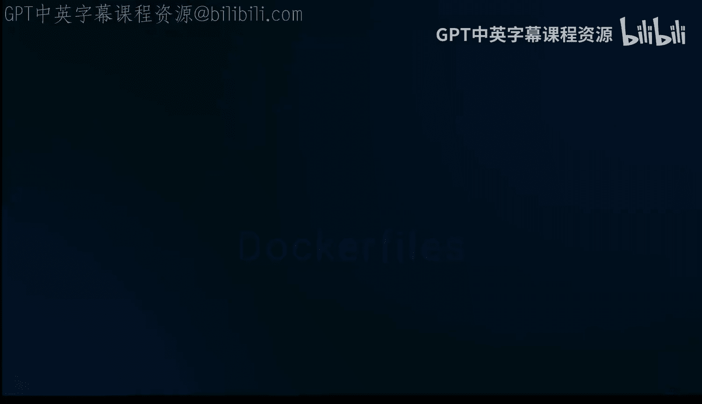
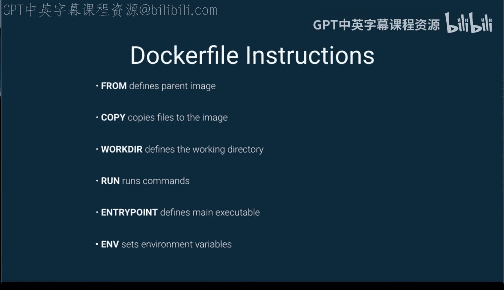

# 杜克大学《应用Python数据工程（3课全）｜Applied Python Data Engineering》中英字幕 p68 13_02_02_Dockerfile文件.zh_en -BV1nz421i7KP_p68-

Let's talk some more about Docker files。As we've already mentioned。

Docker files are named Docker File by convention。And by using the dash F flag of the build command。

Docker files， which are not in the current context。

 or else don't use the file name convention Docker file can be specified。

The Ducker file's main purpose is that they contain instructions used by the build。

Let's look at some of the most commonly used Docker file instructions。

Images generally are based on other images。So the from instruction specifies the parent image to be used in the build。

Generally， this is the first instruction you'll see in a Docker file。

The copy instruction is used to copy files from the context into the image。

So if you have code that needs to run the image or other objects that need to be in there for the image to function properly。

The copy command is how you get them in。The work directory defines the working directory for other instructions run。

 and is generally a preferred mechanism for doing this over running a change directory command。

The road instruction runs commands。The entry point instruction defines the main executable。

 That is the executable that will determine the lifetime of any。Container。Run based on this image。

And， Lely。The M of instruction is used to set environment variables that will be available within the container once this image is run。

