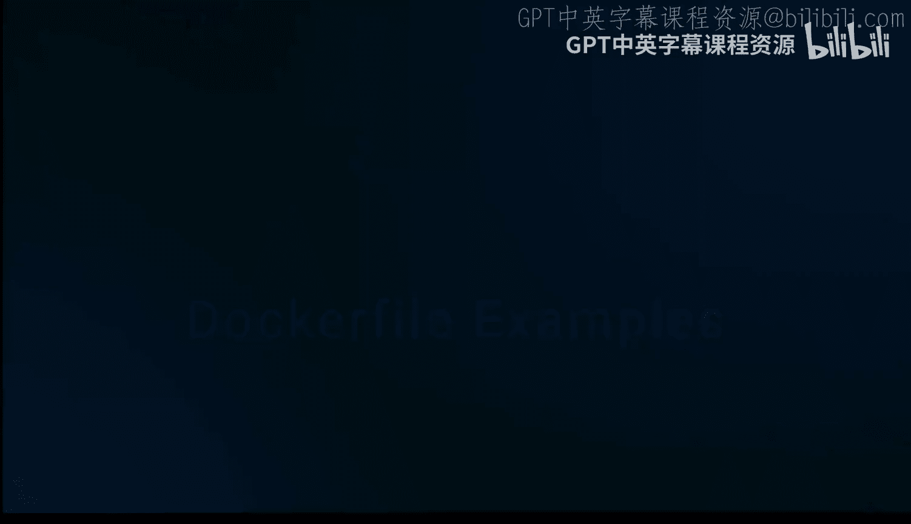
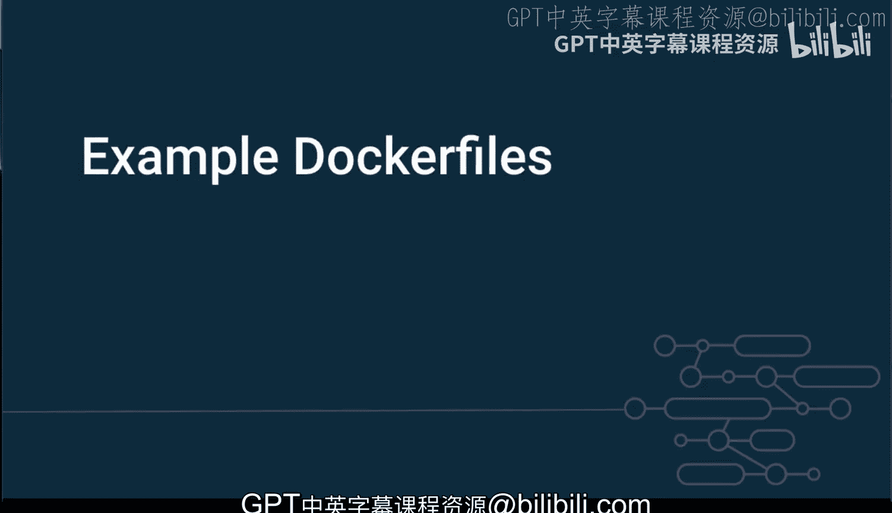
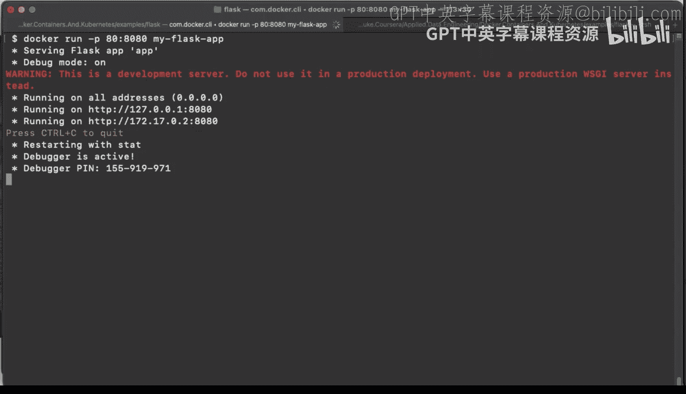
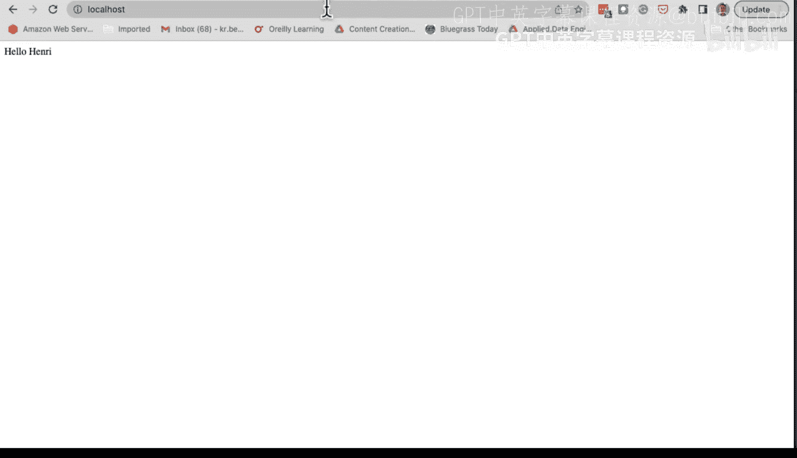
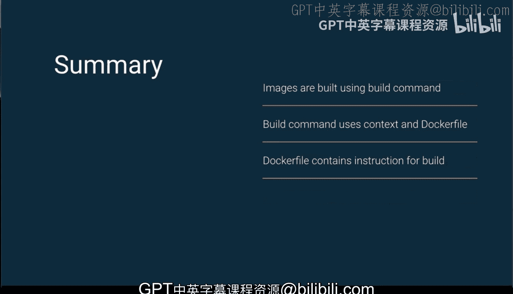

# 杜克大学《应用Python数据工程（3课全）｜Applied Python Data Engineering》中英字幕 p69 14_02_04_Dockerfile示例.zh_en -BV1nz421i7KP_p69-

Now， let's look at two example Dogger files。

So， let's look。Get a very simple。Docker fileile example。

So this Docker file has only two instructions。First， it has a from instruction that specifies。

The parent image and tag for the parent image。Then it has an entry point。

Which specifies the main executable， which in this case。Is the。Command line command， E。

So let's build and run this image。So we can see that there's an image named Ho now。

And if we run the image。It runs the executable， which is the Echo command， which echoes Hello Doctor。

And once that's over？The container stops。Let's look at a slightly more complicated example。

In this directory， I have a Docker file。And a Python file。Take a look at our Python file。

You can see it's a very simple flask app。Which sets up an endpoint。

 which just returns the string hello with a name that's taken from the environment。

And insert it in the string。We have our app running。Listed on port 880。If we look at our Docker file。

 hit once again。Itins with a from instruction。Which specifies that we want to base this image on the Python image。

And on the。Tag 3，1，2 slim。We then copy the contents。Of a context。

Into a directory named App on the image。Then we make that directory， the working directory。Next。

 we install。The dependencies。Required for this code。

Then we define an environment variable named name and set its value to Henri。And lastly。

 we have our entry point。Which in this case is calling Python。

With the argument being the Python file that we've copied into the app directory。

So let's go ahead and build this image。And there we can see our image is now in the repository。

So let's run the image。And we'll map the port 80 to the port 880 in the image。

Now if we go to a web browser。

We can see the message returned from our Flask gap that's running in DACA right now。

So， in summary。This lesson。We've learned that images are built generally using the Docker build command。

That the build command uses the context and a Docker file。

The Docker file contains the instructions for the built。

