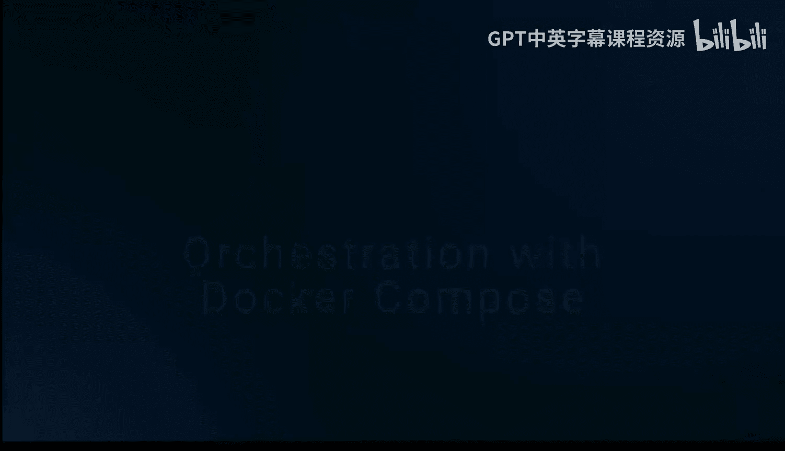
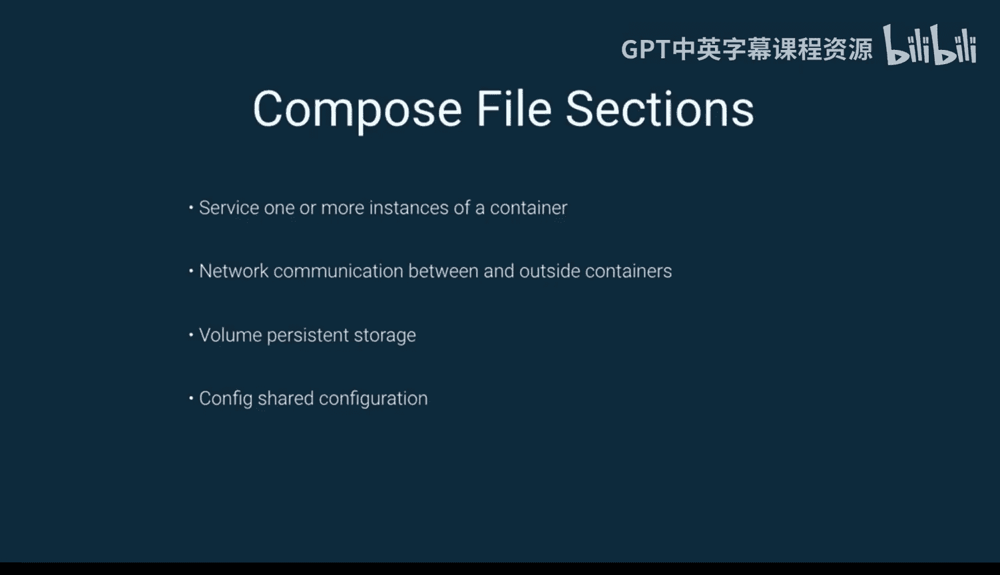
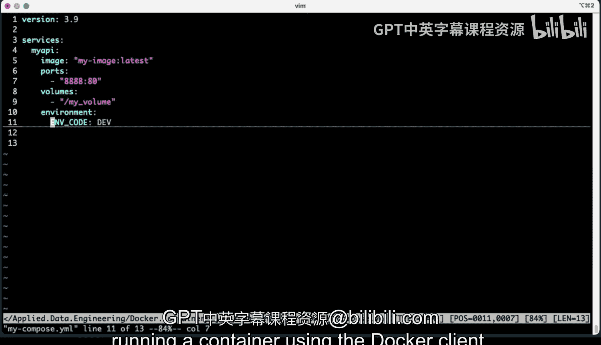

# 杜克大学《应用Python数据工程（3课全）｜Applied Python Data Engineering》中英字幕 p70 15_02_02_使用Docker-Compose编排.zh_en -BV1nz421i7KP_p70-

In this lesson。We look at。Orchestion。Using Docker composeose。

We'll look at these sections of a composed file。Introduce the airflow platform。

And run airflow locally using Docker composeose。Generally， when using docker containers。

Each container should represent a single purpose。In an old server setup。

 we might have a web application and a database on the same server。

But we moved to the Docker ecosystem。The web app and the database should each have its own container。

Each container having a main purpose that defines its execution。For example。

 you might have an application with a web front end。A database in the back end。

 an API and a caching layer。Each would need to be in its own container。

These containers may need to define some kind of networking communication。

And these containers will have dependencies on each other。

The web front end won't function correctly if the API container is not up and running。

And the API container won't function without the database container up and running。

In order to define these multi container applications。And there。Communications and dependencies。

We use what's known as an orchestration tool。Dcker composeose is one such orchestration tool。

It's an alternate Docker client that comes installed with Docker Destop。

Servees as an orchestration tool for creating and managing multi container applications。

And it defines its orchestration in what's known as a compose file， which uses Yaml file formatting。

There are multiple possible sections in the compose file， the main one。Be one for services。

Each service represents one or more instances of a running container。

There can be a section to define network communication between the services or between the services and outside。

It could also define persistent volume storage。In configuration that can be shared by other elements in the compose file。

Let's look at a simple example。In this compose file， we have a single service named My API。

We defined a source image for the service。Aport mapping。A volume to mount。

And we define an environment variable named M code。Notice that these elements were defining。

 similar to the options we had when run into a container using the Docker client。

