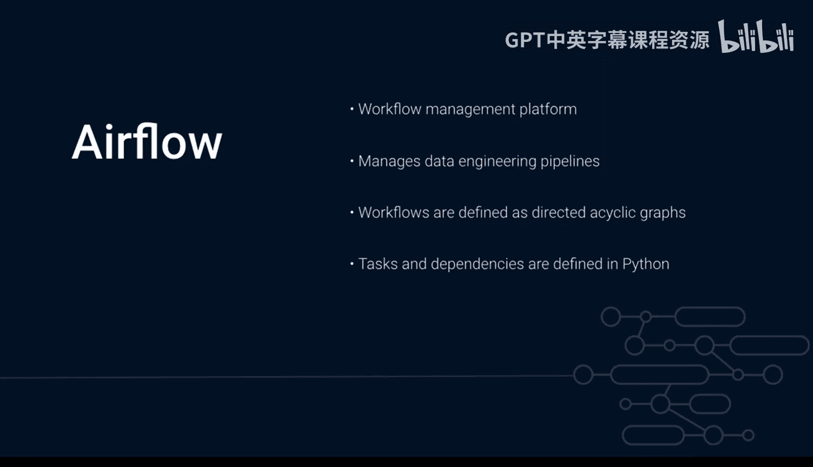
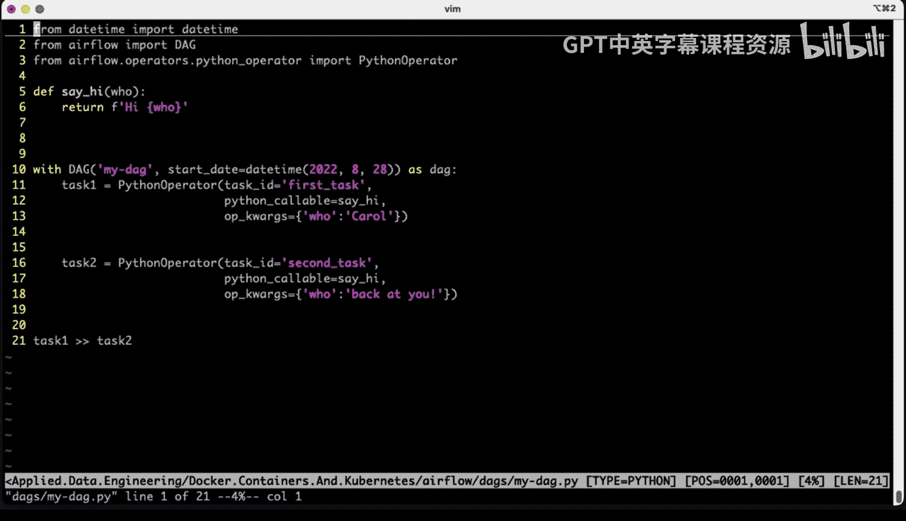
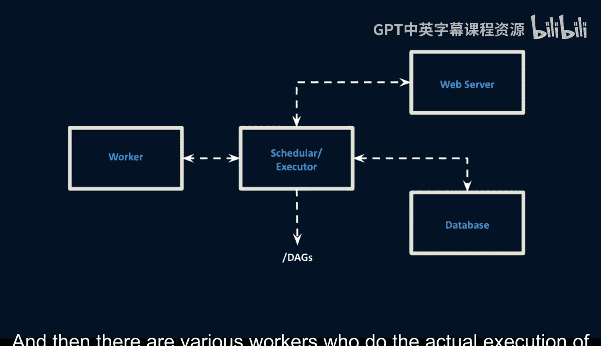
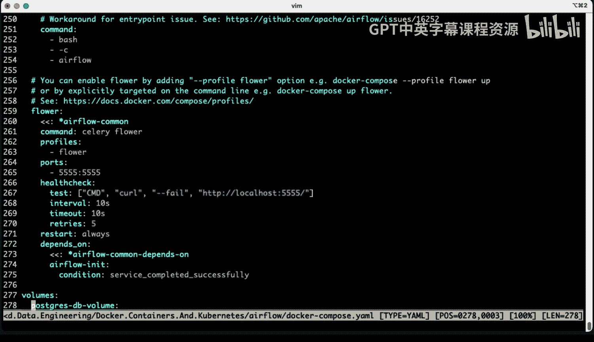

# 杜克大学《应用Python数据工程（3课全）｜Applied Python Data Engineering》中英字幕 p71 16_02_03_Airflow简介.zh_en -BV1nz421i7KP_p71-

Now let's talk about airflow， Airflow is a workflow management platform designed to manage data engineering pipelines referred to as workflows。

These workflows are defined as directed ascyclt graphs。And these graphs。

 as well as the tasks and dependencies that they control， are all defined in Python。

Here's a simple example of a Python file defining an airflow directed acyclic graph known as a DAg。

Here we import the DAg class from airflow。Here we define a simple function。

 which takes an argument and returns a string using that argument。And here we define our dag。

 The Dg has a name and various optional arguments that can be set for the dag Here。

 we're setting the start date。 Now， within the dag's context， we use the Python operator class。

 which is a helper class for defining simple Python tasks。

Here we use it to define a task which calls our method with these arguments。

They're given the task a name here， which will show up in the UI。We would define a second task。

 which calls the same Python function， but with different arguments。We then define task dependencies。

 so you can see here that task 2 will not run until task1 is completed。

Let's take a simplified view of the airflow architecture。

At the center of airflow there is a scheduler/ executionecutor。

 which controls the execution of tasks based on the daAgs defined in the Python files。

There's a web server which has a handy UI for controlling and monitoring tasks and tags。

Is a database which stores metadata about the execution of tags。

And there are various workers that do the actual executed work of tasks。

So the scheduler reads the DAgs from a directory， it'll pick up any Python files in the DAG directory and recognize any daAgs defined in those files so if single file could have a single dag or multiple dags from the scheduler's point of view that doesn't matter。

The scheduler then has the worker execute the DAgs based on the schedules as defined in the DAg files。

It interacts with the database base to save metadata about those executions and reports to the web server。

 so each of these needs to be defined in its own container。In order to run airflow locally。

 you can install airflow in all its components， but Airflow also offers a handy Docker compose version。

 Let's look at the Docker compose file for airflow。

Here we have the compose file that airflow supplies in order to run a version of airflow locally using Docker compose。

This first section defines some configuration that is shared by multiple surface。

So we can see in this configuration we have an image definition。

 we have a section defining environment variables， volumes， and down here。

We have a section that defines some dependencies。The next section defines some of the actual services。

 so here we have the service defining the database server Postgres in this case。

 here is a section defining the caching service， Reis。Down here， you see。

The definition for the airflow web server note that the airflow web server is using the configuration that is defined up above so that the image。

 for example， is coming from the configuration and is not defined directly in this section。

And in addition to the services， we also define a volume here。

For the Postgres database to persist data。

So with this compose file， we can run airflow locally。

