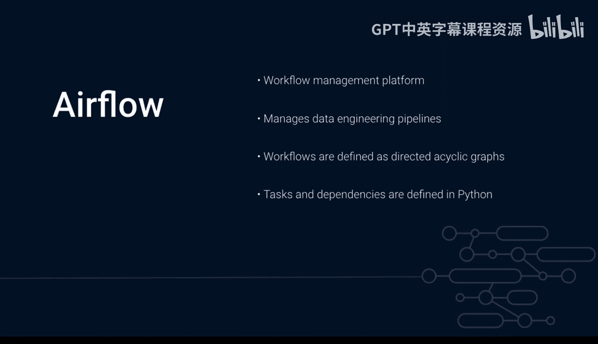
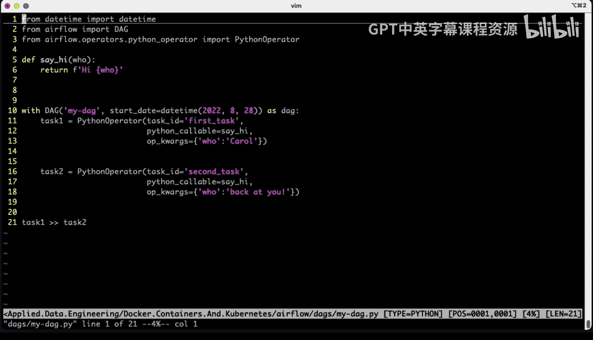
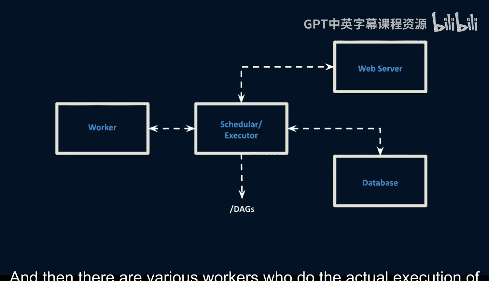
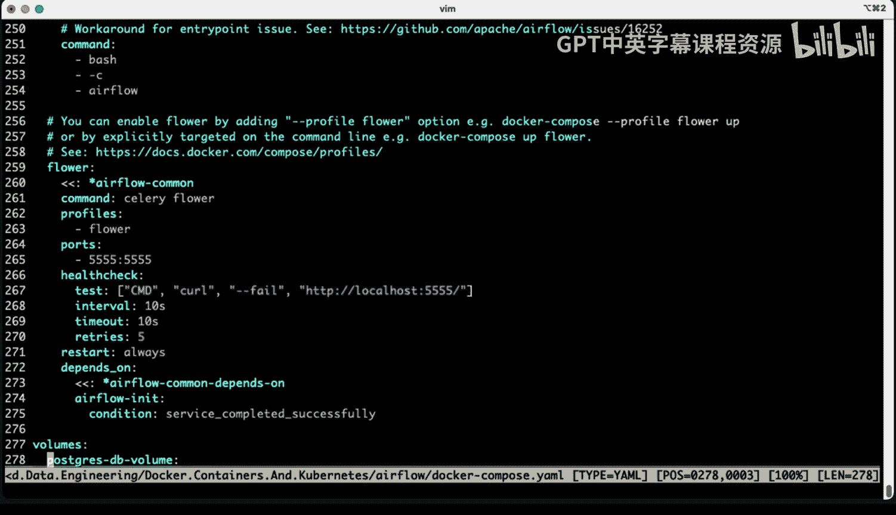

# 应用Python数据工程：3：Airflow简介 🌀

在本节课中，我们将要学习Airflow，一个用于管理和编排数据工程工作流的平台。我们将了解其核心概念、基本架构以及如何通过Docker Compose在本地运行它。

---



## 什么是Airflow？

Airflow是一个工作流管理平台，专门用于管理被称为工作流的数据工程管道。这些工作流被定义为**有向无环图**。这些图，以及它们所控制的任务和依赖关系，全部使用Python代码定义。

---

## 编写一个简单的DAG

上一节我们介绍了Airflow的核心概念，本节中我们来看看如何用Python定义一个DAG。

以下是一个定义Airflow有向无环图（即DAG）的Python文件示例：

```python
from airflow import DAG
from airflow.operators.python_operator import PythonOperator
from datetime import datetime

# 定义一个简单的Python函数
def my_function(my_argument):
    return f"Hello {my_argument}"



# 定义DAG
with DAG(
    'my_dag',  # DAG名称
    start_date=datetime(2023, 1, 1),  # 开始日期
    schedule_interval='@daily'  # 调度间隔
) as dag:

    # 使用PythonOperator定义第一个任务
    task1 = PythonOperator(
        task_id='task_1',
        python_callable=my_function,
        op_args=['World']
    )

    # 使用PythonOperator定义第二个任务
    task2 = PythonOperator(
        task_id='task_2',
        python_callable=my_function,
        op_args=['Airflow']
    )

    # 定义任务依赖：task2 在 task1 完成后执行
    task1 >> task2
```

在这个例子中：
1.  我们从`airflow`模块导入了`DAG`类。
2.  我们定义了一个简单的Python函数`my_function`。
3.  我们创建了一个名为`my_dag`的DAG实例，并设置了开始日期。
4.  在DAG的上下文中，我们使用`PythonOperator`类定义了两个任务（`task1`和`task2`），它们都调用`my_function`但传入不同的参数。
5.  最后，我们使用`>>`运算符定义了任务间的依赖关系，确保`task2`在`task1`完成后才运行。

---

## Airflow架构概览

了解了如何定义DAG后，我们来看看支撑Airflow运行的简化架构。

Airflow的核心架构包含以下几个关键组件：


以下是各组件的主要功能：
*   **调度器/执行器**：这是Airflow的核心。它读取DAG定义，并根据DAG文件中设定的调度计划，控制任务的执行顺序。
*   **Web服务器**：它提供了一个方便的Web用户界面，用于控制、监控任务和DAG的运行状态。
*   **数据库**：用于存储所有DAG、任务执行记录等元数据。
*   **工作节点**：负责实际执行任务代码的进程或机器。

工作流程如下：调度器从指定目录读取DAG文件（一个文件可以包含一个或多个DAG），然后根据依赖关系和调度计划，指挥工作节点执行任务。整个过程的状态信息会存入数据库，并报告给Web服务器以供查看。

---



## 使用Docker Compose运行Airflow

为了在本地运行包含所有组件的Airflow，Airflow官方提供了一个便捷的Docker Compose文件。

让我们查看一下这个用于在本地运行Airflow的Docker Compose文件：


文件主要包含以下部分：
1.  **共享配置**：文件开头定义了被多个服务共享的配置，例如基础镜像、环境变量和挂载卷。
2.  **服务定义**：
    *   `postgres`：用于元数据存储的PostgreSQL数据库服务。
    *   `redis`：用作消息队列的缓存服务。
    *   `airflow-webserver`：Airflow的Web服务器，它使用上方定义的共享配置。
    *   `airflow-scheduler`：Airflow调度器。
    *   `airflow-worker`：执行任务的工作节点。
3.  **数据持久化**：文件末尾定义了一个卷（`postgres-db-volume`），用于确保PostgreSQL数据库的数据在容器重启后不会丢失。



使用这个Compose文件，我们可以通过一条命令在本地启动完整的Airflow环境。

---

## 总结


本节课中我们一起学习了Airflow的基础知识。我们了解到Airflow是一个用Python定义工作流（DAG）的平台，其架构包含调度器、Web UI、数据库和工作节点等核心组件。最后，我们看到了如何利用官方提供的Docker Compose配置，快速在本地搭建一个可运行的Airflow环境，为后续实际构建和管理数据管道奠定了基础。