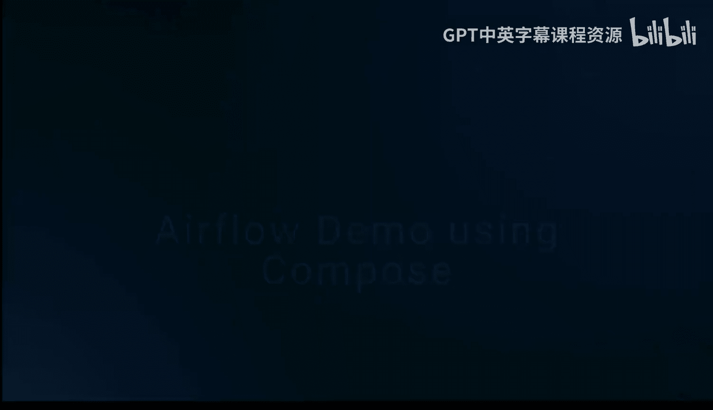
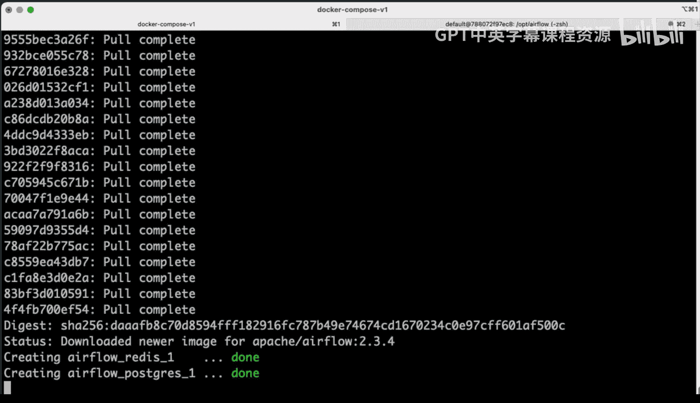
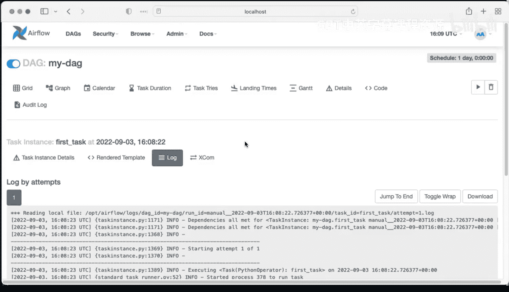
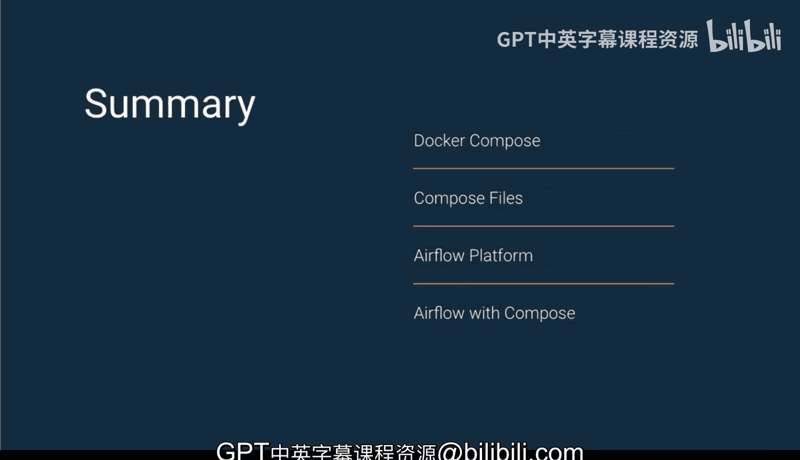

# 杜克大学《应用Python数据工程（3课全）｜Applied Python Data Engineering》中英字幕 p72 17_02_05_使用Compose演示Airflow.zh_en -BV1nz421i7KP_p72-

Now， let's use Docker composeose to run airflow locally。

We can see we have our Docker compose files supplied by airflow。

As well as some subdirecties I've created that are required for airflow to run。

One is a DAGs directory which will hold our Python definition of our DAgGs。

Another is a logs directory， the third a plugins directory。The first step。And setting up air flow。

Is to initialize the database。This is done。With a special command that is defined in the Docker composeose file。

Called airflow in it。Now， the command we're using to run Docker composeose is Docker D composeose。

So we do docker compose up airflow in it。To initialize the database。

Notice we're pulling the Postgres image first。And next， plain the Redis image。

 which is the caching layer。And finally， pulling the airflow image。

We create all our containers。And now， airflow is ready to run。So our next step。

Is to use Docker composeose。To run airflow。We can do this by just typing Docker composeose up。Now。

 airflow is up and running。It get open up a web browser and take a look at the Web UI。

Here's the airflow you eye。By default， airflow is installed with a user named Airflow。

 whose password is airflow。Here we can see the various example dags that are installed with airflow。

But then we can also look for our simple dag example that we created before。

So here's our simple example。We can trigger the dag， manually。And then， see the results。

Of the two tasks。We could also view the directed acyclic graph。

You can see the task dependency represented by an arrow。And we can look at an individual task。

So we look at our first task。We can look at its logs。

And if we scroll down。We can see here。The output。From our method。So in this lesson。

We've talked about Docker Compose as an orchestration tool。

We've looked at some of the elements of a Docker compose file。We've introduced the air flow。

Workflow management platform。And used Docker composeose to run airflow locally on our machine。

