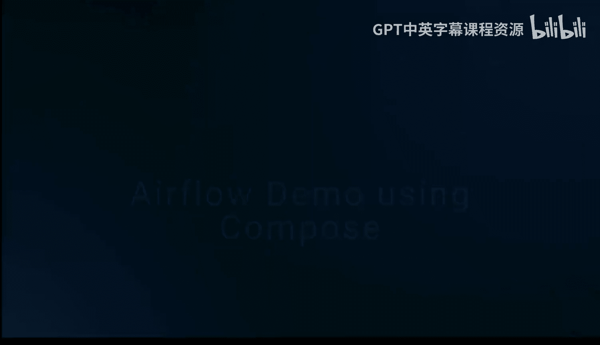
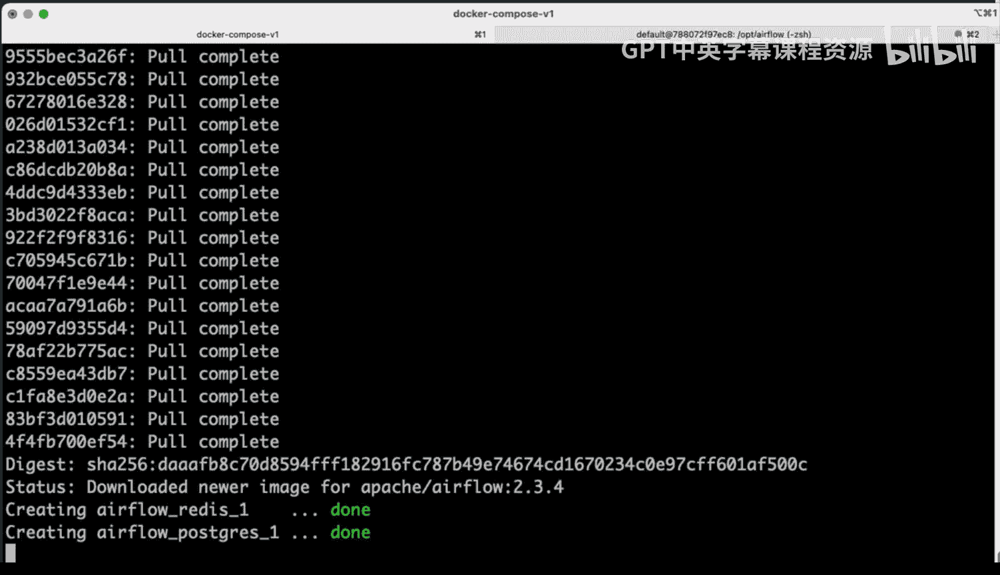
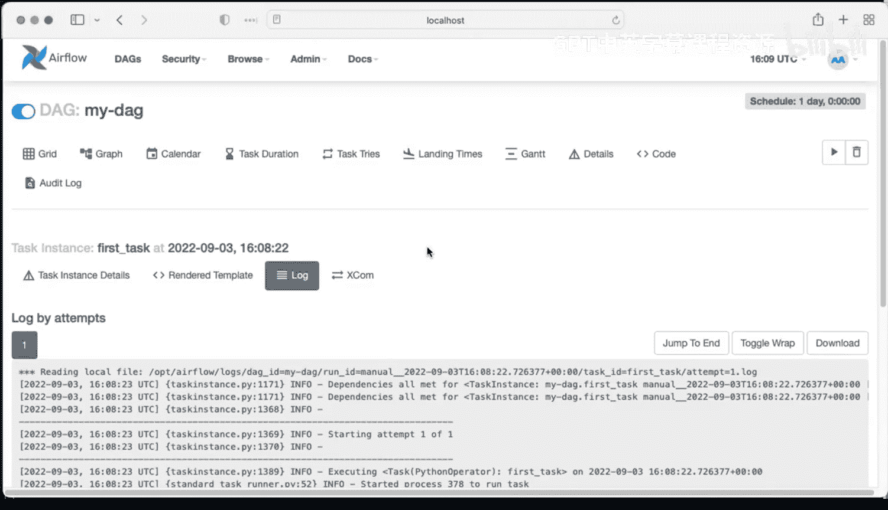
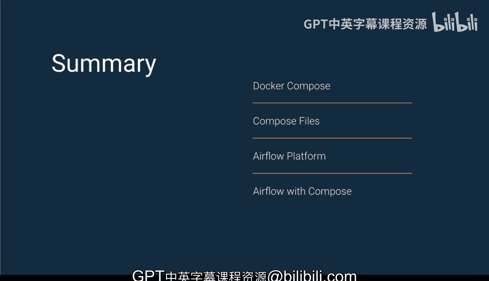

# 应用Python数据工程：3：使用Docker Compose运行Airflow 🚀



在本节课中，我们将学习如何使用Docker Compose在本地运行Airflow工作流管理平台。我们将从初始化数据库开始，逐步启动所有服务，并最终通过Web界面验证我们的DAG（有向无环图）是否成功运行。

---

现在，让我们使用Docker Compose在本地运行Airflow。

我们可以看到，项目中包含了由Airflow官方提供的Docker Compose文件。此外，我还创建了一些Airflow运行所必需的子目录。

以下是运行Airflow所需的三个关键目录：
*   **DAGs目录**：用于存放定义我们工作流的Python DAG文件。
*   **logs目录**：用于存储Airflow运行过程中产生的日志。
*   **plugins目录**：用于存放自定义的Airflow插件。

---

## 初始化数据库

设置Airflow的第一步是初始化其数据库。这可以通过Docker Compose文件中定义的一个特殊命令来完成，该命令名为 `airflow-init`。



我们使用 `docker compose` 命令来运行Docker Compose。因此，初始化数据库的命令是：
```bash
docker compose up airflow-init
```
执行此命令后，系统会首先拉取PostgreSQL镜像作为数据库，接着拉取Redis镜像作为缓存层，最后拉取Airflow镜像本身。

所有容器创建完成后，Airflow的数据库就已准备就绪，可以运行了。

---

## 启动Airflow服务

上一节我们完成了数据库的初始化，本节中我们来看看如何启动完整的Airflow服务。

接下来，我们使用Docker Compose来启动Airflow。只需在终端中输入以下命令：
```bash
docker compose up
```
现在，Airflow服务已经启动并运行。我们可以打开一个网页浏览器，访问Airflow的Web用户界面进行查看。

这就是Airflow的Web UI。默认安装的Airflow有一个用户名为 `airflow`，密码同样为 `airflow`。在这里，我们可以看到Airflow自带的多个示例DAG。

我们也可以找到之前创建的简单示例DAG。这就是我们的 `simple_example` DAG。我们可以手动触发这个DAG，然后查看两个任务运行的结果。



我们还可以查看有向无环图（DAG）的可视化表示，其中任务间的依赖关系由箭头表示。此外，我们可以查看单个任务的详情。

例如，查看我们的第一个任务。我们可以查看它的运行日志。向下滚动，就能看到我们任务方法打印的输出信息。

---

## 课程总结



本节课中，我们一起学习了以下内容：
*   介绍了Docker Compose作为一个容器编排工具。
*   浏览了Docker Compose文件的一些基本元素。
*   引入了Airflow这一工作流管理平台。
*   实践了如何使用Docker Compose在我们自己的机器上本地运行Airflow。