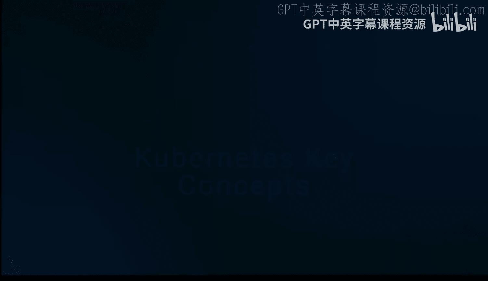
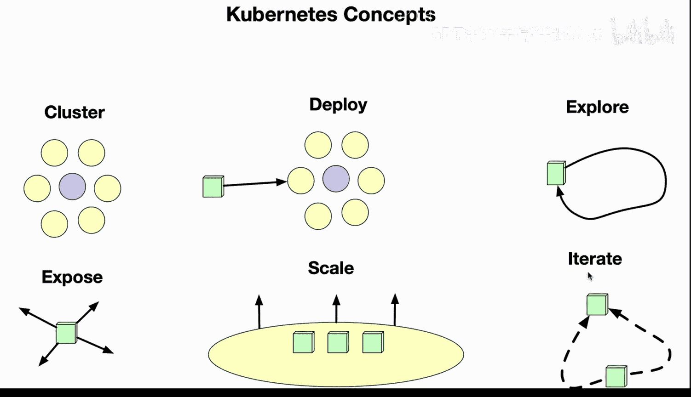
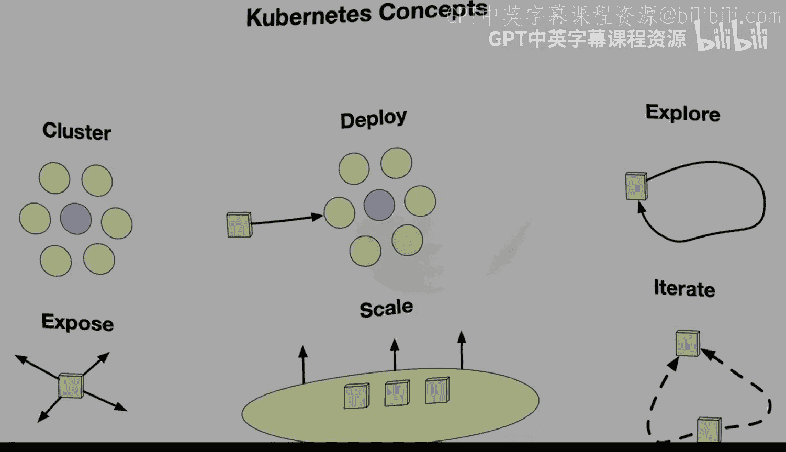

# 杜克大学《应用Python数据工程（3课全）｜Applied Python Data Engineering》中英字幕 p73 18_03_02_Kubernetes核心概念.zh_en -BV1nz421i7KP_p73-

Kubernetes concepts， there are a few that are important to discuss。 First， there is a cluster。

 So the idea with a cluster is a collection of nodes that are controlled by an API。

 and this cluster can be on your virtual machine。 It could also be in a cloud based environment or in your own data center。

 and it has this scalability component to it。In terms of deployment。

 you would take a containerized application and you would move it into a cluster and then start that deployment。

 this is a very common practice， you could start with let's say a public container registry like DockerHub and then move that into your deployment system。

A third option is exploring。 So once you've got this thing done。And it's deployed。

 you can explore and iterate on your application。Finally， with exposing。

 the idea here is that you would expose your application to the outside world so that other people could use it。

 it would be serving out via a public port。And then the next step is scaling so with scaling。

 you're able to respond to certain events like CPU or memory and then make more resources available for the application that you've deployed Finally one of the use cases that comes up quite a bit is to make a new version of your application but potentially do a rolling update and so you would iterate through multiple versions of your containerized application。

 So these are really the most common scenarios with Kubernetes。

And let's go in and dig into a few more of those scenarios in the following courses。

