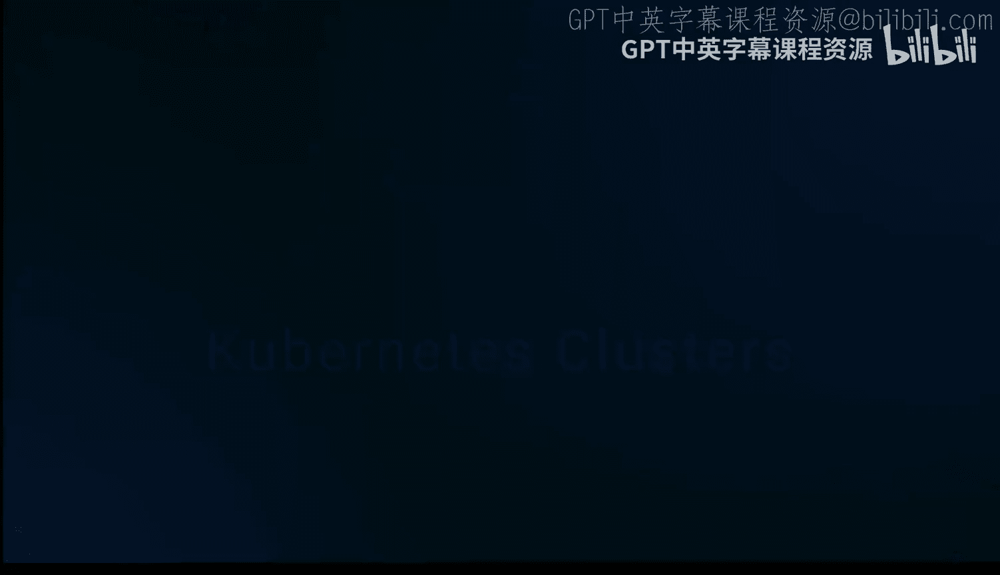
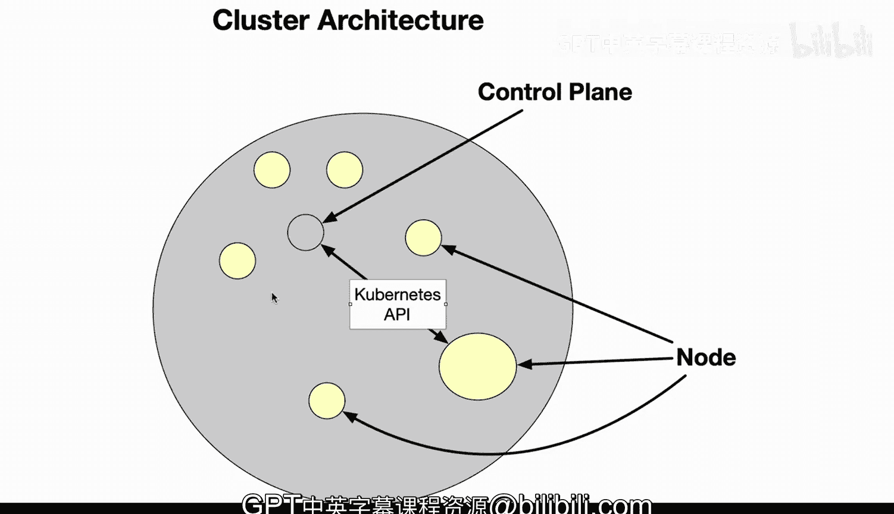

# 杜克大学《应用Python数据工程（3课全）｜Applied Python Data Engineering》中英字幕 p74 19_03_03_Kubernetes集群.zh_en -BV1nz421i7KP_p74-

Kubernetes， cluster architecture。A Kubernetes cluster contains a couple different types of resources。

 First， theres the control plane that coordinates the entire cluster。

 And this is the purple dot right here。And the nodes are the workers that run inside。

 so you've got several workers inside and they're communicating via this Kubernetes API。

You can see here that the nodes are all basically inside of this control plane controlled in a cluster diagram and they're processing different types of work depending on what kind of Kubernetes architecture that you're building a node can also run on a physical computer。

 it could run on a virtual machine it could run in a cluster。

 so it's important to know that this cluster is a conceptual cluster。

 but the physical nodes could be living in multiple different types of locations。

