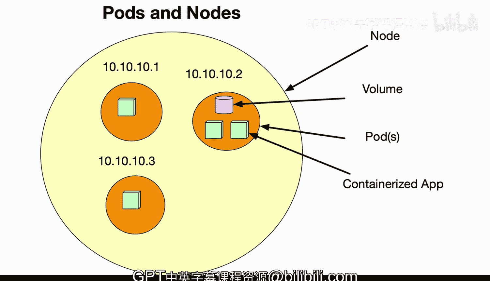

# 杜克大学《应用Python数据工程（3课全）｜Applied Python Data Engineering》中英字幕 p75 20_03_04_Kubernetes节点.zh_en -BV1nz421i7KP_p75-

Kubernetes pods and nodes are important concepts。 You can see in this diagram that the node can contain multiple pods。

 and we know that nodes can run on a virtual machine。

 they can run in a data center that can run in a cloud but inside of this node you could have many different pods which in turn could have many different containerized applications。

 volumes IP addresses and it's typical to have multiple pods inside of one node a few things to consider here is that a pod is an applicationspec logical host and it can contain different application containers that are very tightly coupled。

 for example， a frontend and a backend could be included in this particular configuration a few other things to consider is that a pod will always run on a node and that node worker machine in Kubernetes。

Can either be a physical machine or it could be a virtual machine depending on what kind of cluster you've configured。

