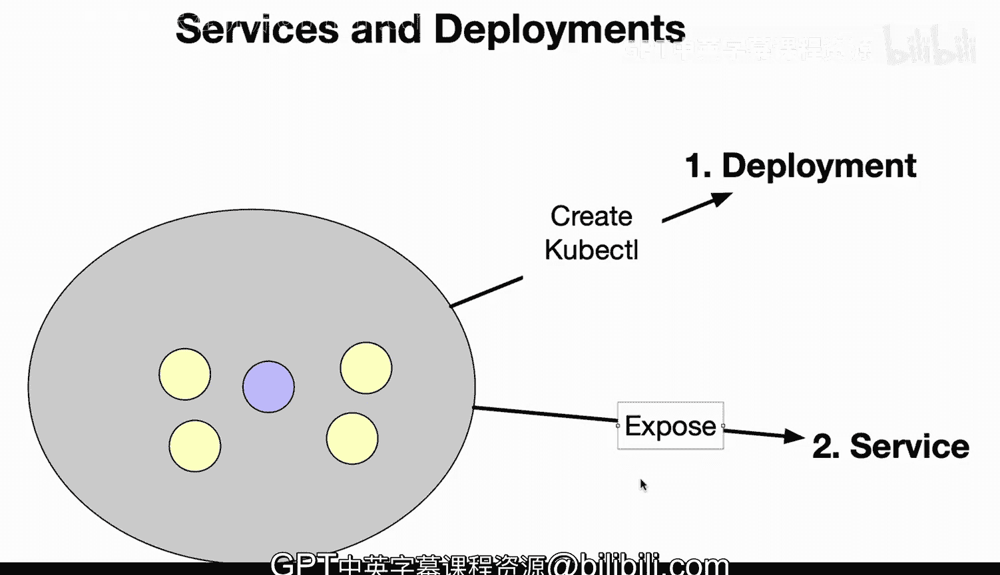

# 杜克大学《应用Python数据工程（3课全）｜Applied Python Data Engineering》中英字幕 p76 21_03_05_Kubernetes服务部署.zh_en -BV1nz421i7KP_p76-

An important concept in Kubernetes is a service and a deployment。

When you want to deploy something initially， a good way to start is to do a deployment。

 so you would go ahead and create a deployment and manage that by using the Kubernetes Kaallan interface。

 and this would be done via Cube CTL so we can go ahead and put that in here， type in Cube CTL。

And what's nice about KubB CTL is that it will allow us to control and interact with the Kubernetes control plane here。

And once you've been able to do that， and this deployment is specified。

Then the next thing to do would be to refer to a service itself。

 and then once that service has been set up， you can expose your application to the outside world so you could open up a port for example。

 and once that port has been exposed， you would be able to then talk to it via accal command or run some kind of functional test or end to end test against it。

 so really the step one is a deployment when you're setting up your Kubernetes application and then step two would be to set up a service and expose that application to the outside world。

