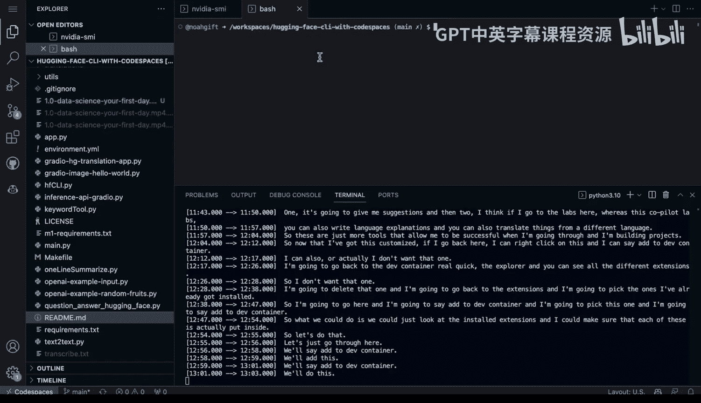

# 杜克大学《应用Python数据工程（3课全）｜Applied Python Data Engineering》中英字幕 p81 26_03_04_使用OpenAI-CodeWhisper.zh_en -BV1nz421i7KP_p81-

Here we have an NVIDdia monitoring tool that allows me to see the full saturation of the NviIDdia GPU here。

 you can see here the couda driver is 11。7， it's using 43% of the GPU and in the other terminal I'm running Whi which is able to take advantage of the GPUs that are on codespace and I'm also able to trascribe very large files as well。

 with the storage that's available with codespace so for the data science and machine learning students that are using the GPU based instances。

 it really is a great environment to actually do GPU based work。

We can also toggle over here and take a look at each top and we can see in fact that I'm able to saturate not only the GPU。

 but I'm able to use these six core machines and take advantage of some of that very large memory footprint that is available on these heavy GPU machines。

 you can see there's 110 gigabs available。 So what it means is I could actually put a few more transcuing jobs use open A eyes whisper here。

 monitor my resources then later what I wanted to do。

 let's say text summarization or some other hugging face pretrain model on top of the transcriptnscribe data。

 it would be good to go。

