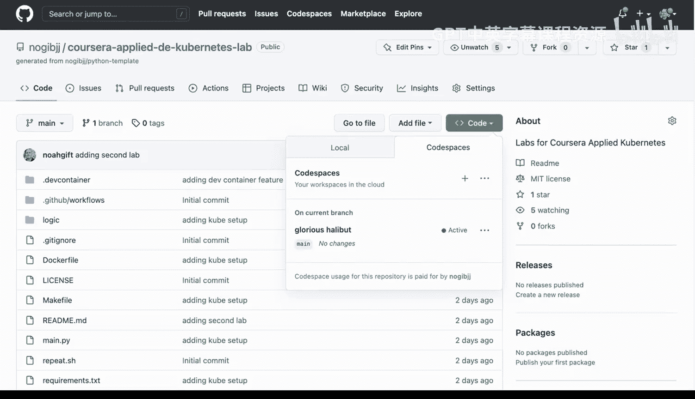
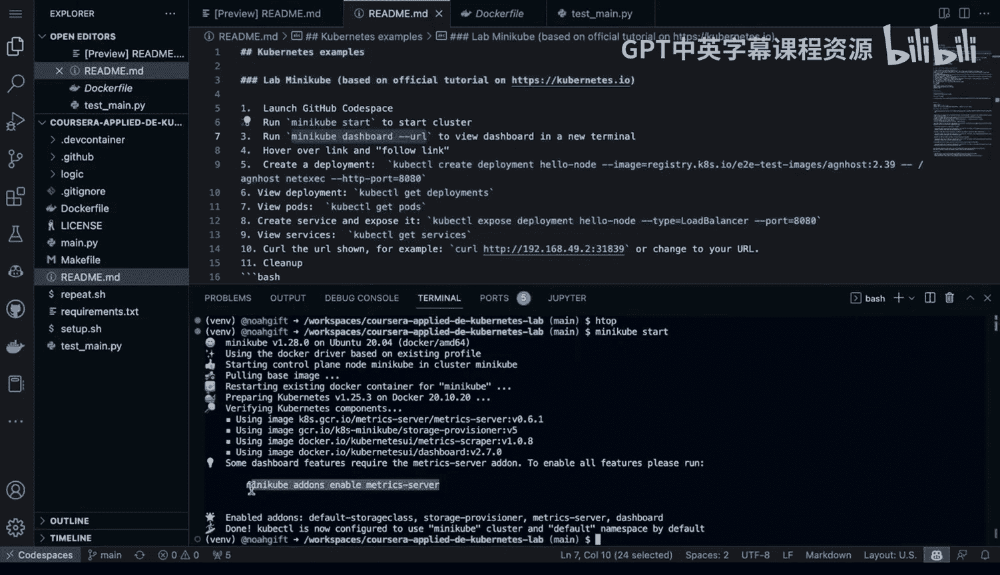
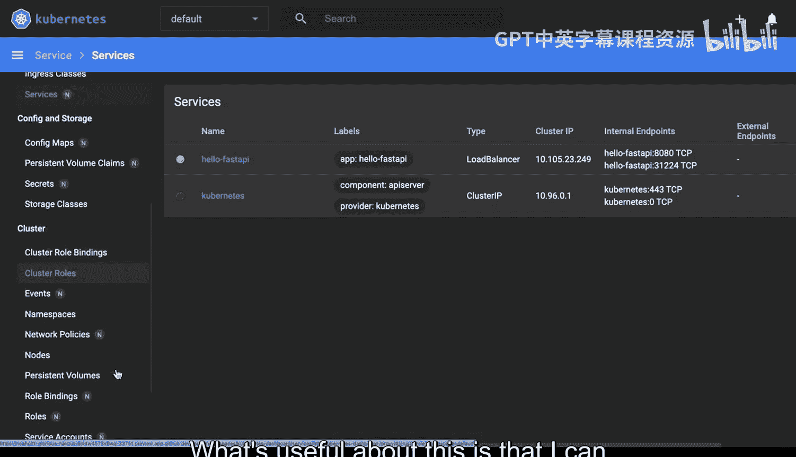
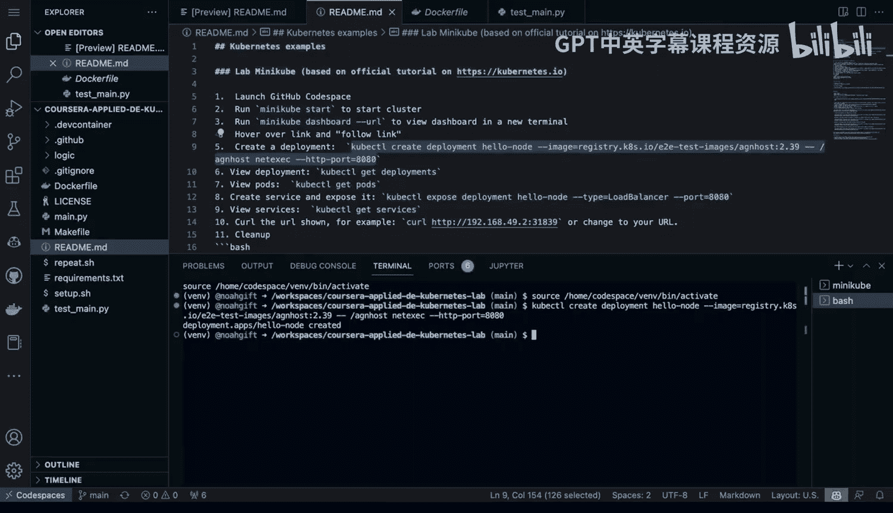
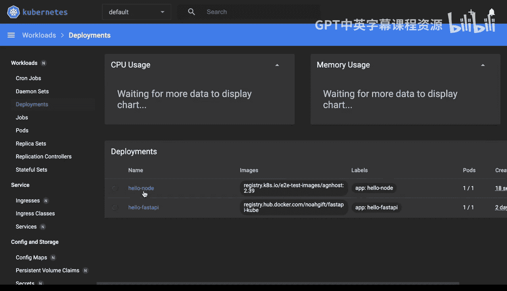
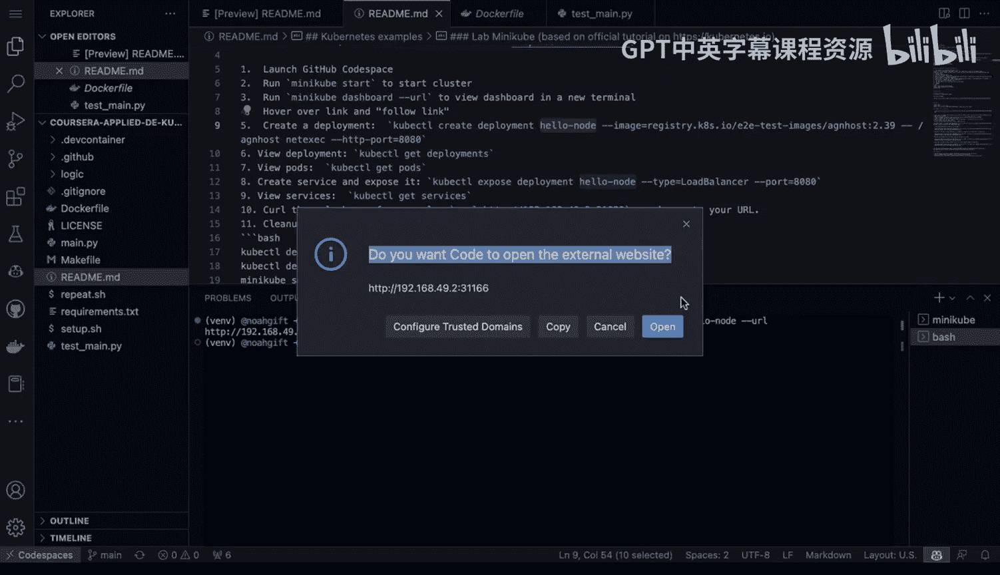
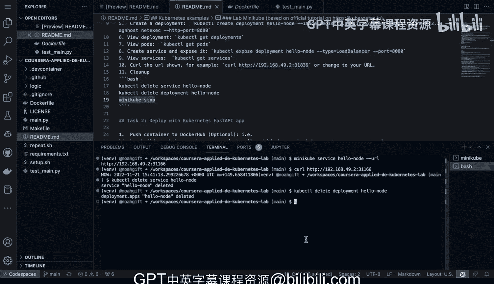

# 杜克大学《应用Python数据工程（3课全）｜Applied Python Data Engineering》中英字幕 p85 30_03_02_在GitHub-Codespaces中运行Minikube.zh_en -BV1nz421i7KP_p85-

If we take a look at the official documentation for Kubernetes。

 you can see there is a section called Hlo Min Cube。

 and it has a tutorial that walks you through how to set it up in an environment。

 One of the better environments to explore Kubernetes and containers is GiHub codespaces。

 So I have a repo here， Nogi B JJ， Corra applied D E Kubernetes lab。

And if we select this code icon here， you can see that if I wanted to。

 I could create a new codespace， but since I've already got one enabled right here。

 I can actually go ahead and switch over to that codespace。

 And this allows me to run both Kubernetes via mini cubeubbe and also compile Docker containers。

 So let's go ahead and take a look at how this would work。 So if I go over to this environment here。

 you can see there's a series of steps and the first thing I'm going to do is I'm going to either push a container in the case of my own deployment or I'm going to use a pre-existing container Since I'm going to go through the official tutorial here。

 I'm going to go ahead and select minicuubbe start and this will start the mini cube system locally in this environment and again what's so great about Github codespaces is I don't have to worry about。

😊。

Creating runaway processes on my machine。 It's in a hosted cloud based environment。

 and it's actually mapped directly into the the repo that I'm working on。

 So it's a very good one to one relationship。 and actually， while this is launching and running。

Another thing I could do is I could create a new terminal and I could also monitor what's happening by running Htop and this is always a good way to see what's happening on your machine and you can see in fact。

 that it's prepared in Kubernetes and if I run this， we can see there we go。

 look at all those resources that are actually being run。 Now this is a very powerful machine。

 it's a 16 core machine here and it has lots of RA but in this particular scenario we've been able to get this thing started。

😊，Now that mini cube has started， we can also enable the metric server here。 So if I type in。

This commander just paste it in here。 we can also start this metric server。

So the next step would be to go ahead and create a dashboard URL so we can take a look at what's happening。

All right， now that we've got this dashboard here， what we can do is also open this up inside of GitHub and if I follow this link。

You'll see that it's able to show us a very comprehensive dashboard here。' that's pretty neat。

 that shows us what's going on in terms of our Kubernetes cluster that's running locally here。

 So we have workload status。 We can see there's a deployment， a pods， a replica set。😊。

from here we could just go through and play around with the different things that are running。

 you can see that there's a pod right here called Hello fastty API， something I had set up earlier。

 and we can also look at different services as well。

 and what's useful about this is that I can basically control my entire system by looking at this dashboard。

Now what else can we do here， Well， the other thing to do would be to go ahead and create a deployment for our service。

So let's go ahead and do that， so I'm going to create a new deployment here。

And this is using a default container that lives in this registry called registry。kaais。

o and if we go ahead and paste this in。There we go。 The deployment is created。 Now。

 I could look at the deployment one of two ways I could actually go through here and look at the dashboard if I wanted to。

By looking at the deployment。And we should be able to find it there。And there we go。

 we see its hello node right there， or I also could do it from the terminal。

 So if we go through here。

And we run this。 We can see that。Cube C T L get deployments。

 You can see I have two deployments that are running。

 I also can go ahead and do the same thing from the terminal as well。 say get pods。

 and we see the pods that are running。And then if I want to expose the service so I basically use it。

 I can also go through here。And piece this in。Now that the service is exposed。

 I can also view it from this cube CTL terminal right here。And there you see where it is。

 And then I can also go ahead and look at what is the actual service that I would actually want to connect to and so。

In this particular location here， one of the things that we can do is grab in exactly this IP address here and go ahead and pull it up。

 Now there is another command that we can do' that's kind of a nice little command to do and it's basically this mini cubebe service URL And so I'm going to go ahead and type this in here so I'm going to go ahead and say。

Mini mini cube service。And we're going to call it。The service name that we created earlier。

And this will show me the URL that if I wanted to preview it， I could communicate with， so again。

 because I'm in GitHub here， I could just hover and wait till the follow link shows up。

 go ahead and select that and it says， do you want to open to an external website let's go ahead and do that。

And we'll be able to see our running service。 Finally， another thing we can do。

Is we can also just curl this。And get access to the service。There we go。

 We see that the service is active and it returns back a timestamp。Now， to clean things up here。

What we could do is is run these commands to get everything stopped so we can say。Hello。

 cube CT T L delete service。Let's go ahead and run that。Let's go ahead and stop the deployment。

Let's go and run that。And then if we wanted to， we could also stop mini cube as well。

