# 应用Python数据工程：3：使用Minikube部署服务 🚀

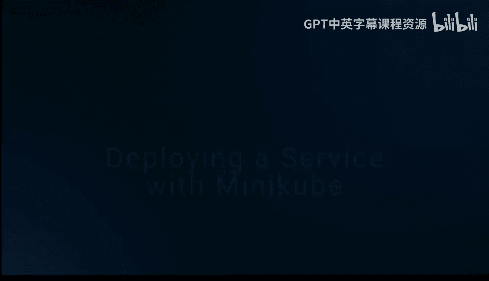

在本节课中，我们将学习如何将一个使用FastAPI编写的微服务容器化，并使用Minikube在本地Kubernetes环境中进行部署和管理。我们将从代码结构开始，逐步完成本地运行、容器构建、推送到镜像仓库，最终在Minikube集群中部署和访问服务的全过程。

## 项目结构概述 📁

首先，我们来看一下这个微服务项目的代码结构。项目托管在一个GitHub仓库中，核心是一个FastAPI应用。

以下是项目的主要组成部分：

*   **`main.py`**：这是微服务的主文件，包含了应用的主要逻辑和API路由定义。
*   **`logic/` 目录**：这个目录下存放着具体的业务逻辑函数。例如，有一个函数可以随机返回不同的水果名称。你可以在这里构建任意数量的功能模块，然后在主文件中通过路由调用它们。
*   **`Dockerfile`**：这是容器化应用的关键文件。它定义了如何将我们的Python应用及其依赖打包成一个Docker镜像。
*   **API文档**：由于使用了FastAPI框架，应用自动生成了交互式API文档，可以通过访问 `/docs` 端点来查看和测试所有API接口，无需额外构建前端界面。

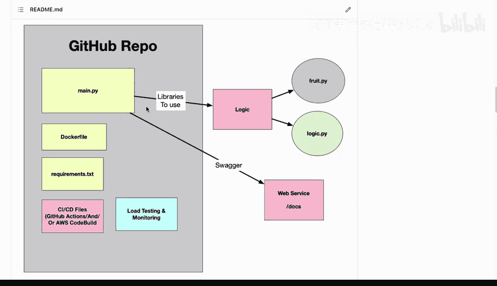

这个结构为我们提供了灵活性：我们可以将容器镜像推送到镜像仓库（如Docker Hub），也可以在本地或云端的Kubernetes环境中运行它。

## 本地运行与测试 🔧

上一节我们介绍了项目结构，本节中我们来看看如何本地运行这个FastAPI应用。

在GitHub Codespaces环境中，我们可以直接运行主程序。执行命令 `python main.py` 后，应用将在本地启动。

```bash
python main.py
```

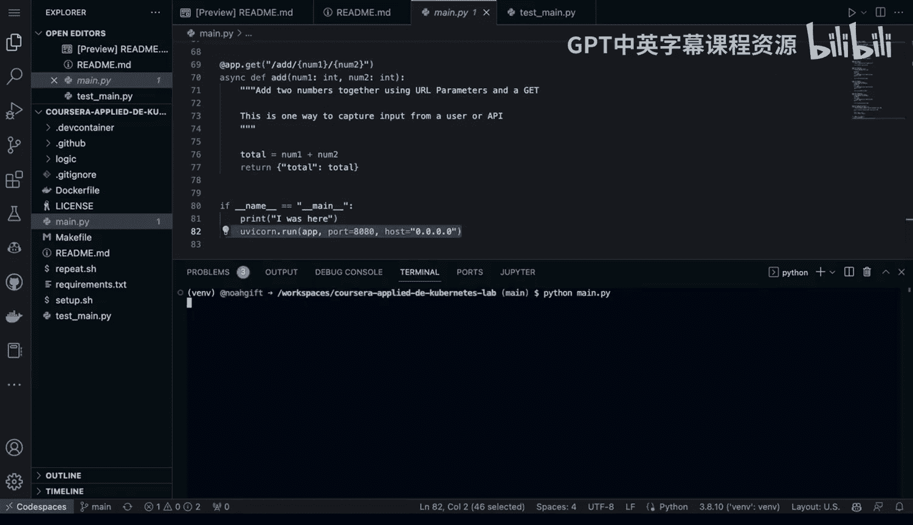

服务启动后，默认运行在 `8080` 端口。通过浏览器访问，可以看到基础的“Hello World”响应。更重要的是，访问 `/docs` 路径可以打开Swagger UI界面，这是一个强大的工具，允许我们直接查看和测试所有已定义的API端点。

例如，我们可以测试“获取随机水果”的端点，它会返回如“orange”这样的结果。我们也可以测试“搜索维基百科”的端点，通过提交一个包含搜索词（如“Obama”）的请求体，API会返回相关的搜索结果。


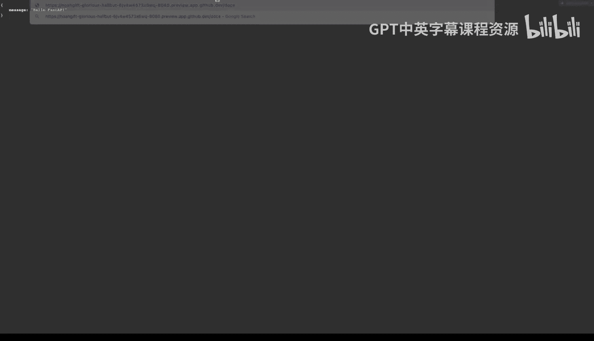

## 容器化与推送至Docker Hub 🐳

现在，我们已经验证了应用可以在本地正常运行。接下来，我们将利用项目中的 `Dockerfile` 将其容器化。

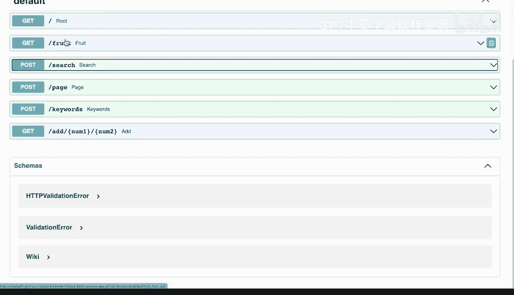

容器化的好处是能将应用及其运行环境打包成一个标准、可移植的镜像。我们可以使用Docker命令在本地构建这个镜像。

```bash
docker build -t your-username/fastapi-app:latest .
```

构建完成后，我们可以将这个镜像推送到公共或私有的容器镜像仓库，例如Docker Hub。这样做意味着在任何支持Docker的环境中，我们都可以通过一条简单的命令拉取并运行这个完全一致的应用环境，而无需关心宿主机上是否安装了Python或相关依赖包。

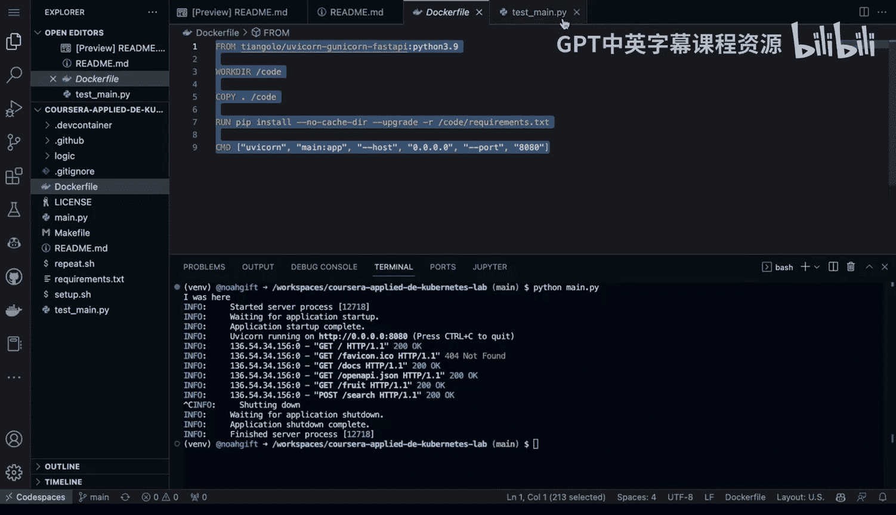

```bash
docker push your-username/fastapi-app:latest
```

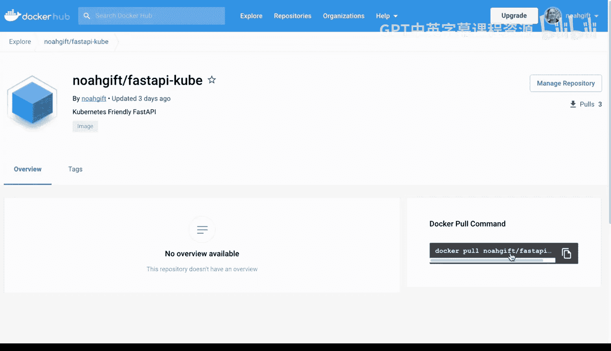

## 使用Minikube在Kubernetes中部署 🚢

虽然将容器推送到仓库已经很方便，但我们的目标是利用Kubernetes来编排和管理容器化应用。Minikube是一个工具，它能在本地轻松创建一个单节点的Kubernetes集群，非常适合学习和测试。

以下是使用Minikube部署我们服务的步骤：

1.  **启动Minikube集群**：首先，我们需要启动一个本地Kubernetes环境。
    ```bash
    minikube start
    ```

2.  **（可选）启用指标服务器**：为了获取集群资源使用的额外指标，可以启用metrics-server插件。
    ```bash
    minikube addons enable metrics-server
    ```

3.  **创建Deployment**：Deployment是Kubernetes中定义应用部署和更新策略的资源对象。我们使用 `kubectl` 命令创建一个Deployment，并指定从Docker Hub拉取我们之前推送的镜像。
    ```bash
    kubectl create deployment hello-fastapi --image=your-username/fastapi-app:latest
    ```
    执行后，可以使用 `kubectl get deployments` 命令查看Deployment的状态，确认其已成功创建并运行。

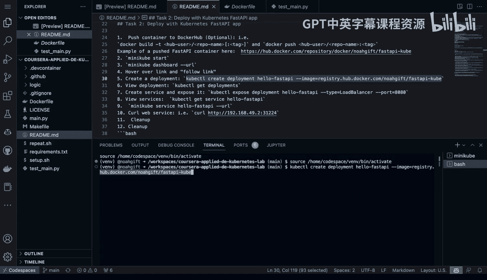

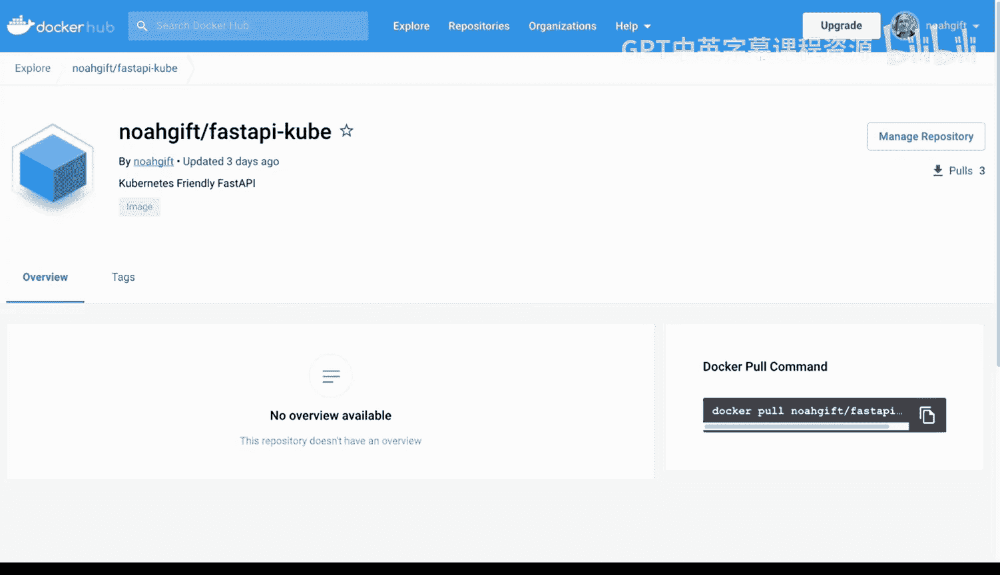

4.  **暴露Service**：Deployment管理着Pod（容器组），但为了能从集群外部访问到我们的应用，需要创建一个Service（服务）来提供稳定的网络端点。
    ```bash
    kubectl expose deployment hello-fastapi --type=NodePort --port=8080
    ```
    执行 `kubectl get services` 可以查看Service的详细信息，包括被分配的外部访问端口。

5.  **访问应用**：Minikube提供了一个便捷的命令来获取Service的可访问URL。
    ```bash
    minikube service hello-fastapi --url
    ```
    复制该URL到浏览器，或者使用 `curl` 命令，即可访问到运行在Kubernetes集群中的FastAPI服务，验证其是否返回“Hello FastAPI”等预期响应。

## 清理资源 🧹

在完成测试后，及时清理资源是一个好习惯。我们可以按创建资源的相反顺序进行删除。

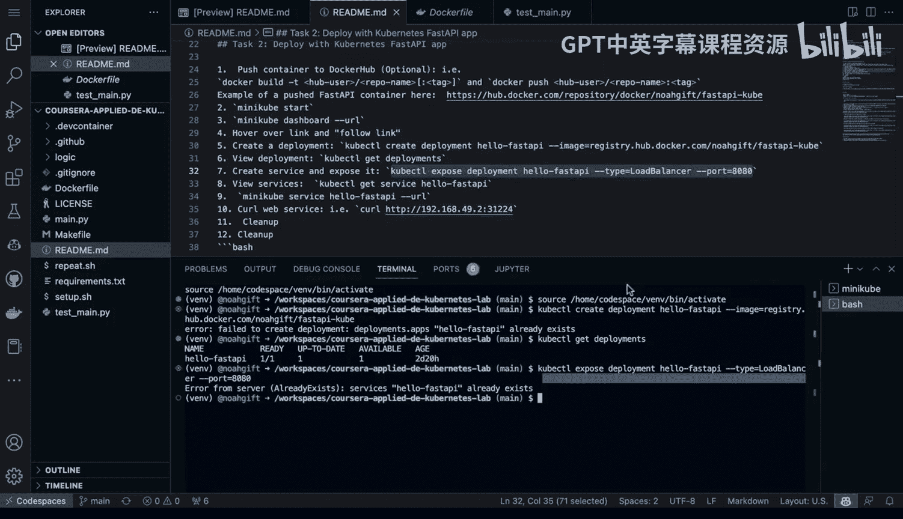

以下是清理步骤：


*   删除Service：`kubectl delete service hello-fastapi`
*   删除Deployment：`kubectl delete deployment hello-fastapi`
*   停止Minikube集群：`minikube stop`

## 总结 📝

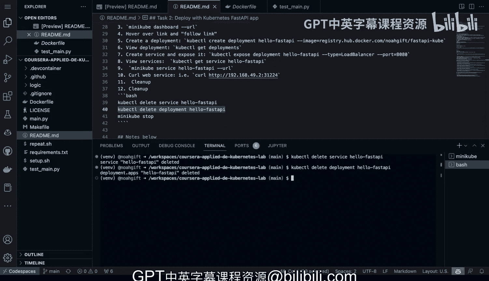


本节课中我们一起学习了微服务从代码到部署的完整流程。我们首先分析了一个FastAPI微服务的项目结构，并在本地成功运行和测试了它。接着，我们使用Dockerfile将应用容器化并推送到了Docker Hub镜像仓库。最后，我们利用Minikube工具在本地搭建了Kubernetes环境，通过创建Deployment和Service，成功地将我们的容器化应用部署到了Kubernetes集群中，并实现了从外部的访问。这个过程涵盖了现代云原生应用部署的核心步骤，是进行更复杂数据工程应用编排的基础。