# 杜克大学《应用Python数据工程（3课全）｜Applied Python Data Engineering》中英字幕 p87 32_04_01_使用GitHub-Codespaces构建微型Bash容器.zh_en -BV1nz421i7KP_p87-

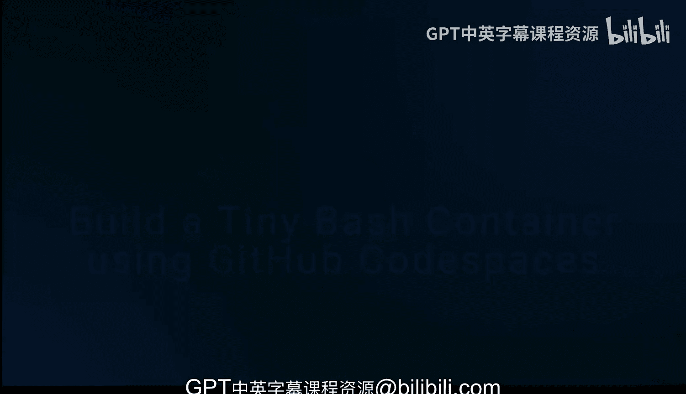

All right， so I'm going to start with this Python template。 I'm going to build off of it。

 I'm going to use this template。And I'm going to go here and we'll call this container template。

It'll probably be working a lot with containers。I want a container kindfig here， container template。

All，'ve got this thing going。It should build pretty quick。

 I'm also going to tell the code spaces to pre build， get that thing cooking。Great。All right。

 so one of the big things I think that happens when people are you know hearing the word container it's like hey。

 what is a container， why do I care about it？ So we're just going to really quickly go through some basic container stuff。

 And every couple weeks I'll do a new。Tip on containers。

 the first thing we're going to do is just set up this environment now while this is building and everything's working。

I'm going to go ahead and grab some other code。That I think would be useful。 and I think it's in。

Here。是。Mes。😔，Yeah， so I have some。Good container code right here， which is a super tiny。Container。

And then， I also。Here we go。 tiny container demo。 That's the  one I want to do。

 So I'm gonna I'm going to walk through this， which is， I think， is a good first lesson。

 is let's just take the simplest possible thing we could do， which is a command a tool。In bash。

 and let's turn it into a containerized application and then play around with some of the things you can do with that。

 So that's that's the core concept as this thing's getting built here。

We'll be able to launch it and use it for this particular environment。All right。

 looks like it's getting ready to run， good。So a few other things to point out here in terms of building containers would be you need。

 you know you actually don't need any source good at all。

 you could just start with a Docker file and the idea with a Docker file is it is it defines the runtime that you're going to play around with and in particular this is a。

A very tiny runtime， which I think is kind of fun to play around with。

And that's why we're going to start with this， but I could actually create lots of different containers and test out different ideas。

 So that's really the idea with a container is that you're going to set up your own runtime and add something to it and then you can distribute it to other people or to yourself and and this is I think one of the best first demos to play around with so。

As soon as this thing spins up here， what I'll do is I'll run it inside of this environment。

And build my container and then later in further lessons we can go into pushing containers into let's say Docker hubub or pushing them into ECR Amazon's container registry or to another cloud registry but again the first idea here is to just get this thing running here locally。

 so it looks like it's just doing a little bit more installation here。

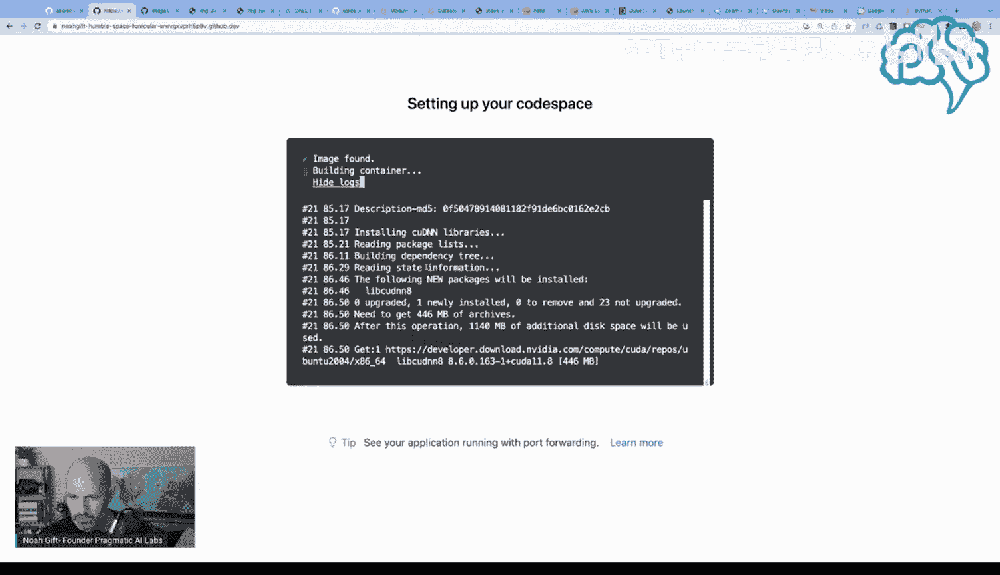

All right， so we got this environment set up。 I'm going to just change a little bit。

 So we're going to call this template。Template for container projects。AndGet rid of this stuff here。

😔，Let's get rid of all this stuff。And the first thing to start out with is to make a。Rectory。

All the tiny tiny computer。Here and then let's just put some stuff inside of here so we'll see the into it。

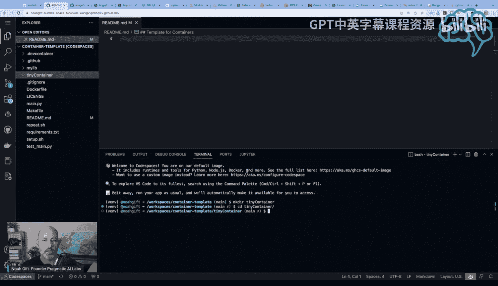

And then we'll grab this docker file so really you just need a docker file that's the main thing to create a container in the runtime so you can run it。

 but let's。

Create that Docker file， so we'll say touch Docker file。And the we。

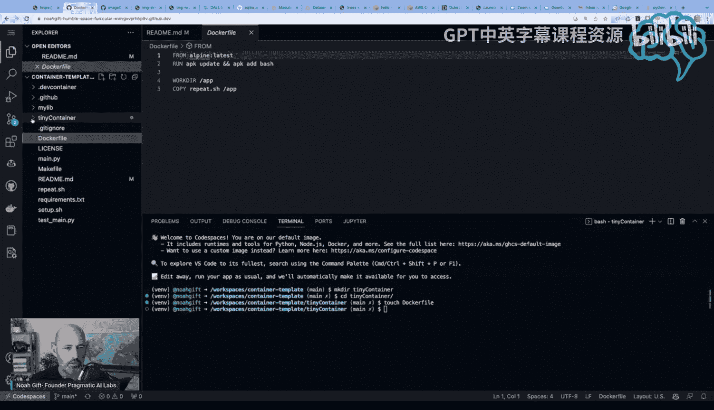

Go。There we go， so we're going to use alpine， which is a tiny one。

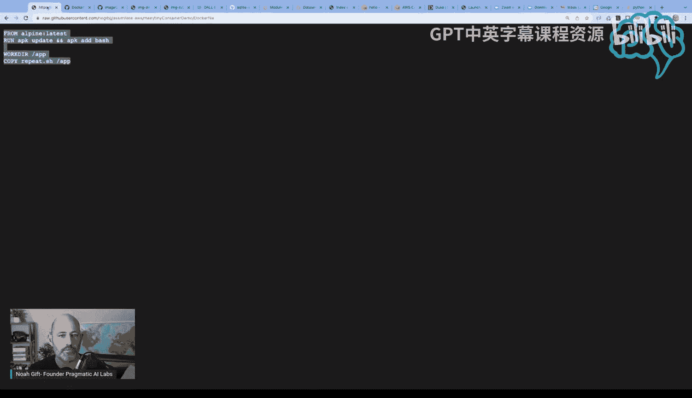

Any container runtime。And then we can go to here， we can grab a small little Camilan tool。

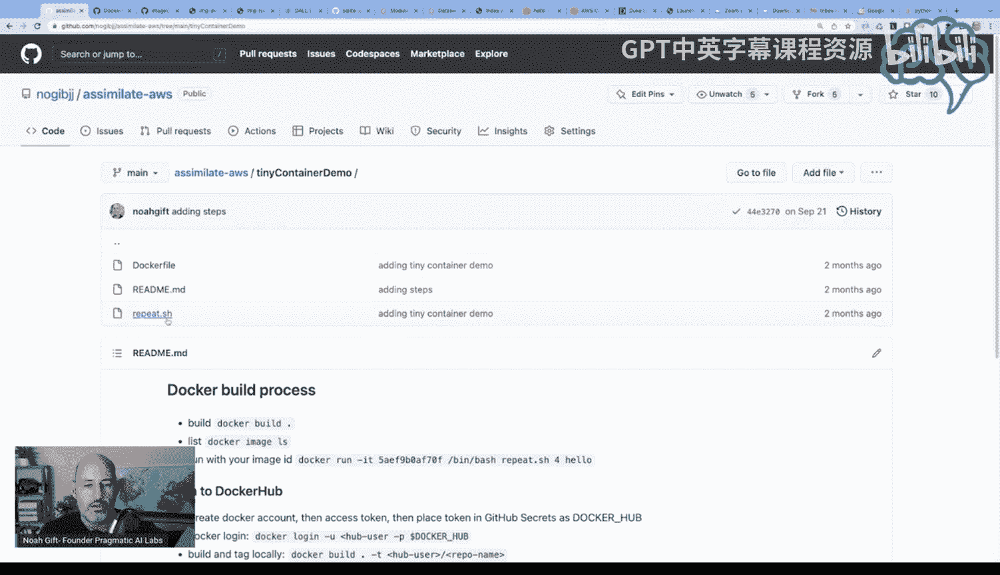

And let's go ahead and do that。 So we'll call this。He。Assage。嗯。An executable。There go。😔。

And repeat foo。I be3。

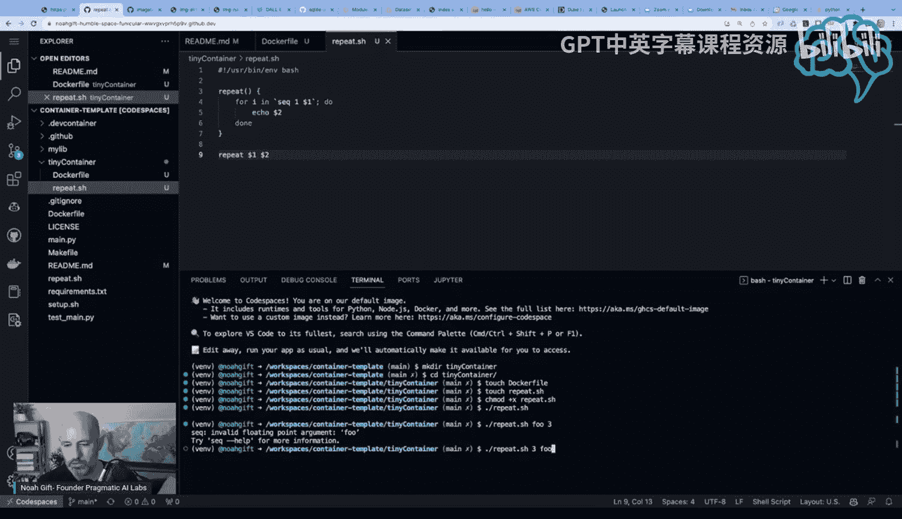

There goSo just repeat something a few different times and then if I go and I add some some documentation for this。

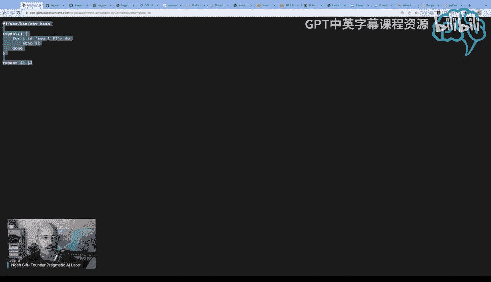

We can see the different things that we would do， so we'll just add a little readme file as well。

And so'll say touch。

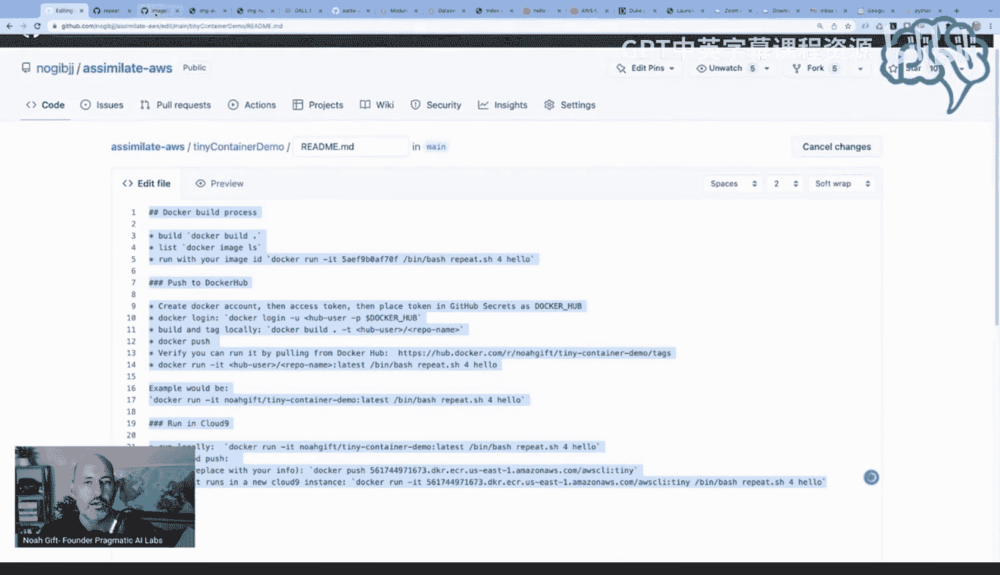

Beatme。 M all right。So。What we can do now is。I wanted to push it to Docker hubub。

 I could push it Docker hubub， but what I really care about。Is actually running it locally here。

Let's go ahead and build it by typing in Docker build。So we'll do that。We'll say Do。 build。

And so this is going to look inside of the current working directory and it's going to build a container。

There we go now what's fun about this is a I type been Docker image。

Alas you can see it's tiny right like it's only 10 megabytes。

 so this is running a Linux operating system。That I can actually play around with now。

 and so all they would need to do。Is just is log into it。 So if I say this。If I say doc or run。

And I put in the image ID。😔，It should drop me right in there we go and to that out now I've got this app inside of here and I can do the same thing I did。

It is just is running it like that。 So that's one way you could do things。 and you can just see like。

it's even got a top command and I mean so it's it's basically a complete little sandbox for me to play around with stuff if I wanted to create a file。

 you know， like we could we could create a file。You know，'ll do all kinds of stuff inside of here。

 but once I get out of it and。And I exit if I log back into that same container。

The file is not there anymore so it's it's essentially like recreates everything the way it lived before。

 which is which is actually kind of cool because it means that I can use it as a sandbox now the other thing I could do。

😊，As well as I could push this into some other repository like again。

 if I wanted to go to Docker Hub， for example。

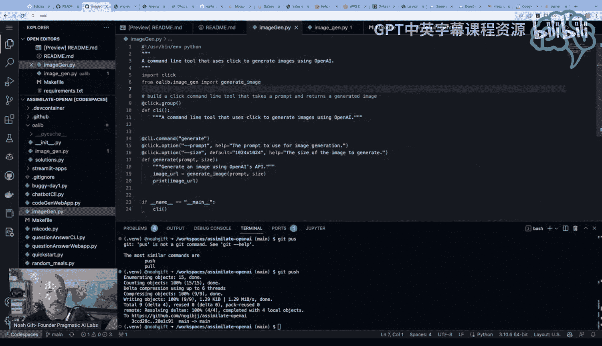

Go here。This and I go to Docker Hub right here， I can push this directly into this location and other people can use in fact I already did do this and we can take a look at this if I go here and I want to try a version of this。

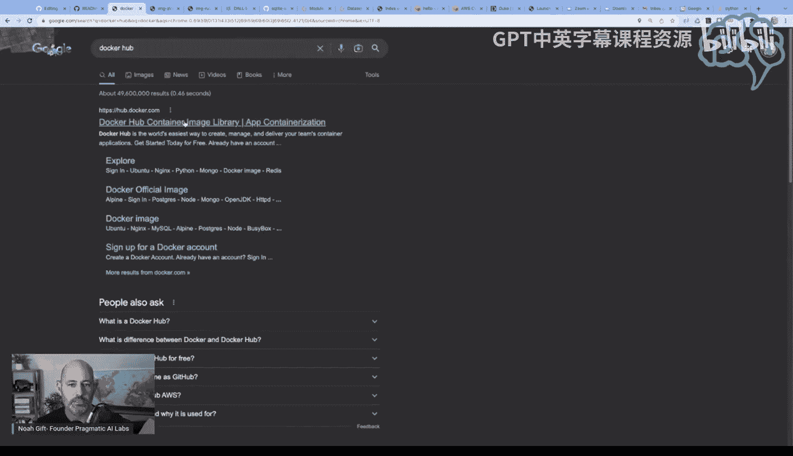

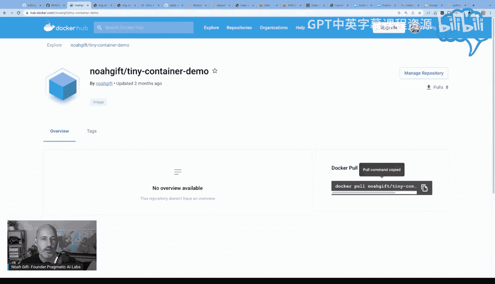

We could go over here。Dow this directory， and I could say。Just run the command， say Docker pull。

There we go， and now if I do Docker image Ls， there's going to be another one。There we go。

 And now if I want to run that same command。Docker run， I can pass in the exact name here。

Matt and if I wanted to， I can even invoke it without even going into the shell。There you go。

 so this is a great little tip to be aware of if you want to write a little tool and keep it fresh and doesn't have problems or distribute to somebody else。

 you can actually go through here， build something with Alpine。😊，Like a very small script here。

 distributed， push it to Docker Hub and you're good to go。

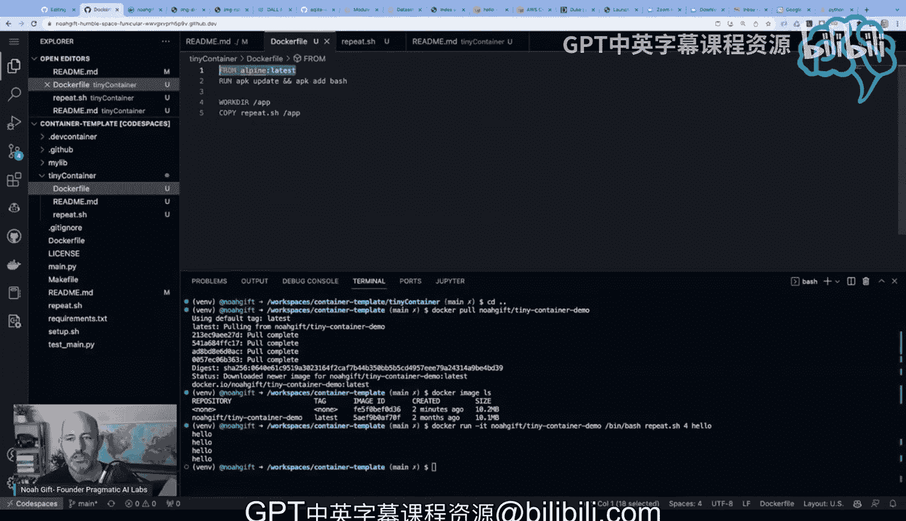