# 应用Python数据工程：3：使用GitHub Codespaces构建微型Bash容器 🐳

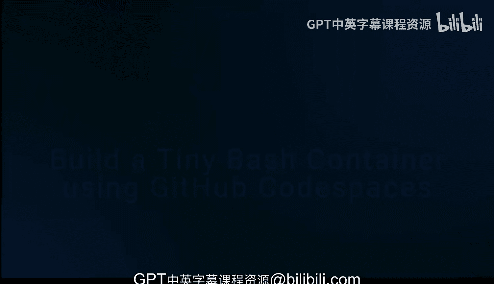

在本节课中，我们将要学习如何使用GitHub Codespaces来构建一个微型的Bash容器。我们将从创建一个简单的Dockerfile开始，构建一个极小的容器镜像，并学习如何运行和分发它。通过这个过程，你将理解容器的基本概念及其作为独立运行环境的价值。

## 概述

容器技术允许你将应用程序及其所有依赖项打包在一起，确保它在任何环境中都能以相同的方式运行。本节我们将从一个最简单的例子入手：将一个Bash命令行工具容器化。

## 准备工作与环境搭建

首先，我们需要一个开发环境。我们将使用GitHub Codespaces，它提供了一个预配置的、基于云的开发环境。

上一节我们介绍了课程目标，本节中我们来看看如何设置我们的开发环境。

我选择了一个Python项目模板作为起点，并将其命名为“container template”。这样命名是因为我们后续会大量使用容器。启动这个Codespace后，系统会自动进行构建和配置。同时，为了后续演示，我提前准备了一些有用的容器示例代码。

## 理解容器基础

当人们听到“容器”这个词时，常常会问：容器是什么？我为什么需要关心它？因此，在环境构建的同时，我们先快速过一些容器的基础知识。

容器的核心思想是创建一个独立的运行时环境。你只需要一个Dockerfile来定义这个环境。在这个环境中，你可以添加任何你需要的工具或应用，然后将其分发给他人或在不同地方使用。这是一个极佳的入门演示。

## 创建容器项目

现在我们的Codespace环境已经准备就绪。让我们开始创建我们的第一个容器项目。

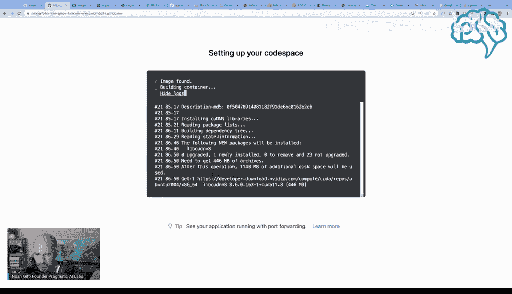

首先，清理一下模板自带的文件，然后创建一个专门用于本项目的目录。

以下是创建项目目录和初始文件的步骤：
*   创建一个名为 `tiny-computer` 的目录。
*   进入该目录。
*   创建一个空的 `Dockerfile` 文件。

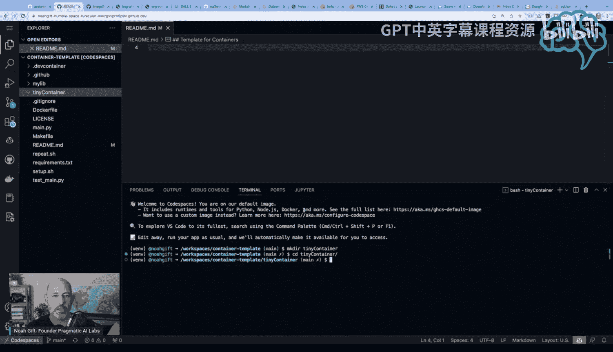

## 编写Dockerfile


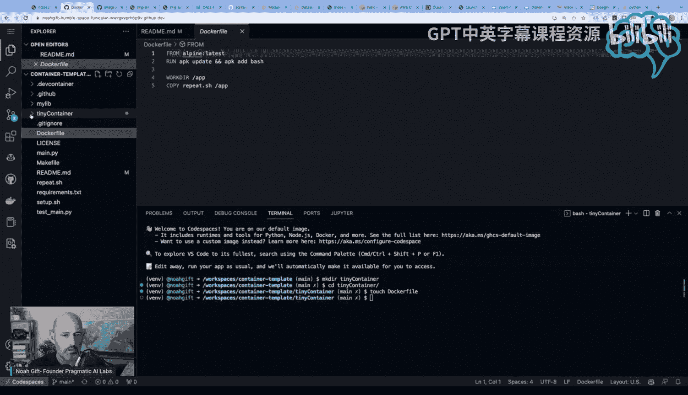

Dockerfile是构建容器的蓝图。我们将使用Alpine Linux作为基础镜像，因为它非常小巧。

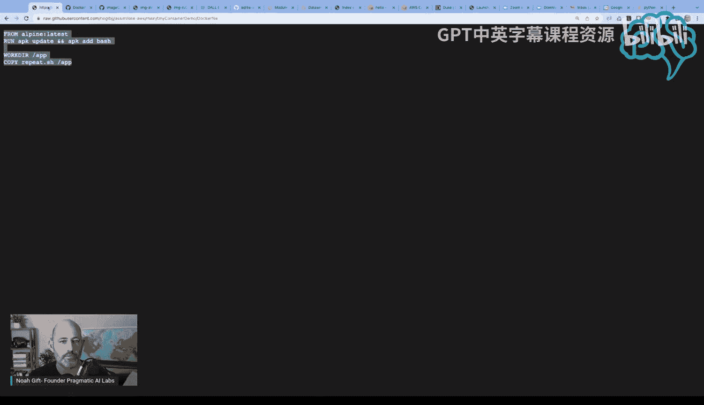

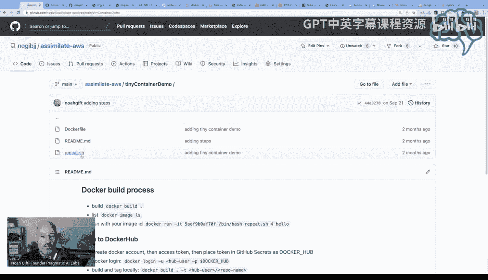

我们将创建一个简单的Bash脚本作为我们的“应用”，并将其添加到容器中。

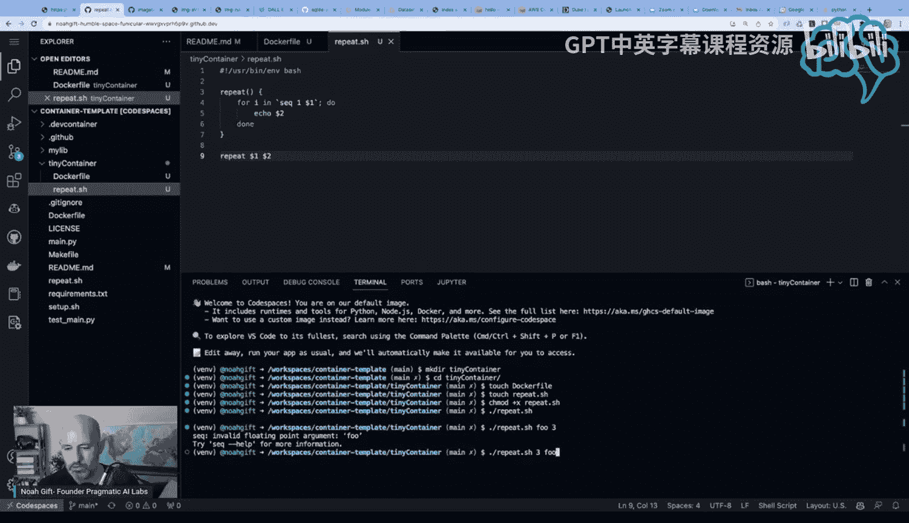

以下是创建应用脚本和Dockerfile的步骤：
*   创建一个名为 `message` 的可执行Bash脚本。
*   脚本内容很简单：重复打印传入的参数三次。
*   我们还可以创建一个 `README.md` 文件作为文档。

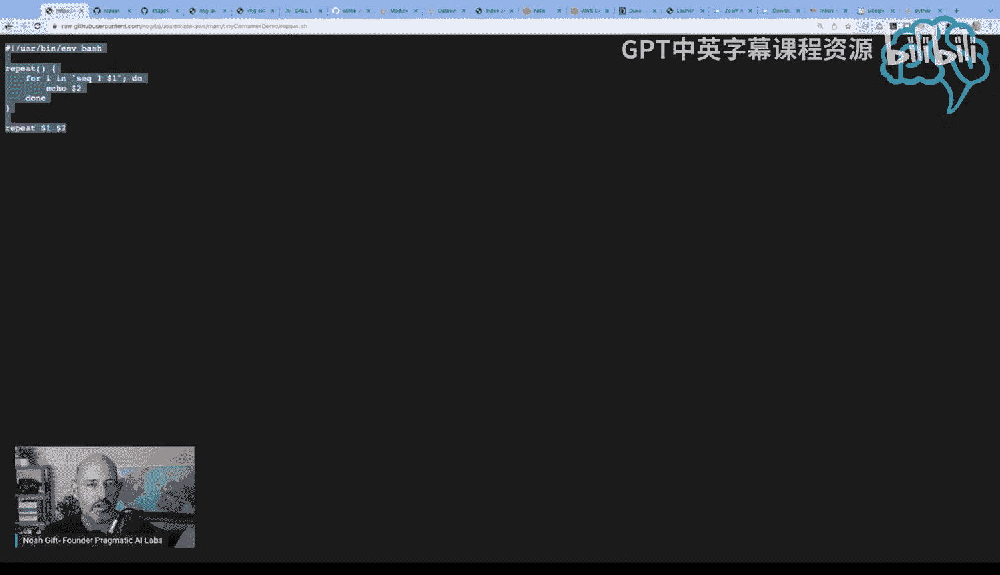

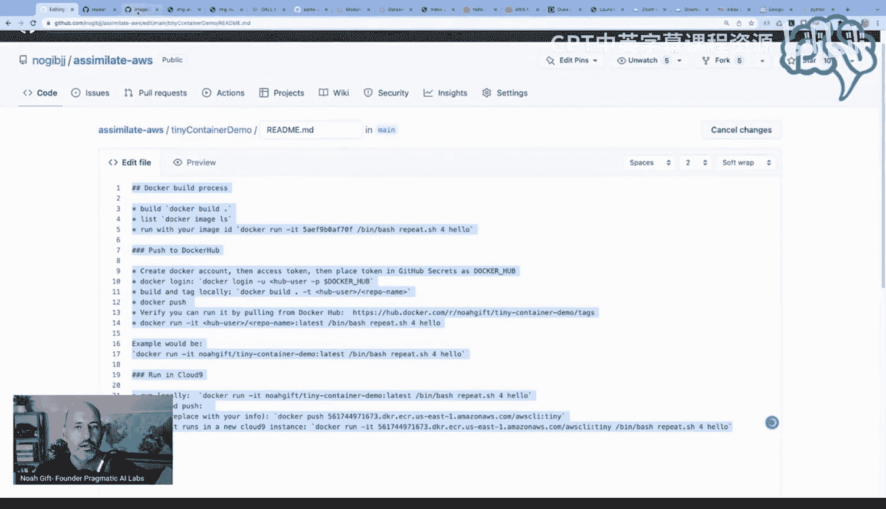

现在，让我们编写Dockerfile。它将基于Alpine镜像，并将我们的 `message` 脚本复制到容器内的 `/usr/local/bin` 目录，使其可以在任何地方被调用。

**Dockerfile 示例代码：**
```dockerfile
FROM alpine:latest
COPY message /usr/local/bin/message
RUN chmod +x /usr/local/bin/message
```

## 构建与运行容器

有了Dockerfile，我们就可以构建容器镜像了。

在项目目录下，运行 `docker build -t tiny-app .` 命令。这个命令会读取当前目录的Dockerfile并构建一个名为 `tiny-app` 的镜像。

构建完成后，使用 `docker image ls` 命令查看镜像列表。你会发现这个镜像非常小，大约只有10MB，但它包含了一个完整的、可运行的Linux操作系统环境。

现在，让我们运行它。有两种主要方式：
1.  **交互式Shell方式**：使用 `docker run -it <镜像ID> /bin/sh` 命令。这会进入容器的Shell，你可以在里面直接执行 `message` 命令，就像在一个微型Linux系统里操作一样。退出后，容器内的临时更改会丢失，这体现了其“沙盒”特性。
2.  **直接执行命令方式**：使用 `docker run <镜像名> message “Hello”` 命令。这可以直接在容器外部调用容器内的应用，并看到输出结果，无需进入Shell。

## 分发容器镜像

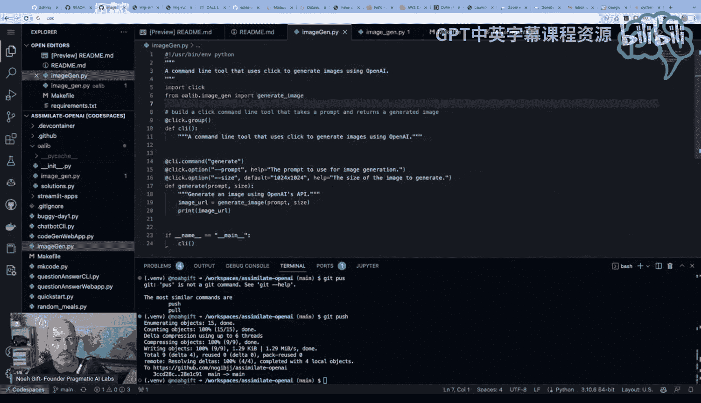

自己使用容器很方便，但容器的强大之处在于易于分发。你可以将构建好的镜像推送到像Docker Hub这样的容器注册中心。

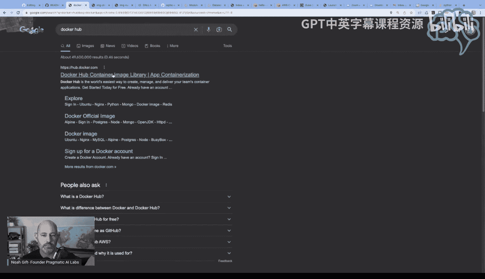

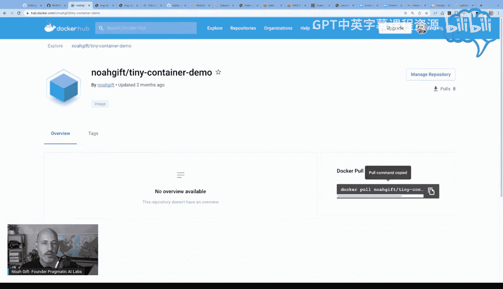

例如，你可以登录Docker Hub，然后使用 `docker push <你的用户名>/tiny-app` 命令推送镜像。之后，任何人只需执行 `docker pull <你的用户名>/tiny-app` 和 `docker run <你的用户名>/tiny-app message “Hi”` 就能运行你的工具，无需关心他们的本地环境如何。

这是一个非常实用的技巧：你可以用Alpine这样轻量的基础镜像，打包一个小脚本，推送到Docker Hub，就能轻松地分享或部署你的工具。

## 总结

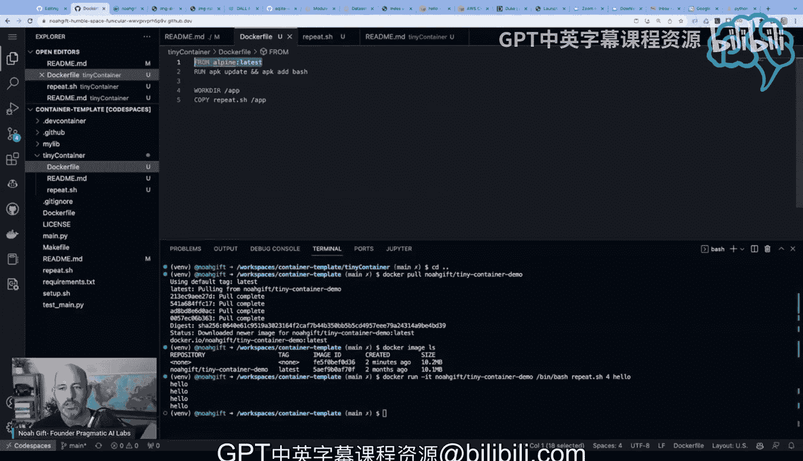

本节课中我们一起学习了容器的基本概念和实战操作。我们从在GitHub Codespaces中设置环境开始，创建了一个包含简单Bash脚本的Dockerfile，并使用它构建了一个微型的Alpine Linux容器。我们探索了如何以交互模式或直接执行命令的方式来运行容器，并了解了如何将容器镜像推送到Docker Hub进行分发。这个微型Bash容器的例子展示了容器技术如何为工具和应用程序提供一致、隔离且可移植的运行环境。